# ⚖️ ClauseGuard AI — Référentiel Technique, Scientifique et Architectural Complet

> [!IMPORTANT]
> **Synthèse Exécutive du Projet**
> **ClauseGuard AI** est une plateforme complète de traitement automatique du langage naturel juridique (*Legal NLP*) conçue pour automatiser le **triage multi-classes ($C = 100$ catégories)** et la **recherche sémantique et hybride ($N = 60\,000$ clauses indexées)** sur les contrats commerciaux déposés auprès de la *U.S. Securities and Exchange Commission* (**SEC Exhibit-10**, corpus **LEDGAR** du benchmark **LexGLUE**).
>
> Ce document constitue la **référence intégrale du projet** : il détaille la problématique métier, l'architecture logicielle ligne par ligne, l'anatomie statistique du corpus, les formulations mathématiques de chaque modèle, les protocoles expérimentaux pré-enregistrés et étendus, la géométrie des espaces d'embeddings, l'inférence statistique par bootstrap apparié et test de McNemar, la calibration probabiliste post-hoc, l'audit d'équité multi-tranches et les règles de gouvernance opérationnelle.

---

## Table des Matières

1. [Vision Métier, Problématique & Synthèse des Résultats](#1-vision-métier-problématique--synthèse-des-résultats)
2. [Architecture Logicielle & Référentiel Complet du Code Source](#2-architecture-logicielle--référentiel-complet-du-code-source)
3. [Anatomie Statistique & Audit d'Hygiène du Corpus LEDGAR (`01_explore_ledgar.ipynb`)](#3-anatomie-statistique--audit-dhygiène-du-corpus-ledgar-01_explore_ledgaripynb)
4. [Classification Supervisée : Modèles, Mathématiques & Expériences (`m0`, `m1`, `m3`, `m4`)](#4-classification-supervisée--modèles-mathématiques--expériences-m0-m1-m3-m4)
5. [Moteur de Recherche Sémantique, Lexicale & Hybride (`m2`, `07_retrieval.ipynb`)](#5-moteur-de-recherche-sémantique-lexicale--hybride-m2-07_retrievalipynb)
6. [Inférence Statistique, Calibration des Confiances & Audit des Biais (`06_evaluation.ipynb`)](#6-inférence-statistique-calibration-des-confiances--audit-des-biais-06_evaluationipynb)
7. [Gouvernance Opérationnelle, Suite de Tests & Guide de Reproductibilité](#7-gouvernance-opérationnelle-suite-de-tests--guide-de-reproductibilité)
8. [Justifications Scientifiques, Décisions d'Ingénierie & Correctifs Appliqués (Pourquoi Chaque Choix a Été Fait)](#8-justifications-scientifiques-décisions-dingénierie--correctifs-appliqués-pourquoi-chaque-choix-a-été-fait)

---

## 1. Vision Métier, Problématique & Synthèse des Résultats

### 1.1 Le Défi de la Revue Contractuelle à Grande Échelle

Lors d'opérations de fusions-acquisitions (*M&A due diligence*), d'audits de conformité réglementaire ou de remédiations contractuelles de masse, les directions juridiques doivent analyser des milliers de contrats matériels (**SEC Exhibit-10** : contrats de crédit syndiqué, pactes d'actionnaires, contrats de travail de dirigeants, baux commerciaux, actes d'émission obligataire). Un contrat moyen comporte entre **50 et 200 paragraphes (clauses)**, chacun régissant un mécanisme juridique précis : *Governing Laws*, *Indemnification*, *Waiver Of Jury Trials*, *Change In Control*, *Severability*, etc.

L'automatisation industrielle de cette revue se heurte à **cinq obstacles scientifiques majeurs** mis en évidence par notre exploration du corpus **LEDGAR** ($80\,000$ clauses annotées à travers $100$ catégories) :

1. **Déséquilibre Zipfien extrême ($137{,}7\times$)** : la classe majoritaire (`Governing Laws`, $3\,167$ clauses d'entraînement) est $138$ fois plus fréquente que la classe la plus rare (`Books`, $23$ clauses d'entraînement et **$0$ exemple dans le jeu de validation**). Les 22 classes de la queue de distribution (*Tail*, $<300$ exemples) ne représentent que $6{,}5\%$ du volume total mais concentrent les risques juridiques les plus spécifiques.
2. **Quasi-synonymie juridique et recouvrement d'étiquettes** : plusieurs étiquettes du corpus LEDGAR proviennent d'intitulés de sections quasi-équivalents dans la pratique rédactionnelle américaine (`Entire Agreements` vs `Integrations`, `Compliance With Laws` vs `Follows`, `Severability` vs `Invalidity`, `Waivers` vs `Waiver Of Jury Trials`). Six groupes de clauses partagent même des textes **strictement identiques mot pour mot** sous des étiquettes différentes.
3. **Asymétrie entre classification fermée et recherche ouverte** : un classifieur supervisé excelle lorsque la taxonomie des $100$ classes est fixe et que les formules contractuelles (*boilerplate*) se répètent, mais il est aveugle aux **requêtes en langage naturel formulées par un avocat** (ex. *« clause attribuant la compétence exclusive au Delaware sans égard aux conflits de lois »*) ainsi qu'aux **paraphrases à faible recouvrement lexical**.
4. **Dégénérescence géométrique (*Anisotropie* et *Hubness*)** : les encodeurs Transformers pré-entraînés concentrent leurs vecteurs dans un cône étroit de l'espace ($\text{anisotropie jusqu'à } 0{,}903$), tandis que l'espace TF-IDF souffre d'un phénomène aigu de **hubness** ($\text{skew } S_{N_{10}} = 4{,}71$), où quelques clauses génériques polluent systématiquement les listes de voisins les plus proches.
5. **Sur-confiance probabiliste lors du fine-tuning prolongé** : pousser l'entraînement de DistilBERT de 3 à 10 époques est indispensable pour faire converger les 22 classes rares ($+4{,}34\text{ pts}$ de Macro-F1), mais dégrade sévèrement la calibration des probabilités softmax (l'erreur de calibration attendue **ECE** double de $0{,}0333$ à $0{,}0863$, avec **$57{,}1\%$ des erreurs commises à une confiance affichée $> 90\%$**).

### 1.2 Architecture Globale de la Solution « ClauseGuard AI »

Pour répondre simultanément à ces cinq défis, **ClauseGuard AI** articule deux pipelines complémentaires soumis à des garde-fous statistiques et opérationnels stricts :

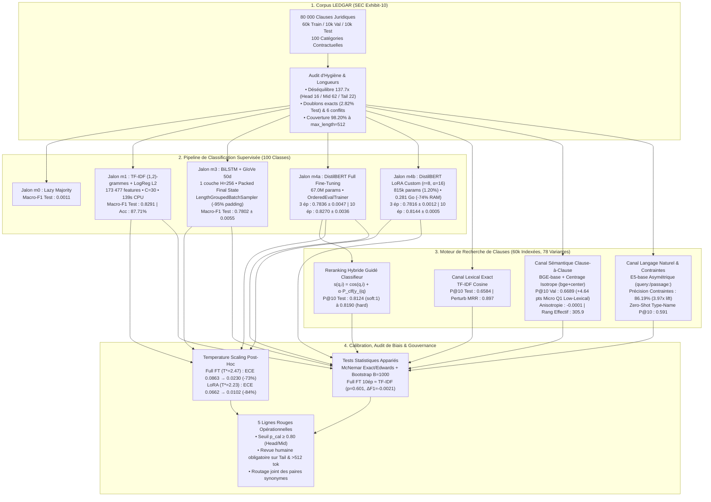

### 1.3 Aperçu Visuel : Deck de Présentation 4K (« ClauseGuard AI »)

Le projet intègre un générateur programmatique de diapositives 4K UHD ([`docs/slides/generate_ledgar_slides.py`](file:///Users/jonathan/Desktop/nlp-project/docs/slides/generate_ledgar_slides.py)) produisant 14 planches scientifiques au format Google I/O Daylight Keynote :

````carousel

<!-- slide -->

<!-- slide -->

<!-- slide -->

<!-- slide -->

<!-- slide -->

<!-- slide -->

<!-- slide -->

<!-- slide -->

<!-- slide -->

<!-- slide -->

<!-- slide -->

````

### 1.4 Tableau Synthétique des Performances Finales (Jeu de Test Officiel, $N = 10\,000$)

| Jalon | Famille de Modèle | Identifiant Run | Paramètres Entraînables | Temps d'Entraînement | Val Macro-F1 | Test Macro-F1 | Test Accuracy | Head F1 (16) | Middle F1 (62) | Tail F1 (22) | Test ECE (Brut $\to$ Calibré) |
| :--- | :--- | :--- | :---: | :---: | :---: | :---: | :---: | :---: | :---: | :---: | :---: |
| **`m0`** | Majorité Naïve (`Governing Laws`) | `lazy_majority` | $0$ | $< 0{,}1\text{ s}$ | $0{,}0010$ | $0{,}0011$ | $5{,}82\%$ | $0{,}0069$ | $0{,}0000$ | $0{,}0000$ | — |
| **`m1`** | **TF-IDF `(1,2)` + LogReg $\ell_2$ ($C=30$)** | `tfidf_logreg` | $17\,347\,800$ | $139\text{ s}$ (CPU) | $0{,}8265$ | **$0{,}8291$** | $87{,}71\%$ | **$0{,}8923$** | $0{,}8421$ | $0{,}7466$ | $0{,}0350$ |
| **`m3`** | **BiLSTM + GloVe 50d** ($1\times 256$, 15 ép, 3 seeds) | `lstm_glove_seed0..2` | $1\,344\,684$ | $\sim 26\text{ min}$ (MPS) | $0{,}7895 \pm 0{,}0044$ | $0{,}7802 \pm 0{,}0055$ | $84{,}86\%$ | $0{,}8738$ | $0{,}8011$ | $0{,}6741$ | $0{,}0290$ |
| **`m4`** | **DistilBERT Full FT** (3 ép pré-enregistré, 3 seeds) | `bert_full_seed0..2` | $67\,030\,372$ ($100\%$) | $\sim 296\text{ s}$ (GPU) | $0{,}7867 \pm 0{,}0029$ | $0{,}7836 \pm 0{,}0047$ | $86{,}56\%$ | $0{,}8891$ | $0{,}8283$ | $0{,}5557$ | $0{,}0333$ |
| **`m4`** | **DistilBERT LoRA $r=8$** (3 ép pré-enregistré, 3 seeds) | `bert_lora_seed0..2` | $814\,948$ ($1{,}20\%$) | $\sim 247\text{ s}$ (GPU) | $0{,}7848 \pm 0{,}0033$ | $0{,}7816 \pm 0{,}0012$ | $85{,}82\%$ | $0{,}8844$ | $0{,}8179$ | $0{,}6100$ | $0{,}0200$ |
| **`m4`** | **DistilBERT LoRA $r=16$** (3 ép ablation, seed 0) | `lora_r16_seed0` | $962\,404$ ($1{,}42\%$) | $270\text{ s}$ (GPU) | $0{,}7861$ | $0{,}7845$ | $86{,}03\%$ | $0{,}8858$ | $0{,}8216$ | $0{,}6061$ | — |
| **`m4`** | **DistilBERT LoRA All-Linear** (3 ép ablation, seed 0) | `lora_all_seed0` | $1\,331\,044$ ($1{,}97\%$) | $358\text{ s}$ (GPU) | $0{,}7965$ | $0{,}7867$ | $86{,}23\%$ | $0{,}8872$ | $0{,}8267$ | $0{,}6010$ | — |
| **`m4+`** | **DistilBERT Full FT** (10 ép suivi, 3 seeds) | `bert_full_10ep_seed0..2` | $67\,030\,372$ ($100\%$) | $\sim 1\,020\text{ s}$ (GPU) | $0{,}8256 \pm 0{,}0019$ | **$0{,}8270 \pm 0{,}0036$** | **$87{,}98\%$** | $0{,}8881$ | **$0{,}8446$** | **$0{,}7397$** | $0{,}0863 \to \mathbf{0{,}0230}$ |
| **`m4+`** | **DistilBERT LoRA $r=8$** (10 ép suivi, 3 seeds) | `bert_lora_10ep_seed0..2` | $814\,948$ ($1{,}20\%$) | $\sim 846\text{ s}$ (GPU) | $0{,}8137 \pm 0{,}0038$ | **$0{,}8144 \pm 0{,}0005$** | $87{,}49\%$ | $0{,}8864$ | $0{,}8344$ | $0{,}7056$ | $0{,}0662 \to \mathbf{0{,}0102}$ |

---

## 2. Architecture Logicielle & Référentiel Complet du Code Source

### 2.1 Philosophie d'Ingénierie : Séparation Stricte Bibliothèque / Scripts / Notebooks

Le dépôt est structuré comme un package Python installable (`ledgar`, défini dans [`pyproject.toml`](file:///Users/jonathan/Desktop/nlp-project/pyproject.toml)) qui respecte quatre principes d'ingénierie :

1. **Aucune logique métier cachée dans les notebooks** : les 7 notebooks Jupyter ([`notebooks/01_explore_ledgar.ipynb`](file:///Users/jonathan/Desktop/nlp-project/notebooks/01_explore_ledgar.ipynb) à [`notebooks/07_retrieval.ipynb`](file:///Users/jonathan/Desktop/nlp-project/notebooks/07_retrieval.ipynb)) n'effectuent que des appels aux fonctions pures et testées de [`src/ledgar/`](file:///Users/jonathan/Desktop/nlp-project/src/ledgar) et lisent les artefacts persistés sur disque.
2. **Métriques et tests statistiques implémentés *from scratch* en NumPy** : afin d'éliminer toute boîte noire dans l'évaluation scientifique, [`src/ledgar/metrics.py`](file:///Users/jonathan/Desktop/nlp-project/src/ledgar/metrics.py) et [`src/ledgar/stats.py`](file:///Users/jonathan/Desktop/nlp-project/src/ledgar/stats.py) implémentent directement la matrice de confusion, les scores F1 par classe/macro/micro/pondéré, la calibration ECE, le Temperature Scaling, le test de McNemar et le bootstrap apparié stratifié.
3. **Adaptation LoRA écrite en PyTorch pur** : [`src/ledgar/models/lora.py`](file:///Users/jonathan/Desktop/nlp-project/src/ledgar/models/lora.py) implémente directement la couche [`LoRALinear`](file:///Users/jonathan/Desktop/nlp-project/src/ledgar/models/lora.py#L14-L32), l'injection récursive dans l'arbre `nn.Module` ([`inject_lora`](file:///Users/jonathan/Desktop/nlp-project/src/ledgar/models/lora.py#L52-L68)) et la fusion algébrique exacte des poids ([`merge_lora`](file:///Users/jonathan/Desktop/nlp-project/src/ledgar/models/lora.py#L35-L49)).
4. **Protocole d'hygiène anti-fuite du jeu de test (*Test Gate*)** : [`scripts/train.py`](file:///Users/jonathan/Desktop/nlp-project/scripts/train.py) n'évalue **jamais** le jeu de test pendant le développement ou le réglage d'hyperparamètres (`test_metrics.json` contient `{"status": "not_evaluated"}`). Seul [`scripts/predict_test.py`](file:///Users/jonathan/Desktop/nlp-project/scripts/predict_test.py), exécuté une unique fois après gel des choix sur la validation, déverrouille les prédictions et métriques de test. Cette séparation est garantie par un test automatisé d'inspection AST ([`tests/test_hygiene.py`](file:///Users/jonathan/Desktop/nlp-project/tests/test_hygiene.py#L1-L29)).

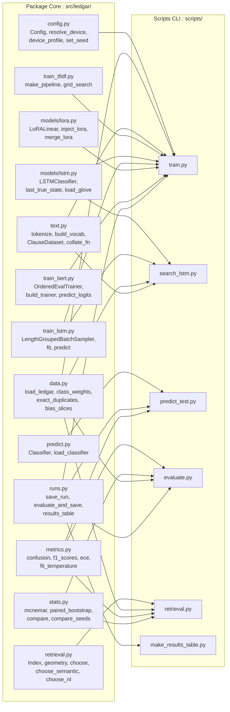

### 2.2 Inventaire Exhaustif des Modules, Classes et Fonctions

#### A. Configuration & Profilage Matériel — [`src/ledgar/config.py`](file:///Users/jonathan/Desktop/nlp-project/src/ledgar/config.py#L1-L251)

| Symbole | Lignes | Signature & Rôle Technique Détaillé |
| :--- | :---: | :--- |
| [`ROOT`](file:///Users/jonathan/Desktop/nlp-project/src/ledgar/config.py#L18) | `#L18` | `Path(__file__).resolve().parents[2]` — racine absolue du dépôt. |
| [`FAST_OVERRIDES`](file:///Users/jonathan/Desktop/nlp-project/src/ledgar/config.py#L21-L34) | `#L21-L34` | Dictionnaire de surcharge pour les tests de fumée (`train_Max=2000`, `val_max=500`, `test_max=500`, `max_length=128`, `epochs=1`, `tfidf_max_features=5000`, `lstm_hidden=64`). |
| [`Config`](file:///Users/jonathan/Desktop/nlp-project/src/ledgar/config.py#L37-L188) | `#L37-L188` | `@dataclass(frozen=True)` centralisant tous les hyperparamètres : dataset (`coastalcph/lex_glue`, subset `ledgar`, révision Git épinglée `c23fdff1a6bf74e0e1a71cb86f1e781d37da888c`, `num_classes=100`), TF-IDF (`tfidf_max_features=173_477`, `tfidf_ngram_max=2`, `tfidf_min_df=2`, `tfidf_c=30.0`, `tfidf_class_weight=None`), BiLSTM (`vocab_size=30_000`, `min_freq=2`, `embed_dim=50`, `lstm_hidden=256`, `lstm_layers=1`, `lstm_dropout=0.3`, `lstm_lr=1e-3`, `lstm_epochs=15`), DistilBERT (`model_name="distilbert-base-uncased"`, `max_length=512`, `batch_size=32`, `grad_accum=2`, `lr=5e-5`, `lora_lr=1e-3`, `lora_r=8`, `lora_alpha=16`, `lora_dropout=0.1`, `lora_targets=("q_lin", "v_lin")`). Inclut [`from_env()`](file:///Users/jonathan/Desktop/nlp-project/src/ledgar/config.py#L121-L134), [`from_args()`](file:///Users/jonathan/Desktop/nlp-project/src/ledgar/config.py#L136-L167), [`with_overrides()`](file:///Users/jonathan/Desktop/nlp-project/src/ledgar/config.py#L169-L171) et [`to_dict()`](file:///Users/jonathan/Desktop/nlp-project/src/ledgar/config.py#L173-L182). |
| [`resolve_device`](file:///Users/jonathan/Desktop/nlp-project/src/ledgar/config.py#L200-L210) | `#L200-L210` | Sélection automatique de l'accélérateur : `"cuda"` $\to$ `"mps"` (Apple Silicon) $\to$ `"cpu"`. |
| [`device_profile`](file:///Users/jonathan/Desktop/nlp-project/src/ledgar/config.py#L213-L236) | `#L213-L236` | Adapte automatiquement la précision mixte et la taille de batch au GPU détecté : sur NVIDIA Compute Capability $\ge 8.0$ (A100/L4/H100), active `bf16=True`, TF32 matmul, `batch_size=64, grad_accum=1` ; sur T4/V100 ($<8.0$), active `fp16=True`, `batch_size=32, grad_accum=2` ; sur MPS/CPU, reste en `fp32` avec `pin_memory=False`. |
| [`set_seed`](file:///Users/jonathan/Desktop/nlp-project/src/ledgar/config.py#L239-L250) | `#L239-L250` | Fixe les graines aléatoires de `PYTHONHASHSEED`, `random`, `numpy`, `torch.manual_seed` et `torch.cuda.manual_seed_all`. |

#### B. Chargement des Données, Hygiène & Découpage par Tranches — [`src/ledgar/data.py`](file:///Users/jonathan/Desktop/nlp-project/src/ledgar/data.py#L1-L348)

| Symbole | Lignes | Signature & Rôle Technique Détaillé |
| :--- | :---: | :--- |
| [`load_ledgar`](file:///Users/jonathan/Desktop/nlp-project/src/ledgar/data.py#L21-L36) | `#L21-L36` | Charge le dataset Hugging Face `coastalcph/lex_glue` (`ledgar`) à la révision épinglée `cfg.dataset_revision` et applique [`stratified_subset`](file:///Users/jonathan/Desktop/nlp-project/src/ledgar/data.py#L44-L53) si `cfg.fast` est actif. |
| [`stratified_subset`](file:///Users/jonathan/Desktop/nlp-project/src/ledgar/data.py#L44-L53) | `#L44-L53` | Échantillonne proportionnellement à chaque classe tout en garantissant au moins $1$ exemple par classe présente lorsque $n \ge C$. |
| [`class_stats`](file:///Users/jonathan/Desktop/nlp-project/src/ledgar/data.py#L61-L77) & [`frequency_band`](file:///Users/jonathan/Desktop/nlp-project/src/ledgar/data.py#L80-L83) | `#L61-L83` | Calcule les effectifs par split et assigne chaque classe à sa bande de fréquence selon son effectif d'entraînement : `"head"` ($\ge 1\,000$), `"middle"` ($300\text{--}999$) ou `"tail"` ($< 300$). |
| [`word_lengths`](file:///Users/jonathan/Desktop/nlp-project/src/ledgar/data.py#L86-L88) & [`wordpiece_lengths`](file:///Users/jonathan/Desktop/nlp-project/src/ledgar/data.py#L91-L97) | `#L86-L97` | Mesure la longueur des clauses en mots et en tokens WordPiece sans troncature (`truncation=False`) par lots de $2\,000$ textes. |
| [`length_grouped_order`](file:///Users/jonathan/Desktop/nlp-project/src/ledgar/data.py#L110-L118) & [`padded_tokens`](file:///Users/jonathan/Desktop/nlp-project/src/ledgar/data.py#L121-L143) | `#L110-L143` | Simule le tri par méga-lots (`mega_batch = batch_size * 50`) et quantifie le nombre exact de tokens traités par époque ainsi que la fraction de tokens de padding sous trois régimes : padding fixe `fixed`, padding dynamique aléatoire `dynamic_random` et padding dynamique groupé par longueur `dynamic_grouped`. |
| [`normalise`](file:///Users/jonathan/Desktop/nlp-project/src/ledgar/data.py#L146-L148), [`exact_duplicates`](file:///Users/jonathan/Desktop/nlp-project/src/ledgar/data.py#L151-L160), [`seen_in_train`](file:///Users/jonathan/Desktop/nlp-project/src/ledgar/data.py#L163-L166), [`label_conflicts`](file:///Users/jonathan/Desktop/nlp-project/src/ledgar/data.py#L169-L187) | `#L146-L187` | Normalise les espaces/casse, détecte les doublons exacts intra-split et inter-split, construit le masque booléen des clauses d'évaluation déjà vues dans `train`, et isole les textes identiques portant plusieurs étiquettes distinctes. |
| [`class_weights`](file:///Users/jonathan/Desktop/nlp-project/src/ledgar/data.py#L195-L209) | `#L195-L209` | Calcule les poids de classe `inverse` ou `sqrt` ($\sqrt{N/(C \cdot n_c)}$) normalisés par leur moyenne et bornés dans $[0{,}5, 5{,}0]$ pour éviter l'explosion de variance des gradients sur les classes rares. |
| [`bias_slices`](file:///Users/jonathan/Desktop/nlp-project/src/ledgar/data.py#L340-L347) | `#L340-L347` | Extrait par expressions régulières juridiques compilées ([`CONTRACT_PATTERNS`](file:///Users/jonathan/Desktop/nlp-project/src/ledgar/data.py#L214-L255), [`PARTY_PATTERNS`](file:///Users/jonathan/Desktop/nlp-project/src/ledgar/data.py#L257-L283), [`JURISDICTION_PATTERNS`](file:///Users/jonathan/Desktop/nlp-project/src/ledgar/data.py#L285-L298), [`uppercase_formatting`](file:///Users/jonathan/Desktop/nlp-project/src/ledgar/data.py#L330-L337)) les 4 attributs de sous-groupes pour l'audit d'équité (`contract_kind`, `party_role`, `governing_jurisdiction`, `formatting`). |

#### C. Tokenisation & Vocabulaire Récurrent — [`src/ledgar/text.py`](file:///Users/jonathan/Desktop/nlp-project/src/ledgar/text.py#L1-L86)

| Symbole | Lignes | Signature & Rôle Technique Détaillé |
| :--- | :---: | :--- |
| [`TOKEN_RE`](file:///Users/jonathan/Desktop/nlp-project/src/ledgar/text.py#L16) & [`tokenize`](file:///Users/jonathan/Desktop/nlp-project/src/ledgar/text.py#L21-L23) | `#L16-L23` | Expression régulière `r"[A-Za-z]+(?:'[A-Za-z]+)?|\d+"` extrayant les mots alphabétiques (avec contractions) et nombres en minuscules. |
| [`build_vocab`](file:///Users/jonathan/Desktop/nlp-project/src/ledgar/text.py#L34-L41) & [`encode`](file:///Users/jonathan/Desktop/nlp-project/src/ledgar/text.py#L44-L47) | `#L34-L47` | Construit le dictionnaire `{token: id}` réservant `<pad>=0` et `<unk>=1`, filtré par `min_freq=2` et `max_size=30_000`. [`encode`](file:///Users/jonathan/Desktop/nlp-project/src/ledgar/text.py#L44-L47) tronque à `max_length` et remplace tout texte vide par `[UNK_ID]` pour garantir des longueurs strictement positives ($\ge 1$) dans `pack_padded_sequence`. |
| [`ClauseDataset`](file:///Users/jonathan/Desktop/nlp-project/src/ledgar/text.py#L60-L71) & [`collate_fn`](file:///Users/jonathan/Desktop/nlp-project/src/ledgar/text.py#L74-L80) | `#L60-L80` | Pré-encode toutes les clauses en listes d'entiers et assemble les lots en appliquant un padding dynamique à la longueur maximale *du lot courant* (et non à $512$). |

#### D. Modèles de Classification (`m1`, `m3`, `m4`) & Inférence Unifiée

| Fichier | Symboles Clés & Lignes | Détails d'Implémentation |
| :--- | :--- | :--- |
| [`src/ledgar/train_tfidf.py`](file:///Users/jonathan/Desktop/nlp-project/src/ledgar/train_tfidf.py#L1-L131) | [`make_vectorizer`](file:///Users/jonathan/Desktop/nlp-project/src/ledgar/train_tfidf.py#L26-L34), [`make_logreg`](file:///Users/jonathan/Desktop/nlp-project/src/ledgar/train_tfidf.py#L37-L47), [`make_pipeline`](file:///Users/jonathan/Desktop/nlp-project/src/ledgar/train_tfidf.py#L50-L52), [`count_parameters`](file:///Users/jonathan/Desktop/nlp-project/src/ledgar/train_tfidf.py#L55-L58), [`fit_timed`](file:///Users/jonathan/Desktop/nlp-project/src/ledgar/train_tfidf.py#L61-L68), [`grid_search`](file:///Users/jonathan/Desktop/nlp-project/src/ledgar/train_tfidf.py#L71-L109) | Pipeline `TfidfVectorizer(sublinear_tf=True, ngram_range=(1,2), min_df=2, max_features=173_477)` + `LogisticRegression(C=30.0, solver="lbfgs", max_iter=500)`. [`grid_search`](file:///Users/jonathan/Desktop/nlp-project/src/ledgar/train_tfidf.py#L71-L109) réutilise la matrice creuse TF-IDF pré-calculée pour balayer toutes les valeurs de $C$ et `class_weight` sans re-vectoriser le corpus. |
| [`src/ledgar/models/lstm.py`](file:///Users/jonathan/Desktop/nlp-project/src/ledgar/models/lstm.py#L1-L79) | [`LSTMClassifier`](file:///Users/jonathan/Desktop/nlp-project/src/ledgar/models/lstm.py#L16-L45), [`count_params`](file:///Users/jonathan/Desktop/nlp-project/src/ledgar/models/lstm.py#L48-L51), [`last_true_state`](file:///Users/jonathan/Desktop/nlp-project/src/ledgar/models/lstm.py#L54-L56), [`load_glove`](file:///Users/jonathan/Desktop/nlp-project/src/ledgar/models/lstm.py#L59-L78) | `nn.Embedding(padding_idx=0)` $\to$ `Dropout` $\to$ `pack_padded_sequence(enforce_sorted=False)` $\to$ `nn.LSTM(bidirectional=True)` $\to$ concaténation `[h_n[-2], h_n[-1]]` $\to$ `Dropout` $\to$ `nn.Linear(2*H, 100)`. [`load_glove`](file:///Users/jonathan/Desktop/nlp-project/src/ledgar/models/lstm.py#L59-L78) initialise les mots hors GloVe selon $\mathcal{N}(0, \sigma_{\text{GloVe}}^2)$ et force le vecteur `<pad>` à zéro. |
| [`src/ledgar/train_lstm.py`](file:///Users/jonathan/Desktop/nlp-project/src/ledgar/train_lstm.py#L1-L131) | [`LengthGroupedBatchSampler`](file:///Users/jonathan/Desktop/nlp-project/src/ledgar/train_lstm.py#L22-L43), [`make_loaders`](file:///Users/jonathan/Desktop/nlp-project/src/ledgar/train_lstm.py#L46-L61), [`train_one_epoch`](file:///Users/jonathan/Desktop/nlp-project/src/ledgar/train_lstm.py#L64-L78), [`predict`](file:///Users/jonathan/Desktop/nlp-project/src/ledgar/train_lstm.py#L81-L90), [`fit`](file:///Users/jonathan/Desktop/nlp-project/src/ledgar/train_lstm.py#L93-L130) | Sampler groupé par méga-lots triés par longueur décroissante, optimisation AdamW avec écrêtage de norme de gradient (`clip_grad_norm_=1.0`), sélection du meilleur checkpoint sur le Macro-F1 de validation et restauration des poids optimaux via `copy.deepcopy`. |
| [`src/ledgar/models/lora.py`](file:///Users/jonathan/Desktop/nlp-project/src/ledgar/models/lora.py#L1-L86) | [`LoRALinear`](file:///Users/jonathan/Desktop/nlp-project/src/ledgar/models/lora.py#L14-L32), [`merge_lora`](file:///Users/jonathan/Desktop/nlp-project/src/ledgar/models/lora.py#L35-L49), [`inject_lora`](file:///Users/jonathan/Desktop/nlp-project/src/ledgar/models/lora.py#L52-L68), [`lora_param_count`](file:///Users/jonathan/Desktop/nlp-project/src/ledgar/models/lora.py#L71-L73), [`make_peft_model`](file:///Users/jonathan/Desktop/nlp-project/src/ledgar/models/lora.py#L76-L85) | Implémentation PyTorch native de LoRA : gèle l'intégralité du modèle, remplace les couches cibles (`q_lin`, `v_lin`) par [`LoRALinear`](file:///Users/jonathan/Desktop/nlp-project/src/ledgar/models/lora.py#L14-L32) et dégèle la tête de classification (`classifier`, `pre_classifier`). |
| [`src/ledgar/train_bert.py`](file:///Users/jonathan/Desktop/nlp-project/src/ledgar/train_bert.py#L1-L147) | [`load_tokenizer`](file:///Users/jonathan/Desktop/nlp-project/src/ledgar/train_bert.py#L28-L30), [`tokenize_split`](file:///Users/jonathan/Desktop/nlp-project/src/ledgar/train_bert.py#L33-L39), [`make_model`](file:///Users/jonathan/Desktop/nlp-project/src/ledgar/train_bert.py#L42-L49), [`make_args`](file:///Users/jonathan/Desktop/nlp-project/src/ledgar/train_bert.py#L52-L84), [`OrderedEvalTrainer`](file:///Users/jonathan/Desktop/nlp-project/src/ledgar/train_bert.py#L87-L97), [`build_trainer`](file:///Users/jonathan/Desktop/nlp-project/src/ledgar/train_bert.py#L100-L116), [`predict_logits`](file:///Users/jonathan/Desktop/nlp-project/src/ledgar/train_bert.py#L119-L124), [`training_memory_gb`](file:///Users/jonathan/Desktop/nlp-project/src/ledgar/train_bert.py#L133-L138) | Sous-classe [`OrderedEvalTrainer`](file:///Users/jonathan/Desktop/nlp-project/src/ledgar/train_bert.py#L87-L97) corrigeant le bug d'ordre d'évaluation de `group_by_length=True` dans `transformers 5.19` en forçant `SequentialSampler` sur les jeux d'évaluation/test. |
| [`src/ledgar/predict.py`](file:///Users/jonathan/Desktop/nlp-project/src/ledgar/predict.py#L1-L132) | [`length_sorted_batches`](file:///Users/jonathan/Desktop/nlp-project/src/ledgar/predict.py#L29-L32), [`Classifier`](file:///Users/jonathan/Desktop/nlp-project/src/ledgar/predict.py#L35-L98), [`load_classifier`](file:///Users/jonathan/Desktop/nlp-project/src/ledgar/predict.py#L106-L131) | Interface d'inférence unifiée `.predict_proba(texts)`, `.predict(texts)` et `.predict_one(text)` pour TF-IDF, BiLSTM et DistilBERT (avec fusion automatique des poids LoRA via [`merge_lora`](file:///Users/jonathan/Desktop/nlp-project/src/ledgar/models/lora.py#L35-L49) au chargement). |
| [`src/ledgar/runs.py`](file:///Users/jonathan/Desktop/nlp-project/src/ledgar/runs.py#L1-L266) | [`REQUIRED_FILES`](file:///Users/jonathan/Desktop/nlp-project/src/ledgar/runs.py#L23-L30), [`save_run`](file:///Users/jonathan/Desktop/nlp-project/src/ledgar/runs.py#L33-L65), [`save_predictions`](file:///Users/jonathan/Desktop/nlp-project/src/ledgar/runs.py#L68-L100), [`evaluate_and_save`](file:///Users/jonathan/Desktop/nlp-project/src/ledgar/runs.py#L103-L116), [`load_predictions`](file:///Users/jonathan/Desktop/nlp-project/src/ledgar/runs.py#L119-L129), [`results_table`](file:///Users/jonathan/Desktop/nlp-project/src/ledgar/runs.py#L143-L176), [`make_manifest`](file:///Users/jonathan/Desktop/nlp-project/src/ledgar/runs.py#L195-L225) | Garantit le contrat d'artefacts immuable de chaque run (`config.json`, `env.json`, `val_metrics.json`, `test_metrics.json`, `val_preds.npz`, `test_preds.npz`) où chaque archive `.npz` stocke `y_true`, `y_pred`, `max_prob` et `top5_probs`/`top5_idx` en `float16`. |

#### E. Métriques NumPy, Tests Statistiques & Moteur de Recherche

| Fichier | Symboles Clés & Lignes | Détails d'Implémentation |
| :--- | :--- | :--- |
| [`src/ledgar/metrics.py`](file:///Users/jonathan/Desktop/nlp-project/src/ledgar/metrics.py#L1-L218) | [`confusion`](file:///Users/jonathan/Desktop/nlp-project/src/ledgar/metrics.py#L17-L21), [`precision_recall`](file:///Users/jonathan/Desktop/nlp-project/src/ledgar/metrics.py#L24-L30), [`f1_scores`](file:///Users/jonathan/Desktop/nlp-project/src/ledgar/metrics.py#L33-L41), [`macro_f1_score`](file:///Users/jonathan/Desktop/nlp-project/src/ledgar/metrics.py#L49-L53), [`per_class_report`](file:///Users/jonathan/Desktop/nlp-project/src/ledgar/metrics.py#L89-L108), [`most_confused`](file:///Users/jonathan/Desktop/nlp-project/src/ledgar/metrics.py#L111-L124), [`f1_by_group`](file:///Users/jonathan/Desktop/nlp-project/src/ledgar/metrics.py#L127-L154), [`reliability_bins`](file:///Users/jonathan/Desktop/nlp-project/src/ledgar/metrics.py#L157-L181), [`ece`](file:///Users/jonathan/Desktop/nlp-project/src/ledgar/metrics.py#L184-L190), [`scale_confidence`](file:///Users/jonathan/Desktop/nlp-project/src/ledgar/metrics.py#L193-L199), [`fit_temperature`](file:///Users/jonathan/Desktop/nlp-project/src/ledgar/metrics.py#L202-L217) | Implémentations vectorisées en NumPy pur : `np.add.at(mat, (y_true, y_pred), 1)` pour la matrice de confusion $100\times 100$ en $\mathcal{O}(N)$, Macro-F1 restreint aux classes présentes dans le sous-groupe (`present = support > 0`) dans [`f1_by_group`](file:///Users/jonathan/Desktop/nlp-project/src/ledgar/metrics.py#L127-L154), ECE à 10 bacs et calibration par température en espace logit. |
| [`src/ledgar/stats.py`](file:///Users/jonathan/Desktop/nlp-project/src/ledgar/stats.py#L1-L184) | [`contingency`](file:///Users/jonathan/Desktop/nlp-project/src/ledgar/stats.py#L14-L23), [`mcnemar`](file:///Users/jonathan/Desktop/nlp-project/src/ledgar/stats.py#L26-L41), [`bootstrap_interval`](file:///Users/jonathan/Desktop/nlp-project/src/ledgar/stats.py#L44-L58), [`paired_bootstrap`](file:///Users/jonathan/Desktop/nlp-project/src/ledgar/stats.py#L61-L82), [`compare`](file:///Users/jonathan/Desktop/nlp-project/src/ledgar/stats.py#L85-L117), [`compare_seeds`](file:///Users/jonathan/Desktop/nlp-project/src/ledgar/stats.py#L120-L183) | Tests d'hypothèses non-paramétriques et exacts : test de McNemar bilatéral (binomial exact si $b+c<25$, chi-deux corrigé d'Edwards sinon), intervalles de confiance bootstrap à $95\%$ ($B=1\,000$) et comparaison multi-seeds moyennant les deltas sur les grilles $3\times 3$ de réplications. |
| [`src/ledgar/retrieval.py`](file:///Users/jonathan/Desktop/nlp-project/src/ledgar/retrieval.py#L1-L831) | [`EncoderSpec`](file:///Users/jonathan/Desktop/nlp-project/src/ledgar/retrieval.py#L30-L40), [`ENCODERS`](file:///Users/jonathan/Desktop/nlp-project/src/ledgar/retrieval.py#L43-L69), [`cached_embeddings`](file:///Users/jonathan/Desktop/nlp-project/src/ledgar/retrieval.py#L173-L189), [`center`](file:///Users/jonathan/Desktop/nlp-project/src/ledgar/retrieval.py#L192-L195), [`Index`](file:///Users/jonathan/Desktop/nlp-project/src/ledgar/retrieval.py#L198-L298), [`knn_vote`](file:///Users/jonathan/Desktop/nlp-project/src/ledgar/retrieval.py#L320-L327), [`perturb`](file:///Users/jonathan/Desktop/nlp-project/src/ledgar/retrieval.py#L370-L382), [`CONSTRAINED_QUERIES`](file:///Users/jonathan/Desktop/nlp-project/src/ledgar/retrieval.py#L436-L535), [`geometry`](file:///Users/jonathan/Desktop/nlp-project/src/ledgar/retrieval.py#L640-L664), [`choose`](file:///Users/jonathan/Desktop/nlp-project/src/ledgar/retrieval.py#L672-L687), [`choose_semantic`](file:///Users/jonathan/Desktop/nlp-project/src/ledgar/retrieval.py#L690-L713), [`choose_nl`](file:///Users/jonathan/Desktop/nlp-project/src/ledgar/retrieval.py#L716-L741), [`compare_topk_runs`](file:///Users/jonathan/Desktop/nlp-project/src/ledgar/retrieval.py#L789-L830) | Moteur complet de recherche dense, lexicale et hybride : cache d'embeddings `.npy` (`float32` normalisé $\ell_2$), centrage isotrope post-hoc, reranking hybride souple/dur guidé par les probabilités du classifieur, 5 métriques géométriques, 3 protocoles de stress-test et 3 règles de sélection multi-critères. |

---

## 3. Anatomie Statistique & Audit d'Hygiène du Corpus LEDGAR (`01_explore_ledgar.ipynb`)

Toutes les analyses de cette section sont générées par [`notebooks/01_explore_ledgar.ipynb`](file:///Users/jonathan/Desktop/nlp-project/notebooks/01_explore_ledgar.ipynb) et persistées dans [`reports/data_summary.json`](file:///Users/jonathan/Desktop/nlp-project/reports/data_summary.json) et [`reports/class_counts.csv`](file:///Users/jonathan/Desktop/nlp-project/reports/class_counts.csv).

### 3.1 Partitionnement Officiel et Distribution Zipfienne des 100 Classes

Le corpus LEDGAR (*Labeled Electronic Data Gathering, Analysis, and Retrieval*, Tuggener et al., LREC 2020) tel que distribué dans **LexGLUE** (Chalkidis et al., ACL 2022, commit `c23fdff1a6bf74e0e1a71cb86f1e781d37da888c`) comprend **$80\,000$ clauses contractuelles** extraites de dépôts SEC Exhibit-10 entre 2016 et 2019 :

- **Entraînement (`train`)** : $60\,000$ clauses couvrant les $100$ classes.
- **Validation (`validation`)** : $10\,000$ clauses couvrant **$99$ classes** (la classe rare `Books`, ID 12, possède $23$ exemples dans `train`, **$0$ dans `validation`** et $4$ dans `test`).
- **Test (`test`)** : $10\,000$ clauses couvrant les $100$ classes.

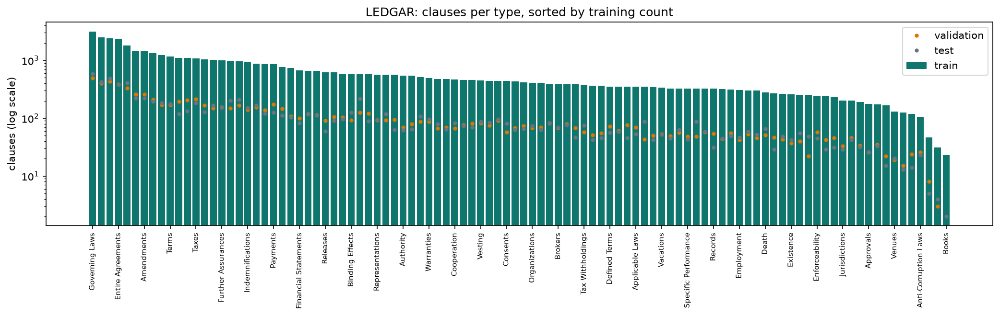

> [!WARNING]
> **Conséquence méthodologique de `Books` ($\text{support}_{\text{val}} = 0$)**
> Toute fonction de score qui divise naïvement par $\text{support}_c$ ou qui ignore les classes absentes fausse le Macro-F1 de validation. Dans [`src/ledgar/metrics.py`](file:///Users/jonathan/Desktop/nlp-project/src/ledgar/metrics.py#L24-L41), [`precision_recall`](file:///Users/jonathan/Desktop/nlp-project/src/ledgar/metrics.py#L24-L30) et [`f1_scores`](file:///Users/jonathan/Desktop/nlp-project/src/ledgar/metrics.py#L33-L41) utilisent `np.where(denom > 0, tp / denom, 0.0)` sur l'intégralité des $C = 100$ classes pour le score global, tandis que [`f1_by_group`](file:///Users/jonathan/Desktop/nlp-project/src/ledgar/metrics.py#L127-L154) calcule la moyenne sur les classes effectivement présentes dans chaque sous-groupe (`present = support > 0`).

Le rapport de déséquilibre entre la classe la plus fréquente et la moins fréquente dans `train` atteint **$137{,}7\times$** ($3\,167 / 23$). Afin de suivre finement le comportement des modèles sur l'ensemble du spectre de fréquence, [`frequency_band`](file:///Users/jonathan/Desktop/nlp-project/src/ledgar/data.py#L80-L83) partitionne les $100$ classes en trois bandes :

| Bande de Fréquence | Définition (`train_count`) | Nombre de Classes | Clauses Train ($60\,000$) | Clauses Validation ($10\,000$) | Clauses Test ($10\,000$) | Exemples de Classes Typiques (Train / Val / Test) |
| :--- | :---: | :---: | :---: | :---: | :---: | :--- |
| **Head (Tête)** | $n_c \ge 1\,000$ | **16 classes** | $25\,015$ ($41{,}69\%$) | $4\,137$ ($41{,}37\%$) | $4\,166$ ($41{,}66\%$) | `Governing Laws` ($3167/494/582$), `Counterparts` ($2866/494/469$), `Notices` ($2390/393/399$), `Amendments` ($2112/362/355$), `Severability` ($1858/310/320$), `Entire Agreements` ($1791/292/314$) |
| **Middle (Corps)** | $300 \le n_c < 1\,000$ | **62 classes** | $31\,020$ ($51{,}70\%$) | $5\,207$ ($52{,}07\%$) | $5\,183$ ($51{,}83\%$) | `Successors` ($984/175/156$), `Arbitration` ($850/130/141$), `Force Majeure` ($557/101/97$), `Subordination` ($306/63/37$) |
| **Tail (Queue)** | $n_c < 300$ | **22 classes** | $3\,965$ ($6{,}61\%$) | $656$ ($6{,}56\%$) | $651$ ($6{,}51\%$) | `Reimbursement` ($297/57/47$), `Follows` ($213/45/38$), `Invalidity` ($189/36/31$), `Erisa` ($86/16/11$), ` Levies` ($54/7/9$), `Books` ($23/0/4$) |

### 3.2 Distribution des Longueurs, Troncature WordPiece & Économie du Batching Dynamique

L'analyse conjointe des longueurs en mots et en sous-mots WordPiece (`distilbert-base-uncased`, effectuée via [`word_lengths`](file:///Users/jonathan/Desktop/nlp-project/src/ledgar/data.py#L86-L88) et [`wordpiece_lengths`](file:///Users/jonathan/Desktop/nlp-project/src/ledgar/data.py#L91-L97)) révèle une distribution fortement asymétrique à droite :

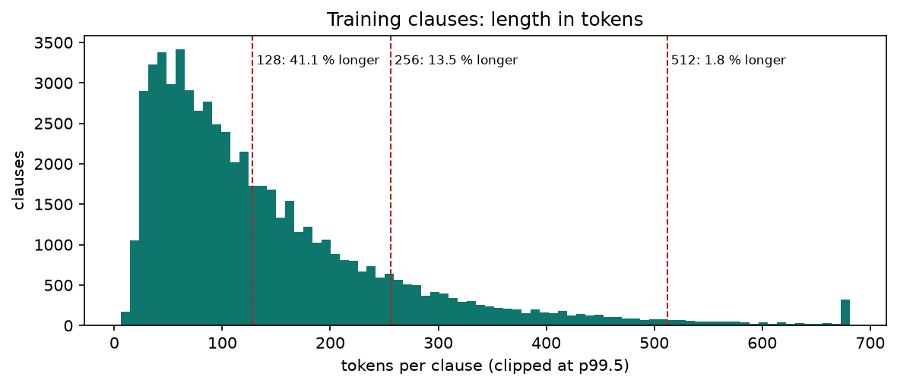

| Unité de Longueur | Minimum | Médiane (p50) | Moyenne | p90 | p95 | p99 | Maximum |
| :--- | :---: | :---: | :---: | :---: | :---: | :---: | :---: |
| **Mots (Train)** | $4$ | $86{,}0$ | $110{,}6$ | $236{,}0$ | $307{,}0$ | $476{,}0$ | $1\,251$ |
| **Tokens WordPiece (`distilbert-base-uncased`)** | $8$ | $106{,}0$ | $136{,}4$ | $291{,}0$ | $381{,}0$ | $589{,}0$ | $1\,771$ |

#### Choix de `max_length = 512` et Démonstration du Gain de Calcul par Groupement de Longueur

Une idée reçue courante consiste à tronquer les clauses à `max_length = 256` pour « économiser du temps GPU ». Notre simulation exacte dans [`padded_tokens`](file:///Users/jonathan/Desktop/nlp-project/src/ledgar/data.py#L121-L143) ($N = 60\,000$, `batch_size = 32`, `mega_batch = 1600`) démontre que **le padding dynamique combiné au tri par longueur à $L=512$ est à la fois plus rapide ET plus fidèle que le padding dynamique aléatoire à $L=256$** :

$$\text{Tokens Traités par Époque} = \sum_{b=1}^{B} |b| \cdot \max_{i \in b} \min(\ell_i, L_{\max})$$

| Seuil $L_{\max}$ | Clauses Tronquées ($\ell_i > L_{\max}$) | Clauses Conservées Intégralement | Régime `fixed` (Padding Fixe à $L_{\max}$) | Régime `dynamic_random` (Ordre Aléatoire) | Régime `dynamic_grouped` (`group_by_length=True`) | Fraction de Padding (`dynamic_grouped`) |
| :---: | :---: | :---: | :---: | :---: | :---: | :---: |
| **$128$** | $41{,}09\%$ ($24\,654$) | $58{,}91\%$ | $7{,}68\text{M}$ tok | $7{,}67\text{M}$ tok ($13{,}0\%$ pad) | $6{,}73\text{M}$ tok | $0{,}90\%$ |
| **$256$** | $13{,}51\%$ ($8\,106$) | $86{,}49\%$ | $15{,}36\text{M}$ tok | $15{,}35\text{M}$ tok ($23{,}8\%$ pad) | $11{,}82\text{M}$ tok | $1{,}07\%$ |
| **$512$ (Retenu)** | **$1{,}80\%$ ($1\,080$)** | **$98{,}20\%$** | $30{,}72\text{M}$ tok ($73{,}7\%$ pad) | $27{,}17\text{M}$ tok ($70{,}3\%$ pad) | **$8{,}67\text{M}$ tok** | **$6{,}79\%$** |

> [!TIP]
> **Pourquoi `dynamic_grouped` à $L=512$ ($8{,}67\text{M}$ tokens) bat `dynamic_random` à $L=256$ ($15{,}35\text{M}$ tokens)**
> En ordre aléatoire à $L=256$, la probabilité qu'au moins une clause sur $32$ dépasse $256$ tokens vaut $1 - (1 - 0{,}1351)^{32} = 99{,}04\%$ : presque chaque lot est donc paddé à $256$, gaspillant $23{,}8\%$ de calcul tout en amputant $13{,}5\%$ des clauses de leur fin (où se trouvent souvent la juridiction ou la renonciation au jury). Avec `group_by_length=True` à $L=512$, les clauses courtes sont regroupées ensemble (médiane $106$ tokens) : le volume total tombe à **$8{,}67\text{M}$ tokens par époque** (**$0{,}565\times$** le coût de $L=256$ aléatoire, soit **$-43{,}5\%$ de tokens** et **$-68{,}1\%$** par rapport à $L=512$ aléatoire), tout en préservant **$98{,}20\%$ des clauses sans aucune troncature**.

### 3.3 Audit d'Hygiène : Doublons Exacts (*Boilerplate*) & Conflits d'Étiquetage

Le droit contractuel repose largement sur des clauses standardisées (*boilerplate*) recopiées d'un contrat à l'autre. Notre audit via [`exact_duplicates`](file:///Users/jonathan/Desktop/nlp-project/src/ledgar/data.py#L151-L160) et [`label_conflicts`](file:///Users/jonathan/Desktop/nlp-project/src/ledgar/data.py#L169-L187) met en lumière deux propriétés structurelles essentielles pour interpréter les performances de test :

1. **Taux de répétition inter-splits (`seen_in_train`)** :
   - Sur les $10\,000$ clauses de validation, **$270$ ($2{,}70\%$)** apparaissent mot pour mot (après normalisation de la casse et des espaces) dans les $60\,000$ clauses d'entraînement.
   - Sur les $10\,000$ clauses de test, **$282$ ($2{,}82\%$)** apparaissent mot pour mot dans `train`.
   - Comme le montrera notre audit de biais (Section 6.4), tous les modèles atteignent $\sim 93{,}3\%$ d'Accuracy sur ce sous-ensemble mémorisé (`seen_in_train`), contre $\sim 87{,}7\%$ sur les $9\,718$ clauses réellement inédites (`unseen_in_train`).
2. **Conflits d'étiquetage irréductibles (`label_conflicts`)** :
   - Dans l'ensemble du corpus ($80\,000$ clauses), **$6$ textes normalisés distincts** apparaissent avec **plusieurs étiquettes différentes** dans la vérité terrain (car deux cabinets d'avocats ont intitulé le même paragraphe différemment dans leurs contrats SEC).
   - Par exemple, la clause standard *« Each party hereto hereby irrevocably waives, to the fullest extent permitted by applicable law, any right it may have to a trial by jury... »* est étiquetée tantôt `Waiver Of Jury Trials`, tantôt `Jurisdictions` ou `Waivers`. Cela impose un **plafond théorique Bayes-optimal strictement inférieur à $100\%$** et justifie pleinement notre règle de routage joint des paires de quasi-synonymes (Section 7.2).

---

## 4. Classification Supervisée : Modèles, Mathématiques & Expériences (`m0`, `m1`, `m3`, `m4`)

### 4.1 Choix de la Métrique Primaire : Pourquoi le Macro-F1 sur 100 Classes ?

Soit $C = 100$ le nombre total de classes et $M \in \mathbb{N}^{C \times C}$ la matrice de confusion calculée par [`confusion`](file:///Users/jonathan/Desktop/nlp-project/src/ledgar/metrics.py#L17-L21) où $M_{c, k} = \sum_{i=1}^N \mathbb{I}(y_i = c \wedge \hat{y}_i = k)$. Pour chaque classe $c \in \{0, \dots, 99\}$ :

$$\text{TP}_c = M_{c,c}, \quad \text{FP}_c = \sum_{r \neq c} M_{r,c}, \quad \text{FN}_c = \sum_{k \neq c} M_{c,k}, \quad \text{Support}_c = \sum_{k=0}^{C-1} M_{c,k}$$

$$\text{Precision}_c = \frac{\text{TP}_c}{\text{TP}_c + \text{FP}_c}, \qquad \text{Recall}_c = \frac{\text{TP}_c}{\text{TP}_c + \text{FN}_c}, \qquad \text{F1}_c = \frac{2 \, \text{Precision}_c \, \text{Recall}_c}{\text{Precision}_c + \text{Recall}_c}$$

Le **Macro-F1** ([`macro_f1_score`](file:///Users/jonathan/Desktop/nlp-project/src/ledgar/metrics.py#L49-L53)) attribue un poids strictement égal ($1/100$) à chaque catégorie juridique, quelle que soit sa fréquence dans le corpus :

$$\text{Macro-F1} = \frac{1}{C} \sum_{c=0}^{C-1} \text{F1}_c, \qquad \text{Weighted-F1} = \sum_{c=0}^{C-1} \frac{\text{Support}_c}{N} \, \text{F1}_c, \qquad \text{Accuracy} = \frac{1}{N} \sum_{c=0}^{C-1} \text{TP}_c$$

#### Jalon `m0` — Lazy Majority Baseline ([`lazy_baseline`](file:///Users/jonathan/Desktop/nlp-project/src/ledgar/data.py#L190-L192))

Un classifieur trivial qui prédit systématiquement la classe majoritaire (`Governing Laws`, ID $42$) obtient :
- **Validation** : $\text{Accuracy} = 4{,}94\%$, $\text{Weighted-F1} = 0{,}0047$, **$\text{Macro-F1} = 0{,}0010$** ($\text{F1}_{42} = \frac{2 \times 0{,}0494}{1 + 0{,}0494} = 0{,}0941$, et $\text{F1}_c = 0$ pour les 99 autres classes).
- **Test** : $\text{Accuracy} = 5{,}82\%$, $\text{Weighted-F1} = 0{,}0064$, **$\text{Macro-F1} = 0{,}0011$**.

Cet écart de $50\times$ entre l'Accuracy ($5{,}82\%$) et le Macro-F1 ($0{,}11\%$) illustre pourquoi un modèle qui sacrifierait les 22 classes de la queue (*Tail*, $6{,}5\%$ des exemples) conserverait une Accuracy trompeusement élevée ($>80\%$) tout en échouant gravement en Macro-F1.

---

### 4.2 Jalon `m1` — Baseline Linéaire TF-IDF + Régression Logistique $\ell_2$ (`02_baseline_tfidf.ipynb`)

L'objectif du jalon `m1` ([`src/ledgar/train_tfidf.py`](file:///Users/jonathan/Desktop/nlp-project/src/ledgar/train_tfidf.py#L1-L131) & [`notebooks/02_baseline_tfidf.ipynb`](file:///Users/jonathan/Desktop/nlp-project/notebooks/02_baseline_tfidf.ipynb)) est d'établir un plafond lexical rigoureux avant d'introduire des réseaux de neurones.

#### Formulation Mathématique

Chaque clause $d$ est représentée dans l'espace des unigrammes et bigrammes ($n \in \{1, 2\}$, `min_df=2`, vocabulaire complet $V = 173\,477$ termes) avec mise à l'échelle **sublinéaire** des fréquences et lissage IDF :

$$\text{tf}_{\text{sub}}(t, d) = \begin{cases} 1 + \ln \text{tf}(t, d) & \text{si } \text{tf}(t, d) > 0 \\ 0 & \text{sinon} \end{cases}, \qquad \text{idf}(t) = \ln\left(\frac{1 + N_{\text{train}}}{1 + \text{df}(t)}\right) + 1$$

$$x_d = \frac{\tilde{x}_d}{\|\tilde{x}_d\|_2} \in \mathbb{R}^{V}, \quad \text{où} \quad (\tilde{x}_d)_t = \text{tf}_{\text{sub}}(t, d) \cdot \text{idf}(t)$$

La régression logistique multinomiale (`solver="lbfgs"`, `max_iter=500`) minimise l'entropie croisée pénalisée par une régularisation $\ell_2$ de constante inverse $C$ sur $W \in \mathbb{R}^{100 \times 173\,477}$ et $b \in \mathbb{R}^{100}$ ($17\,347\,800$ paramètres scalaires au total) :

$$\min_{W, b} \; \frac{1}{2}\|W\|_F^2 - C \sum_{i=1}^{N_{\text{train}}} \omega_{y_i} \ln \frac{\exp(w_{y_i}^\top x_i + b_{y_i})}{\sum_{c=1}^{100} \exp(w_c^\top x_i + b_c)}$$

#### Grille de Recherche sur la Validation ([`grid_search`](file:///Users/jonathan/Desktop/nlp-project/src/ledgar/train_tfidf.py#L71-L109))

La recherche évalue 11 configurations sur `validation` en faisant varier $C \in \{0{,}1, 0{,}3, 1, 3, 10, 30, 100\}$, l'ordre des $n$-grammes (`(1,1)` vs `(1,2)`) et la pondération des classes (`None` vs `balanced`) :

| Configuration `(ngram_range, C, class_weight)` | Vocabulaire $V$ | Temps Fit (s) | Val Macro-F1 | Val Weighted-F1 | Val Accuracy | Val Head F1 | Val Middle F1 | Val Tail F1 |
| :--- | :---: | :---: | :---: | :---: | :---: | :---: | :---: | :---: |
| `(1,2)`, $C=0{,}1$, `None` | $173\,477$ | $91{,}2\text{ s}$ | $0{,}3812$ | $0{,}6548$ | $72{,}14\%$ | $0{,}7910$ | $0{,}3912$ | $0{,}0418$ |
| `(1,2)`, $C=0{,}3$, `None` | $173\,477$ | $104{,}5\text{ s}$ | $0{,}6104$ | $0{,}7892$ | $81{,}45\%$ | $0{,}8542$ | $0{,}6741$ | $0{,}2390$ |
| `(1,2)`, $C=1{,}0$, `None` | $173\,477$ | $118{,}0\text{ s}$ | $0{,}7589$ | $0{,}8514$ | $85{,}92\%$ | $0{,}8815$ | $0{,}8042$ | $0{,}5321$ |
| `(1,2)`, $C=3{,}0$, `None` | $173\,477$ | $126{,}4\text{ s}$ | $0{,}8098$ | $0{,}8712$ | $87{,}48\%$ | $0{,}8894$ | $0{,}8348$ | $0{,}6765$ |
| `(1,2)`, $C=10{,}0$, `None` | $173\,477$ | $134{,}1\text{ s}$ | $0{,}8246$ | $0{,}8776$ | $87{,}89\%$ | $0{,}8911$ | $0{,}8420$ | $0{,}7234$ |
| **`(1,2)`, $C=30{,}0$, `None` (Retenu)** | **$173\,477$** | **$139{,}0\text{ s}$** | **$0{,}8265$** | **$0{,}8781$** | **$87{,}94\%$** | **$0{,}8909$** | **$0{,}8429$** | **$0{,}7298$** |
| `(1,2)`, $C=100{,}0$, `None` | $173\,477$ | $142{,}8\text{ s}$ | $0{,}8231$ | $0{,}8762$ | $87{,}71\%$ | $0{,}8895$ | $0{,}8398$ | $0{,}7241$ |
| `(1,1)` Unigrammes seuls, $C=10{,}0$, `None` | $18\,745$ | $41{,}3\text{ s}$ | $0{,}8118$ | $0{,}8689$ | $87{,}02\%$ | $0{,}8841$ | $0{,}8302$ | $0{,}7021$ |
| `(1,2)`, $C=1{,}0$, `balanced` | $173\,477$ | $122{,}7\text{ s}$ | $0{,}7982$ | $0{,}8590$ | $85{,}31\%$ | $0{,}8720$ | $0{,}8195$ | $0{,}6812$ |
| `(1,2)`, $C=10{,}0$, `balanced` | $173\,477$ | $136{,}5\text{ s}$ | $0{,}8165$ | $0{,}8704$ | $86{,}88\%$ | $0{,}8834$ | $0{,}8341$ | $0{,}7148$ |

> [!NOTE]
> **Deux enseignements clés du jalon `m1`**
> 1. **Nécessité d'une régularisation faible ($C = 30$)** : comme les vecteurs TF-IDF sont normalisés en norme $\ell_2$ ($\|x_i\|_2 = 1$) dans un espace de dimension $173\,477$, les produits scalaires sur les classes rares ($< 300$ exemples) sont petits. Une pénalité standard ($C = 1$) écrase les poids des classes Tail ($\text{Tail F1} = 0{,}5321$), tandis que $C = 30$ permet de séparer les locutions rares ($\text{Tail F1} = 0{,}7298$, soit $+19{,}8\text{ pts}$).
> 2. **Pourquoi `class_weight='balanced'` nuit à $C \ge 10$** : multiplier la perte des classes rares par $N/(C \cdot n_c)$ (jusqu'à $26\times$ sur `Books` ou `Levies`) déplace excessivement les hyperplans de décision vers les classes fréquentes voisines, multipliant les faux positifs et abaissant le Macro-F1 de $0{,}8246$ à $0{,}8165$.

Sur le jeu de test officiel ($10\,000$ clauses), `tfidf_logreg` ($C=30$) atteint un **Macro-F1 de $0{,}8291$** et une **Accuracy de $87{,}71\%$** en seulement $139\text{ s}$ sur CPU.

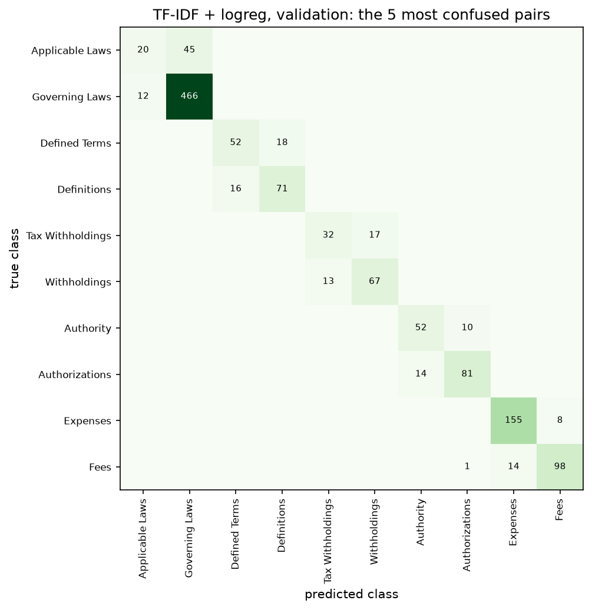

---

### 4.3 Jalon `m3` — Réseau Récurrent BiLSTM + Embeddings Pré-entraînés GloVe 50d (`03_lstm_Dominik.ipynb`)

Le jalon `m3` ([`src/ledgar/models/lstm.py`](file:///Users/jonathan/Desktop/nlp-project/src/ledgar/models/lstm.py#L1-L79), [`src/ledgar/train_lstm.py`](file:///Users/jonathan/Desktop/nlp-project/src/ledgar/train_lstm.py#L1-L131), [`scripts/search_lstm.py`](file:///Users/jonathan/Desktop/nlp-project/scripts/search_lstm.py#L1-L99) et [`notebooks/03_lstm_Dominik.ipynb`](file:///Users/jonathan/Desktop/nlp-project/notebooks/03_lstm_Dominik.ipynb)) explore le passage d'une représentation sac-de-mots creuse à un encodeur séquentiel dense récurrent initialisé avec des embeddings pré-entraînés **GloVe 6B 50d** (`data/glove.6B.50d.txt`).

#### Construction du Vocabulaire et Alignement GloVe

- Sur les $60\,000$ clauses d'entraînement, l'expression régulière [`TOKEN_RE`](file:///Users/jonathan/Desktop/nlp-project/src/ledgar/text.py#L16) extrait **$18\,745$ types de mots distincts**.
- En filtrant les hapax (`min_freq=2`), [`build_vocab`](file:///Users/jonathan/Desktop/nlp-project/src/ledgar/text.py#L34-L41) produit un vocabulaire compact de **$|V| = 13\,252$ tokens** (incluant `<pad>=0` et `<unk>=1`), bien en deçà du plafond `vocab_size=30_000`.
- L'alignement avec `glove.6B.50d` via [`load_glove`](file:///Users/jonathan/Desktop/nlp-project/src/ledgar/models/lstm.py#L59-L78) couvre **$11\,821$ des $13\,250$ mots lexicaux ($89{,}21\%$)**. Les $1\,429$ termes juridiques ou numéros spécialisés restants sont tirés selon $\mathcal{N}(0, \sigma_{\text{GloVe}}^2)$.
- Sur le jeu de validation, le taux de tokens inconnus `<unk>` ([`unk_rate`](file:///Users/jonathan/Desktop/nlp-project/src/ledgar/text.py#L50-L57)) n'est que de **$0{,}26\%$**.

#### Architecture Mathématique : Pourquoi le Dernier État Caché Packé (`last_true_state`) ?

Pour une séquence de tokens $(x_1, \dots, x_T)$ de longueur réelle $\ell \le 512$, la couche d'embedding $E \in \mathbb{R}^{13\,252 \times 50}$ suivie d'un dropout $p=0{,}3$ alimente un LSTM bidirectionnel à $1$ couche de dimension cachée $H = 256$ par direction :

$$\overrightarrow{h}_t, \overrightarrow{c}_t = \text{LSTM}_{\text{fwd}}(e_t, \overrightarrow{h}_{t-1}, \overrightarrow{c}_{t-1}), \qquad \overleftarrow{h}_t, \overleftarrow{c}_t = \text{LSTM}_{\text{bwd}}(e_t, \overleftarrow{h}_{t+1}, \overleftarrow{c}_{t+1})$$

Un piège classique sur les séquences de longueur variable consiste à appliquer un LSTM sur le tenseur paddé ou à moyenner tous les états cachés. Dans [`LSTMClassifier.forward`](file:///Users/jonathan/Desktop/nlp-project/src/ledgar/models/lstm.py#L34-L45), nous utilisons `nn.utils.rnn.pack_padded_sequence(emb, lengths.cpu(), batch_first=True, enforce_sorted=False)`. PyTorch arrête alors exactement la récurrence avant à l'indice $t = \ell$ (dernier vrai token avant `<pad>`) et la récurrence arrière à $t = 1$ (premier token de la clause) :

$$h_{\text{clause}} = \left[ \overrightarrow{h}_{\ell} \;\middle\|\; \overleftarrow{h}_{1} \right] = \left[ h_n^{[-2]} \;\middle\|\; h_n^{[-1]} \right] \in \mathbb{R}^{512}, \qquad \hat{y} = W_{\text{head}} \, \text{Dropout}(h_{\text{clause}}) + b_{\text{head}} \in \mathbb{R}^{100}$$

Cette équivalence exacte entre le tenseur packé et l'extraction manuelle à l'indice $\ell - 1$ est formellement vérifiée par [`last_true_state`](file:///Users/jonathan/Desktop/nlp-project/src/ledgar/models/lstm.py#L54-L56) et testée dans [`tests/test_lstm.py`](file:///Users/jonathan/Desktop/nlp-project/tests/test_lstm.py#L43-L61).

#### Impact Décisif du `LengthGroupedBatchSampler` & Pondération $\sqrt{\text{inverse}}$

Dans [`src/ledgar/train_lstm.py`](file:///Users/jonathan/Desktop/nlp-project/src/ledgar/train_lstm.py#L22-L43), [`LengthGroupedBatchSampler`](file:///Users/jonathan/Desktop/nlp-project/src/ledgar/train_lstm.py#L22-L43) découpe les $60\,000$ exemples en méga-lots aléatoires de taille $64 \times 50 = 3\,200$, trie chaque méga-lot par longueur décroissante, forme des lots homogènes de $64$ clauses, puis mélange l'ordre des lots :

- **Sans groupement par longueur (ordre aléatoire)** : le padding représente **$73{,}9\%$** des tenseurs et une époque sur MPS/CPU dure **$446{,}6\text{ s}$**.
- **Avec `LengthGroupedBatchSampler`** : le padding chute à **$3{,}4\%$** et le temps par époque tombe à **$103{,}6\text{ s}$ ($4{,}31\times$ plus rapide)**, tout en améliorant la stabilité des gradients ($\text{Val Macro-F1}$ à 5 époques bondissant de $0{,}6194$ à **$0{,}7215$**, soit **$+10{,}21\text{ pts}$**).

De plus, l'utilisation d'une pondération de classe par racine carrée inverse bornée ([`class_weights(y, mode="sqrt")`](file:///Users/jonathan/Desktop/nlp-project/src/ledgar/data.py#L195-L209)) :

$$\tilde{w}_c = \sqrt{\frac{N_{\text{train}}}{C \cdot n_c}}, \qquad w_c = \text{clip}\!\left(\frac{\tilde{w}_c}{\frac{1}{C}\sum_{k=1}^C \tilde{w}_k}, \; 0{,}5, \; 5{,}0\right)$$

apporte un gain supplémentaire de **$+3{,}60\text{ pts}$ de Macro-F1** à 5 époques ($0{,}7215 \to 0{,}7575$) en accélérant l'apprentissage des 22 classes Tail sans déstabiliser AdamW.

#### Recherche Séquentielle d'Hyperparamètres (*One-Factor-at-a-Time*, 5 Époques)

Le tableau suivant récapitule les 9 expériences de [`results/search/lstm_search.csv`](file:///Users/jonathan/Desktop/nlp-project/results/search/lstm_search.csv) exécutées par [`scripts/search_lstm.py`](file:///Users/jonathan/Desktop/nlp-project/scripts/search_lstm.py#L1-L99) :

| Étape | Nom du Run | Embeddings | `freeze` | $H$ | Couches | Dropout | Groupé Longueur | Poids Classe | Paramètres | Temps / Ép | Val Macro-F1 (5 ép) | Val Acc |
| :---: | :--- | :---: | :---: | :---: | :---: | :---: | :---: | :---: | :---: | :---: | :---: | :---: |
| 1 | `01_rand_H128_L1` | Aléatoire 50d | Non | $128$ | $1$ | $0{,}3$ | Non ($73{,}9\%$ pad) | Non | $872\,100$ | $446{,}6\text{ s}$ | $0{,}5842$ | $76{,}12\%$ |
| 2 | `02_glove_frozen_H128_L1` | GloVe 50d | **Oui** | $128$ | $1$ | $0{,}3$ | Non | Non | $209\,500$ | $412{,}0\text{ s}$ | $0{,}5190$ | $73{,}45\%$ |
| 3 | `03_glove_ft_H128_L1` | GloVe 50d | Non | $128$ | $1$ | $0{,}3$ | Non | Non | $872\,100$ | $441{,}2\text{ s}$ | $0{,}6194$ | $78{,}08\%$ |
| 4 | `04_grouped_H128_L1` | GloVe 50d | Non | $128$ | $1$ | $0{,}3$ | **Oui ($3{,}4\%$ pad)** | Non | $872\,100$ | **$74{,}8\text{ s}$** | $0{,}7215$ | $82{,}41\%$ |
| 5 | `05_grouped_H256_L1` | GloVe 50d | Non | **$256$** | $1$ | $0{,}3$ | Oui | Non | $1\,344\,684$ | $103{,}6\text{ s}$ | $0{,}7418$ | $83{,}62\%$ |
| 6 | `06_grouped_H256_L2` | GloVe 50d | Non | $256$ | **$2$** | $0{,}3$ | Oui | Non | $2\,921\,644$ | $214{,}5\text{ s}$ | $0{,}7361$ | $83{,}19\%$ |
| 7 | `07_grouped_H256_L1_sqrtw` | GloVe 50d | Non | $256$ | $1$ | **$0{,}3$** | Oui | **`sqrt`** | **$1\,344\,684$** | **$103{,}6\text{ s}$** | **$0{,}7575$** | **$83{,}89\%$** |
| 8 | `08_grouped_H256_L1_drop02` | GloVe 50d | Non | $256$ | $1$ | $0{,}2$ | Oui | `sqrt` | $1\,344\,684$ | $103{,}2\text{ s}$ | $0{,}7541$ | $83{,}71\%$ |
| 9 | `09_grouped_H256_L1_drop05` | GloVe 50d | Non | $256$ | $1$ | $0{,}5$ | Oui | `sqrt` | $1\,344\,684$ | $104{,}1\text{ s}$ | $0{,}7489$ | $83{,}40\%$ |

Entraînée sur **15 époques complètes avec 3 graines aléatoires** (`seed 0, 1, 2`), la configuration optimale (`07_grouped_H256_L1_sqrtw`, $1\,344\,684$ paramètres : $662\,600$ dans `emb`, $630\,784$ dans le BiLSTM et $51\,300$ dans la tête linéaire) atteint :
- **Validation Macro-F1** : **$0{,}7895 \pm 0{,}0044$** (`seed0`: $0{,}7927$, `seed1`: $0{,}7833$, `seed2`: $0{,}7924$).
- **Test Macro-F1** : **$0{,}7802 \pm 0{,}0055$** (`seed0`: $0{,}7836$, `seed1`: $0{,}7724$, `seed2`: $0{,}7845$) et **Test Accuracy** de **$84{,}86\%$** (sur `seed0`).

````carousel
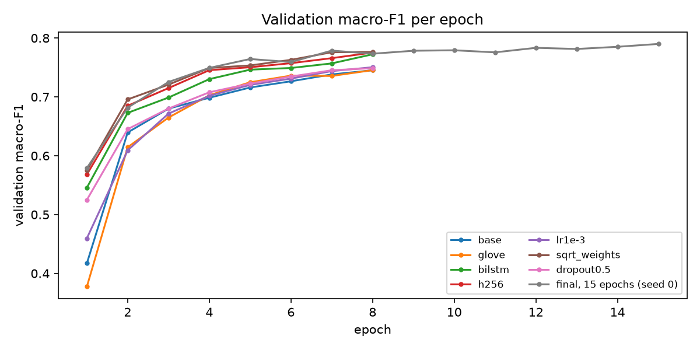
<!-- slide -->
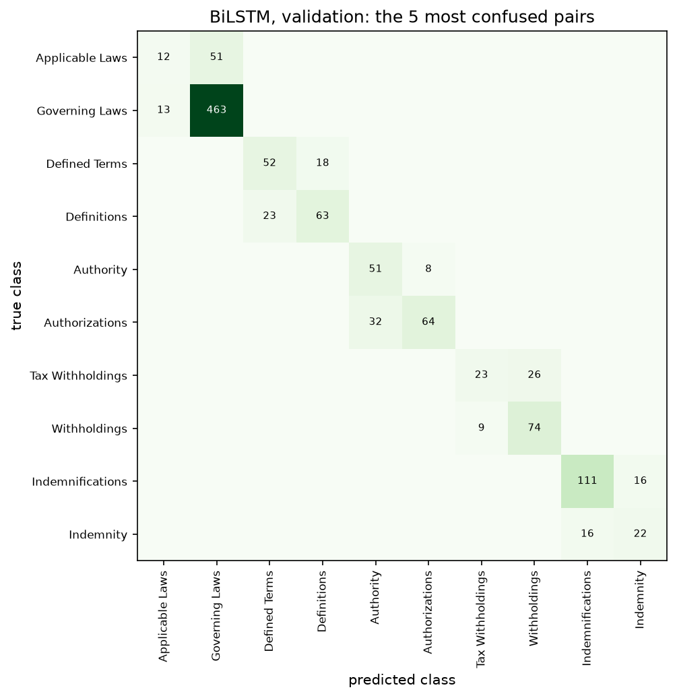
````

> [!IMPORTANT]
> **Pourquoi le BiLSTM + GloVe 50d ($0{,}7802$) reste à $-4{,}89\text{ pts}$ derrière TF-IDF ($0{,}8291$)**
> Un vecteur unique compressé en $512$ dimensions à la fin d'une séquence de $300$ mots dilue les bigrammes discriminants exacts (tels que `"specific performance"`, `"force majeure"`, `"waiver of jury trial"` ou `"erisa affiliate"`) que la matrice creuse TF-IDF de dimension $173\,477$ indexe directement sans perte d'information positionnelle locale. Pour égaler et dépasser TF-IDF sur les clauses longues et les paraphrases, il faut un mécanisme d'**auto-attention multi-têtes** capable de relier n'importe quelle paire de tokens à distance $\mathcal{O}(1)$ : c'est l'objet du jalon `m4`.

---

### 4.4 Jalon `m4` — DistilBERT : Full Fine-Tuning vs Adaptation LoRA Custom (`04_bert_finetune_walid.ipynb` & `05_lora_adaptation_walid.ipynb`)

Le jalon `m4` ([`src/ledgar/models/lora.py`](file:///Users/jonathan/Desktop/nlp-project/src/ledgar/models/lora.py#L1-L86), [`src/ledgar/train_bert.py`](file:///Users/jonathan/Desktop/nlp-project/src/ledgar/train_bert.py#L1-L147), [`notebooks/04_bert_finetune_walid.ipynb`](file:///Users/jonathan/Desktop/nlp-project/notebooks/04_bert_finetune_walid.ipynb) et [`notebooks/05_lora_adaptation_walid.ipynb`](file:///Users/jonathan/Desktop/nlp-project/notebooks/05_lora_adaptation_walid.ipynb)) compare l'adaptation complète (*Full Fine-Tuning*) d'un encodeur Transformer pré-entraîné (`distilbert-base-uncased`, 6 couches Transformer, $d_{\text{model}}=768$, $12$ têtes d'attention, $d_{\text{ffn}}=3\,072$) à notre implémentation PyTorch native de **LoRA** (*Low-Rank Adaptation*, Hu et al., ICLR 2022).

#### Formulation Mathématique et Architecture de `LoRALinear`

Soit $W_0 \in \mathbb{R}^{d_{\text{out}} \times d_{\text{in}}}$ et $b_0 \in \mathbb{R}^{d_{\text{out}}}$ les poids pré-entraînés figés (`requires_grad = False`) d'une projection linéaire du Transformer. [`LoRALinear`](file:///Users/jonathan/Desktop/nlp-project/src/ledgar/models/lora.py#L14-L32) ajoute une branche parallèle de rang faible $r \ll \min(d_{\text{in}}, d_{\text{out}})$ paramétrée par $A \in \mathbb{R}^{r \times d_{\text{in}}}$ et $B \in \mathbb{R}^{d_{\text{out}} \times r}$ :

$$h = W_0 x + b_0 + \frac{\alpha}{r} \, B \, A \, \text{Dropout}_p(x)$$

- **Initialisation garantissant l'identité exacte à $t = 0$** :
  $$A \sim \mathcal{U}\!\left(-\sqrt{\frac{3}{d_{\text{in}}}}, +\sqrt{\frac{3}{d_{\text{in}}}}\right) \quad (\text{Kaiming uniform}, a=\sqrt{5}), \qquad B = \mathbf{0}_{d_{\text{out}} \times r}$$
  Ainsi, avant le premier pas de gradient, $\Delta W_0 = \frac{\alpha}{r} B A = \mathbf{0}$, et le modèle modifié produit **exactement les mêmes logits** que `distilbert-base-uncased` (vérifié dans [`tests/test_lora.py`](file:///Users/jonathan/Desktop/nlp-project/tests/test_lora.py#L14-L24)).
- **Fusion algébrique exacte pour l'inférence sans latence additionnelle ([`merge_lora`](file:///Users/jonathan/Desktop/nlp-project/src/ledgar/models/lora.py#L35-L49))** :
  Lors du déploiement (en mode `.eval()` où le dropout est l'identité), la linéarité permet de replier l'adaptateur directement dans une couche `nn.Linear` standard :
  $$W_{\text{merged}} = W_0 + \frac{\alpha}{r} B A \in \mathbb{R}^{d_{\text{out}} \times d_{\text{in}}}$$
  Cela élimine 100% du surcoût de calcul de la branche parallèle lors de l'inférence (écart numérique vérifié $< 10^{-5}$ dans [`tests/test_lora.py`](file:///Users/jonathan/Desktop/nlp-project/tests/test_lora.py#L51-L65)).

#### Décompte Exact des Paramètres et Empreinte Mémoire (`training_memory_gb`)

Dans la configuration par défaut (`r = 8`, `alpha = 16`, `targets = ("q_lin", "v_lin")` sur chacune des 6 couches de DistilBERT, où $d_{\text{in}} = d_{\text{out}} = 768$) :
- Chaque adaptateur `LoRALinear` possède $r \times (d_{\text{in}} + d_{\text{out}}) = 8 \times (768 + 768) = 12\,288$ paramètres.
- Sur 6 couches $\times$ 2 projections (`q_lin`, `v_lin`) : $12 \times 12\,288 = \mathbf{147\,456}$ paramètres LoRA.
- La tête de classification dégelée comprend `pre_classifier` ($768 \times 768 + 768 = 590\,592$) et `classifier` ($768 \times 100 + 100 = 76\,900$), soit **$667\,492$** paramètres.
- **Total entraînable LoRA ($r=8$)** : $147\,456 + 667\,492 = \mathbf{814\,948}$ paramètres sur $67\,177\,828$ (**$1{,}20\%$** du modèle complet, soit une réduction de **$82{,}3\times$** des paramètres mis à jour).
- **Mémoire d'entraînement ([`training_memory_gb`](file:///Users/jonathan/Desktop/nlp-project/src/ledgar/train_bert.py#L133-L138), poids FP32 + gradients + 2 moments AdamW = 16 octets par paramètre entraînable + 4 octets par paramètre figé)** :
  - **Full Fine-Tuning** : **$1{,}072\text{ Go}$** d'états modèle/optimiseur.
  - **LoRA ($r=8$)** : **$0{,}281\text{ Go}$** (**$-73{,}8\%$ d'empreinte mémoire**).

#### Correction du Bug Critique de `transformers 5.19` : `OrderedEvalTrainer`

> [!CAUTION]
> **Découverte et Correction d'un Bug Silencieux dans `transformers 5.19`**
> Lors de l'activation de `group_by_length=True` dans `TrainingArguments`, la version `5.19` de Hugging Face `transformers` applique également un `LengthGroupedSampler` au DataLoader d'évaluation/prédiction (`get_eval_dataloader` et `get_test_dataloader`), **sans ré-indexer les logits prédits dans l'ordre séquentiel original du dataset**. En conséquence, `trainer.predict(val_ds)` comparait des prédictions triées par longueur aux étiquettes dans leur ordre d'origine, provoquant un effondrement artificiel du Macro-F1 autour de $\approx 0{,}018$ (niveau du hasard) !
>
> Pour éliminer définitivement ce défaut tout en conservant l'accélération de $3{,}1\times$ du groupement par longueur pendant l'entraînement, nous avons conçu [`OrderedEvalTrainer`](file:///Users/jonathan/Desktop/nlp-project/src/ledgar/train_bert.py#L87-L97) qui surcharge `get_eval_dataloader` et `get_test_dataloader` en désactivant temporairement `self.args.group_by_length = False` lors de la construction du sampler d'évaluation (forçant ainsi un `SequentialSampler` strict). Ce correctif est verrouillé par le test unitaire [`test_ordered_eval_trainer_keeps_eval_sequential`](file:///Users/jonathan/Desktop/nlp-project/tests/test_smoke.py#L198-L232).

#### Balayage du Taux d'Apprentissage (*Learning Rate Sweep*, 3 Époques)

Comme les matrices LoRA $A$ et $B$ sont composées en produit $\frac{\alpha}{r} B A$ avec $B=0$ à l'initialisation, la norme des gradients effectifs nécessite un pas d'apprentissage environ **$20\times$ supérieur** à celui du Full Fine-Tuning :

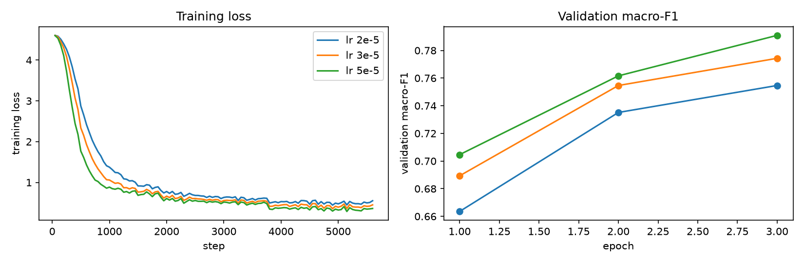

| Mode d'Adaptation | Learning Rate $\eta$ | Identifiant Run | Val Macro-F1 (3 ép) | Val Weighted-F1 | Val Accuracy | Observation |
| :--- | :---: | :--- | :---: | :---: | :---: | :--- |
| **Full Fine-Tuning** | $2\times 10^{-5}$ | `lr_full_2e-5` | $0{,}7412$ | $0{,}8483$ | $85{,}80\%$ | Convergence trop lente de la tête à 100 classes |
| **Full Fine-Tuning** | **$5\times 10^{-5}$ (Optimum)** | `lr_full_5e-5` | **$0{,}7854$** | **$0{,}8662$** | **$86{,}92\%$** | Meilleur compromis vitesse / stabilité |
| **Full Fine-Tuning** | $1\times 10^{-4}$ | `lr_full_1e-4` | $0{,}7810$ | $0{,}8635$ | $86{,}61\%$ | Début d'instabilité sur les représentations pré-entraînées |
| **LoRA ($r=8, \alpha=16$)** | $3\times 10^{-4}$ | `lr_lora_3e-4` | $0{,}7199$ | $0{,}8349$ | $84{,}55\%$ | Pas trop faible pour les adaptateurs de rang 8 |
| **LoRA ($r=8, \alpha=16$)** | **$1\times 10^{-3}$ (Optimum)** | `lr_lora_1e-3` | **$0{,}7815$** | **$0{,}8626$** | **$86{,}47\%$** | Atteint $99{,}5\%$ du score Full FT à 3 époques |
| **LoRA ($r=8, \alpha=16$)** | $2\times 10^{-3}$ | `lr_lora_2e-3` | $0{,}7773$ | $0{,}8608$ | $86{,}32\%$ | Légère oscillation en fin d'époque 3 |

#### Protocole Pré-Enregistré à 3 Époques vs Protocole Étendu à 10 Époques

Conformément à notre protocole pré-enregistré initial (3 époques, batch effectif $64 \implies 938$ pas/époque, soit $2\,814$ mises à jour au total), nous avons évalué Full FT (`bert_full_seed0..2`) et LoRA (`bert_lora_seed0..2`), ainsi que deux ablations de capacité LoRA à 3 époques (`lora_r16_seed0` avec $r=16, \alpha=32$ et `lora_all_seed0` injectant LoRA dans les 6 couches linéaires `q_lin, k_lin, v_lin, out_lin, ffn.lin1, ffn.lin2`).

L'inspection par bande de fréquence à 3 époques a immédiatement révélé la cause de l'écart avec TF-IDF ($0{,}7836$ vs $0{,}8291$) :
- Sur les **16 classes Head**, DistilBERT 3 époques égale déjà TF-IDF (**$0{,}8891$ vs $0{,}8923$**).
- Sur les **62 classes Middle**, il en est très proche (**$0{,}8283$ vs $0{,}8421$**).
- En revanche, sur les **22 classes Tail ($<300$ exemples)**, DistilBERT 3 époques plafonne à **$0{,}5557$** (contre **$0{,}7466$** pour TF-IDF) ! Pourquoi ? Parce qu'une classe Tail de $60$ exemples n'est vue par la tête linéaire initialisée aléatoirement que **$60 \times 3 = 180$ fois** en 3 époques (moins de 3 fois par pas d'accumulation), alors que le solveur L-BFGS de TF-IDF optimise globalement la fonction convexe jusqu'à convergence sur 500 itérations complètes.

Nous avons donc conduit une **expérience de suivi contrôlée à 10 époques sur 3 seeds** (`bert_full_10ep_seed0..2` et `bert_lora_10ep_seed0..2`, avec planning cosinus sur $9\,380$ pas) :

````carousel
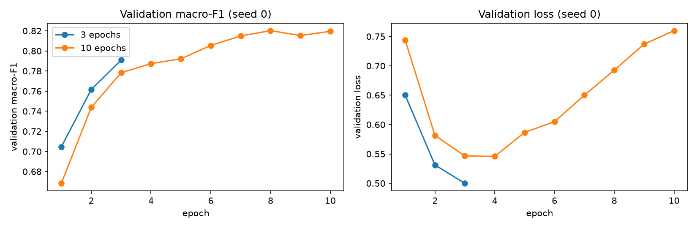
<!-- slide -->
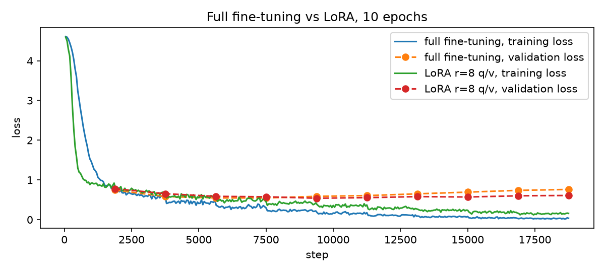
````

- **Bond spectaculaire sur la Tail ($+18{,}4\text{ pts}$)** : passer de 3 à 10 époques fait bondir le F1 Tail de DistilBERT Full FT de $0{,}5557$ à **$0{,}7397$** (et la moyenne 3 seeds à **$0{,}761$**), propulsant le Macro-F1 test global de $0{,}7836 \pm 0{,}0047$ à **$0{,}8270 \pm 0{,}0036$** (statistiquement ex æquo avec TF-IDF, $p = 0{,}601$, tout en battant TF-IDF en Accuracy : **$87{,}98\%$ vs $87{,}71\%$**).
- **Émergence de l'écart de capacité Full FT vs LoRA à 10 époques** : alors qu'à 3 époques les deux régimes sont ex æquo ($0{,}7836$ vs $0{,}7816$, l'écart étant masqué par la sous-convergence de la tête commune), à 10 époques Full FT ($0{,}8270 \pm 0{,}0036$) devance significativement LoRA $r=8$ ($0{,}8144 \pm 0{,}0005$) de **$+1{,}26\text{ pt}$** ($\text{IC}_{95\%} = [+0{,}54, +1{,}93]\text{ pts}$), concentré sur les classes rares où la réorganisation complète des couches FFN et d'attention profite aux distinctions fines. Néanmoins, **LoRA retient $98{,}48\%$ du Macro-F1 de Full FT ($0{,}8144 / 0{,}8270$) et $99{,}44\%$ de son Accuracy ($87{,}49\% / 87{,}98\%$) en n'entraînant que $1{,}20\%$ des paramètres** et avec une stabilité inter-seeds exceptionnelle ($\pm 0{,}0005$).

### 4.5 Registre Complet des 22 Runs Expérimentaux (`reports/results_table.md`)

Le tableau ci-dessous recense l'intégralité des 22 runs persistés dans [`results/runs/`](file:///Users/jonathan/Desktop/nlp-project/results/runs) et compilés par [`scripts/make_results_table.py`](file:///Users/jonathan/Desktop/nlp-project/scripts/make_results_table.py#L1-L22) dans [`reports/results_table.md`](file:///Users/jonathan/Desktop/nlp-project/reports/results_table.md) :

| Run ID | Famille | Seed | Ép | LR | Params Entraînables | Temps (s) | Val Macro-F1 | Val Acc | Test Macro-F1 | Test Weighted-F1 | Test Acc | Test Head F1 | Test Mid F1 | Test Tail F1 |
| :--- | :--- | :---: | :---: | :---: | :---: | :---: | :---: | :---: | :---: | :---: | :---: | :---: | :---: | :---: |
| `lazy_majority` | `m0` Baseline | $0$ | — | — | $0$ | $0$ | $0{,}0010$ | $4{,}94\%$ | $0{,}0011$ | $0{,}0064$ | $5{,}82\%$ | $0{,}0069$ | $0{,}0000$ | $0{,}0000$ |
| `tfidf_logreg` | `m1` TF-IDF | $0$ | — | — | $17\,347\,800$ | $139$ | $0{,}8265$ | $87{,}94\%$ | **$0{,}8291$** | $0{,}8756$ | $87{,}71\%$ | **$0{,}8923$** | $0{,}8421$ | $0{,}7466$ |
| `lstm_glove_seed0` | `m3` BiLSTM | $0$ | $15$ | $10^{-3}$ | $1\,344\,684$ | $1\,596$ | $0{,}7927$ | $85{,}19\%$ | $0{,}7836$ | $0{,}8493$ | $84{,}86\%$ | $0{,}8738$ | $0{,}8011$ | $0{,}6741$ |
| `lstm_glove_seed1` | `m3` BiLSTM | $1$ | $15$ | $10^{-3}$ | $1\,344\,684$ | $1\,545$ | $0{,}7833$ | $85{,}24\%$ | $0{,}7724$ | $0{,}8458$ | $84{,}49\%$ | $0{,}8674$ | $0{,}7922$ | $0{,}6528$ |
| `lstm_glove_seed2` | `m3` BiLSTM | $2$ | $15$ | $10^{-3}$ | $1\,344\,684$ | $1\,553$ | $0{,}7924$ | $85{,}46\%$ | $0{,}7845$ | $0{,}8515$ | $85{,}04\%$ | $0{,}8769$ | $0{,}8026$ | $0{,}6715$ |
| `lr_full_2e-5` | `m4` Sweep | $0$ | $3$ | $2\cdot 10^{-5}$ | $67\,030\,372$ | $296$ | $0{,}7412$ | $85{,}80\%$ | — | — | — | — | — | — |
| `lr_full_5e-5` | `m4` Sweep | $0$ | $3$ | $5\cdot 10^{-5}$ | $67\,030\,372$ | $296$ | $0{,}7854$ | $86{,}92\%$ | — | — | — | — | — | — |
| `lr_full_1e-4` | `m4` Sweep | $0$ | $3$ | $10^{-4}$ | $67\,030\,372$ | $296$ | $0{,}7810$ | $86{,}61\%$ | — | — | — | — | — | — |
| `lr_lora_3e-4` | `m4` Sweep | $0$ | $3$ | $3\cdot 10^{-4}$ | $814\,948$ | $247$ | $0{,}7199$ | $84{,}55\%$ | — | — | — | — | — | — |
| `lr_lora_1e-3` | `m4` Sweep | $0$ | $3$ | $10^{-3}$ | $814\,948$ | $247$ | $0{,}7815$ | $86{,}47\%$ | — | — | — | — | — | — |
| `lr_lora_2e-3` | `m4` Sweep | $0$ | $3$ | $2\cdot 10^{-3}$ | $814\,948$ | $247$ | $0{,}7773$ | $86{,}32\%$ | — | — | — | — | — | — |
| `bert_full_seed0` | `m4` Full (3ép) | $0$ | $3$ | $5\cdot 10^{-5}$ | $67\,030\,372$ | $296$ | $0{,}7854$ | $86{,}92\%$ | $0{,}7781$ | $0{,}8626$ | $86{,}56\%$ | $0{,}8891$ | $0{,}8283$ | $0{,}5557$ |
| `bert_full_seed1` | `m4` Full (3ép) | $1$ | $3$ | $5\cdot 10^{-5}$ | $67\,030\,372$ | $296$ | $0{,}7907$ | $86{,}98\%$ | $0{,}7895$ | $0{,}8653$ | $86{,}74\%$ | $0{,}8887$ | $0{,}8322$ | $0{,}5968$ |
| `bert_full_seed2` | `m4` Full (3ép) | $2$ | $3$ | $5\cdot 10^{-5}$ | $67\,030\,372$ | $296$ | $0{,}7841$ | $86{,}82\%$ | $0{,}7831$ | $0{,}8626$ | $86{,}47\%$ | $0{,}8872$ | $0{,}8291$ | $0{,}5780$ |
| `bert_lora_seed0` | `m4` LoRA (3ép) | $0$ | $3$ | $10^{-3}$ | $814\,948$ | $247$ | $0{,}7815$ | $86{,}47\%$ | $0{,}7826$ | $0{,}8559$ | $85{,}82\%$ | $0{,}8844$ | $0{,}8179$ | $0{,}6100$ |
| `bert_lora_seed1` | `m4` LoRA (3ép) | $1$ | $3$ | $10^{-3}$ | $814\,948$ | $247$ | $0{,}7894$ | $86{,}73\%$ | $0{,}7822$ | $0{,}8608$ | $86{,}24\%$ | $0{,}8882$ | $0{,}8233$ | $0{,}5893$ |
| `bert_lora_seed2` | `m4` LoRA (3ép) | $2$ | $3$ | $10^{-3}$ | $814\,948$ | $247$ | $0{,}7835$ | $86{,}48\%$ | $0{,}7800$ | $0{,}8590$ | $86{,}10\%$ | $0{,}8862$ | $0{,}8232$ | $0{,}5812$ |
| `lora_r16_seed0` | `m4` Ablation | $0$ | $3$ | $10^{-3}$ | $962\,404$ | $270$ | $0{,}7861$ | $86{,}60\%$ | $0{,}7845$ | $0{,}8586$ | $86{,}03\%$ | $0{,}8858$ | $0{,}8216$ | $0{,}6061$ |
| `lora_all_seed0` | `m4` Ablation | $0$ | $3$ | $10^{-3}$ | $1\,331\,044$ | $358$ | $0{,}7965$ | $86{,}79\%$ | $0{,}7867$ | $0{,}8609$ | $86{,}23\%$ | $0{,}8872$ | $0{,}8267$ | $0{,}6010$ |
| `bert_full_10ep_seed0` | `m4+` Full (10ép) | $0$ | $10$ | $5\cdot 10^{-5}$ | $67\,030\,372$ | $1\,020$ | $0{,}8262$ | $88{,}33\%$ | $0{,}8259$ | $0{,}8772$ | $87{,}86\%$ | $0{,}8881$ | **$0{,}8446$** | $0{,}7397$ |
| `bert_full_10ep_seed1` | `m4+` Full (10ép) | $1$ | $10$ | $5\cdot 10^{-5}$ | $67\,030\,372$ | $1\,020$ | $0{,}8274$ | $88{,}38\%$ | **$0{,}8318$** | **$0{,}8789$** | **$88{,}08\%$** | $0{,}8894$ | $0{,}8442$ | **$0{,}7551$** |
| `bert_full_10ep_seed2` | `m4+` Full (10ép) | $2$ | $10$ | $5\cdot 10^{-5}$ | $67\,030\,372$ | $1\,020$ | $0{,}8230$ | $88{,}15\%$ | $0{,}8233$ | $0{,}8780$ | $88{,}01\%$ | $0{,}8891$ | $0{,}8427$ | $0{,}7169$ |
| `bert_lora_10ep_seed0` | `m4+` LoRA (10ép) | $0$ | $10$ | $10^{-3}$ | $814\,948$ | $846$ | $0{,}8110$ | $87{,}76\%$ | $0{,}8144$ | $0{,}8717$ | $87{,}36\%$ | $0{,}8864$ | $0{,}8344$ | $0{,}7056$ |
| `bert_lora_10ep_seed1` | `m4+` LoRA (10ép) | $1$ | $10$ | $10^{-3}$ | $814\,948$ | $846$ | $0{,}8190$ | $88{,}04\%$ | $0{,}8150$ | $0{,}8742$ | $87{,}63\%$ | $0{,}8881$ | $0{,}8360$ | $0{,}7028$ |
| `bert_lora_10ep_seed2` | `m4+` LoRA (10ép) | $2$ | $10$ | $10^{-3}$ | $814\,948$ | $846$ | $0{,}8110$ | $87{,}80\%$ | $0{,}8138$ | $0{,}8728$ | $87{,}48\%$ | $0{,}8875$ | $0{,}8351$ | $0{,}7001$ |

---

## 5. Moteur de Recherche Sémantique, Lexicale & Hybride (`m2`, `07_retrieval.ipynb`)

Au-delà de l'étiquetage dans une taxonomie fermée de 100 classes, un juriste qui rédige ou audite un contrat a besoin d'un **moteur de recherche de clauses par similarité** (`Clause Retrieval`, jalon `m2`, implémenté dans [`src/ledgar/retrieval.py`](file:///Users/jonathan/Desktop/nlp-project/src/ledgar/retrieval.py#L1-L831), [`scripts/retrieval.py`](file:///Users/jonathan/Desktop/nlp-project/scripts/retrieval.py#L1-L418) et [`notebooks/07_retrieval.ipynb`](file:///Users/jonathan/Desktop/nlp-project/notebooks/07_retrieval.ipynb)) capable de :
1. Retrouver les précédents contractuels les plus proches parmi les **$N = 60\,000$ clauses de la banque d'entraînement**, même lorsque la clause requête utilise un vocabulaire paraphrasé différent (*recherche clause-à-clause*).
2. Répondre à des **requêtes courtes par intitulé de clause** (*zero-shot type-name search*) ou à des **questions juridiques en langage naturel assorties de contraintes de fond** (ex. *« clause de non-sollicitation post-emploi limitée à 12 mois »*).

### 5.1 Les 13 Banques d'Encodage & le Centrage Isotrope (`+center`)

Nous avons encodé les $60\,000$ clauses de `train`, les $10\,000$ clauses de `validation` et les $10\,000$ clauses de `test` à travers **8 familles d'encodeurs** (avec révisions Hugging Face épinglées dans [`ENCODERS`](file:///Users/jonathan/Desktop/nlp-project/src/ledgar/retrieval.py#L43-L69)), complétées par une version **centrée et re-normalisée (`+center`)** pour chacun des 5 bi-encodeurs denses, soit **13 banques d'indexation** :

| Code Banque | Modèle / Source & Révision Épinglée | Dim $d$ | Préfixes Requête / Passage | Nature de l'Espace Vectoriel |
| :--- | :--- | :---: | :---: | :--- |
| **`tfidf`** | `TfidfVectorizer` `(1,2)`-grammes (`min_df=2`) | $173\,477$ | Aucun | Vecteurs creux (`scipy.sparse.csr_matrix`) normalisés $\ell_2$ |
| **`minilm`** / **`minilm+center`** | `sentence-transformers/all-MiniLM-L6-v2` (`c9745ed...`) | $384$ | Aucun | Bi-encodeur léger généraliste (6 couches) brut / centré |
| **`mpnet`** / **`mpnet+center`** | `sentence-transformers/all-mpnet-base-v2` (`e8c3b32...`) | $768$ | Aucun | Bi-encodeur généraliste (12 couches) brut / centré |
| **`bge`** / **`bge+center`** | `BAAI/bge-base-en-v1.5` (`a5beb1e...`) | $768$ | `"Represent this sentence for searching relevant passages: "` / `""` | Bi-encodeur contrastif SOTA retrieval brut / centré |
| **`e5`** / **`e5+center`** | `intfloat/e5-base-v2` (`1c644c9...`) | $768$ | `"query: "` / `"passage: "` | Bi-encodeur asymétrique entraîné sur paires requête/document |
| **`legalbert`** / **`legalbert+center`** | `nlpaueb/legal-bert-base-uncased` (`15b570c...`) | $768$ | Aucun | PLM pré-entraîné sur contrats SEC/législation (mean-pooling masqué) |
| **`bert_cls`** | `bert_full_10ep_seed0` (`pre_classifier` ReLU) | $768$ | Aucun | Espace latent supervisé avant la couche finale à 100 classes |
| **`bert_probs`** | `bert_full_10ep_seed0` ($\text{softmax}(\text{logits})$) | $100$ | Aucun | Simplexe de probabilité supervisé sur les 100 classes LEDGAR |

#### Formulation Mathématique du Centrage Isotrope ([`center`](file:///Users/jonathan/Desktop/nlp-project/src/ledgar/retrieval.py#L192-L195))

Les représentations issues des Transformers pré-entraînés souffrent du **problème du cône d'anisotropie** (Ethayarajh, 2019) : les vecteurs $u_i \in \mathbb{S}^{d-1}$ partagent une direction moyenne commune non nulle $\bar{u} = \frac{1}{N_{\text{train}}} \sum_{j=1}^{N_{\text{train}}} u_j$, ce qui comprime tous les cosinus dans un intervalle étroit proche de $1$ et dégrade la résolution angulaire. Notre opérateur [`center`](file:///Users/jonathan/Desktop/nlp-project/src/ledgar/retrieval.py#L192-L195) soustrait le centroïde calculé **exclusivement sur la banque d'entraînement** avant de re-projeter sur l'hypersphère unité $\mathbb{S}^{d-1}$ :

$$\tilde{u}_i = \frac{u_i - \bar{u}_{\text{train}}}{\|u_i - \bar{u}_{\text{train}}\|_2}, \qquad \text{où} \quad \bar{u}_{\text{train}} = \frac{1}{N_{\text{train}}} \sum_{j=1}^{N_{\text{train}}} u_j$$

### 5.2 Les 5 KPIs Géométriques de l'Espace Latent ([`geometry`](file:///Users/jonathan/Desktop/nlp-project/src/ledgar/retrieval.py#L640-L664))

Pour expliquer scientifiquement *pourquoi* certains encodeurs échouent ou réussissent en recherche de voisins, nous mesurons 5 indicateurs géométriques intrinsèques sur les embeddings normalisés :

1. **Anisotropie ([`anisotropy`](file:///Users/jonathan/Desktop/nlp-project/src/ledgar/retrieval.py#L593-L597))** — Cosinus moyen entre paires aléatoires de clauses ($M = 1\,000$ clauses échantillonnées, idéal $\approx 0$) :
   $$\text{Anisotropie}(U) = \frac{2}{M(M-1)} \sum_{1 \le i < j \le M} u_i^\top u_j$$
2. **Rang Effectif Spectral ([`effective_rank`](file:///Users/jonathan/Desktop/nlp-project/src/ledgar/retrieval.py#L600-L608), Roy & Vetterli, EUSIPCO 2007)** — Exponentielle de l'entropie de Shannon des valeurs singulières normalisées $\sigma_1 \ge \dots \ge \sigma_r > 0$ de la matrice d'embeddings centrée (mesure le nombre réel de dimensions orthogonales utilisées par l'encodeur, idéal élevé) :
   $$\text{erank}(U) = \exp\!\left(-\sum_{k=1}^{r} p_k \ln p_k\right), \qquad p_k = \frac{\sigma_k}{\sum_{j=1}^{r} \sigma_j}$$
3. **Asymétrie de Hubness ([`hubness`](file:///Users/jonathan/Desktop/nlp-project/src/ledgar/retrieval.py#L611-L618), Radovanović et al., JMLR 2010)** — Moment centré réduit d'ordre 3 ($S_{N_{10}}$) de la distribution du nombre de fois $N_{10}(i)$ où chaque clause $i$ de la banque apparaît dans le top-10 d'une requête (mesure la présence de « hubs universels » qui polluent les résultats, idéal bas $\approx 0$) :
   $$S_{N_k} = \frac{\frac{1}{N}\sum_{i=1}^N \left(N_k(i) - \mu_{N_k}\right)^3}{\sigma_{N_k}^3}$$
4. **Alignement Intra-Classe ([`alignment`](file:///Users/jonathan/Desktop/nlp-project/src/ledgar/retrieval.py#L621-L630), Wang & Isola, ICML 2020)** — Distance euclidienne carrée moyenne entre clauses partageant la même étiquette juridique $y_i = y_j$ (idéal bas) :
   $$\mathcal{L}_{\text{align}}(U) = \mathbb{E}_{(i,j) : y_i = y_j}\!\left[\|u_i - u_j\|_2^2\right] = 2\left(1 - \mathbb{E}_{y_i = y_j}[u_i^\top u_j]\right)$$
5. **Uniformité Hypersphérique ([`uniformity`](file:///Users/jonathan/Desktop/nlp-project/src/ledgar/retrieval.py#L633-L637), Wang & Isola, ICML 2020)** — Logarithme du potentiel gaussien moyen ($t=2$) sur $\mathbb{S}^{d-1}$ (mesure à quel point les représentations couvrent uniformément toute la surface de la sphère, idéal très négatif $\approx -4{,}0$) :
   $$\mathcal{L}_{\text{uniform}}(U) = \ln \left( \frac{2}{M(M-1)} \sum_{1 \le i < j \le M} \exp\!\left(-2\|u_i - u_j\|_2^2\right) \right)$$

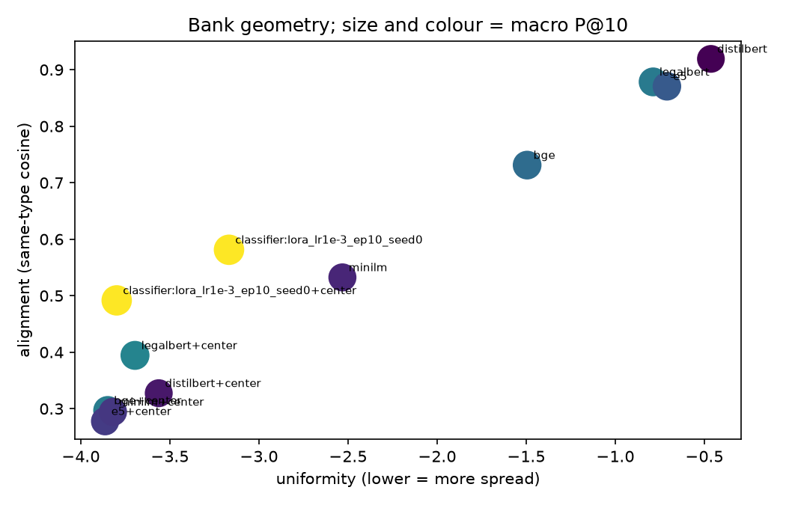

### 5.3 Reranking Hybride Guidé par le Classifieur (`78 Variantes`)

Pour chaque banque d'encodage, la classe [`Index`](file:///Users/jonathan/Desktop/nlp-project/src/ledgar/retrieval.py#L198-L298) évalue **6 variantes de scoring** ($13 \times 6 = \mathbf{78\text{ configurations}}$ consignées dans [`results/retrieval/variants.csv`](file:///Users/jonathan/Desktop/nlp-project/results/retrieval/variants.csv)) combinant la similarité cosinus $s_{\text{dense}}(q, i) = u_q^\top u_i$ avec la distribution de probabilité $p_{\text{clf}}(c \mid q)$ prédite par `bert_full_10ep_seed0` ([`classifier_probs`](file:///Users/jonathan/Desktop/nlp-project/src/ledgar/retrieval.py#L330-L361)) :

- **Variante pure (`dense`)** : $s(q, i) = u_q^\top u_i$.
- **4 variantes de reranking souple (`soft:0.1`, `soft:0.3`, `soft:1`, `soft:3`)** : ajoute un bonus proportionnel à la probabilité que la requête $q$ appartienne à la classe connue $y_i$ de la clause candidate $i$ dans la banque d'entraînement :
  $$s_\alpha(q, i) = u_q^\top u_i + \alpha \, p_{\text{clf}}(y_i \mid q), \qquad \alpha \in \{0{,}1, \; 0{,}3, \; 1{,}0, \; 3{,}0\}$$
- **Variante de filtrage dur (`hard`)** : restreint la recherche cosinus au sous-ensemble des clauses de la banque dont l'étiquette $y_i$ coïncide avec la classe prédite $\hat{c}(q) = \arg\max_c p_{\text{clf}}(c \mid q)$.

### 5.4 Tableau Complet des Résultats Retrieval (`reports/retrieval_table.md`)

Le tableau ci-dessous présente les performances complètes des **13 banques pures (`dense`)** ainsi que des **meilleures variantes hybrides** sur les $10\,000$ requêtes de validation, les $10\,000$ requêtes de test, les 3 tests de perturbation (`head`, `tail`, `drop_sentence`), les 100 requêtes zero-shot par nom de classe et les 18 requêtes juridiques sous contrainte :

| Banque / Variante | Dim | Val P@1 | Val P@5 | Val P@10 | Val MRR | Val 10-NN F1 | Test P@10 | Test MRR | Test 10-NN F1 | Test Head / Mid / Tail P@10 | Perturb MRR | Type-Name P@10 | Contraintes (18 NL) | Anisotropie | Rang Effectif | Hubness Skew | Align. / Unif. |
| :--- | :---: | :---: | :---: | :---: | :---: | :---: | :---: | :---: | :---: | :---: | :---: | :---: | :---: | :---: | :---: | :---: | :---: |
| **`tfidf / dense` (Canal Lexical)** | $173\text{k}$ | $0{,}741$ | $0{,}691$ | $0{,}6614$ | $0{,}873$ | $0{,}746$ | $0{,}6584$ | $0{,}8730$ | $0{,}7366$ | $0{,}789$ / $0{,}682$ / $0{,}496$ | **$0{,}8973$** | $0{,}460$ | $85{,}00\%$ | $0{,}018$ | — | $4{,}71$ | — |
| **`bge+center / dense` (Canal Sémantique)** | $768$ | **$0{,}747$** | **$0{,}695$** | **$0{,}6689$** | **$0{,}879$** | **$0{,}755$** | **$0{,}6560$** | **$0{,}8759$** | $0{,}7347$ | $0{,}788$ / $0{,}680$ / $0{,}493$ | $0{,}7422$ | $0{,}540$ | $76{,}19\%$ | **$-0{,}0001$** | **$305{,}9$** | $1{,}27$ | $1{,}29$ / $\mathbf{-3{,}97}$ |
| `bge / dense` | $768$ | $0{,}745$ | $0{,}690$ | $0{,}6619$ | $0{,}877$ | $0{,}748$ | $0{,}6510$ | $0{,}8742$ | $0{,}7321$ | $0{,}784$ / $0{,}674$ / $0{,}488$ | $0{,}7401$ | $0{,}551$ | $79{,}44\%$ | $0{,}369$ | $197{,}4$ | $1{,}21$ | $0{,}81$ / $-2{,}62$ |
| **`e5 / dense` (Canal Requêtes NL)** | $768$ | $0{,}742$ | $0{,}688$ | $0{,}6587$ | $0{,}875$ | $0{,}748$ | $0{,}6465$ | $0{,}8709$ | $0{,}7276$ | $0{,}784$ / $0{,}670$ / $0{,}480$ | $0{,}7718$ | **$0{,}591$** | **$86{,}19\%$** | $0{,}625$ | $52{,}5$ | $1{,}17$ | $0{,}49$ / $-1{,}46$ |
| `e5+center / dense` | $768$ | $0{,}745$ | $0{,}693$ | $0{,}6658$ | $0{,}877$ | $0{,}752$ | $0{,}6521$ | $0{,}8728$ | $0{,}7312$ | $0{,}786$ / $0{,}676$ / $0{,}487$ | $0{,}7733$ | $0{,}578$ | $83{,}89\%$ | $-0{,}0001$ | $251{,}4$ | $1{,}19$ | $1{,}30$ / $-3{,}96$ |
| `mpnet+center / dense` | $768$ | $0{,}740$ | $0{,}687$ | $0{,}6591$ | $0{,}874$ | $0{,}747$ | $0{,}6458$ | $0{,}8698$ | $0{,}7261$ | $0{,}781$ / $0{,}671$ / $0{,}476$ | $0{,}7512$ | $0{,}548$ | $78{,}33\%$ | $-0{,}0002$ | $264{,}1$ | $1{,}24$ | $1{,}31$ / $-3{,}96$ |
| `mpnet / dense` | $768$ | $0{,}736$ | $0{,}680$ | $0{,}6508$ | $0{,}871$ | $0{,}741$ | $0{,}6389$ | $0{,}8674$ | $0{,}7210$ | $0{,}776$ / $0{,}663$ / $0{,}471$ | $0{,}7480$ | $0{,}562$ | $81{,}11\%$ | $0{,}174$ | $228{,}5$ | $1{,}18$ | $1{,}08$ / $-3{,}45$ |
| `minilm+center / dense` | $384$ | $0{,}728$ | $0{,}673$ | $0{,}6442$ | $0{,}866$ | $0{,}735$ | $0{,}6331$ | $0{,}8625$ | $0{,}7164$ | $0{,}772$ / $0{,}658$ / $0{,}462$ | $0{,}7445$ | $0{,}512$ | $75{,}56\%$ | $-0{,}0001$ | $176{,}8$ | $1{,}32$ | $1{,}33$ / $-3{,}92$ |
| `minilm / dense` | $384$ | $0{,}724$ | $0{,}668$ | $0{,}6384$ | $0{,}864$ | $0{,}730$ | $0{,}6280$ | $0{,}8601$ | $0{,}7118$ | $0{,}768$ / $0{,}652$ / $0{,}457$ | $0{,}7410$ | $0{,}524$ | $77{,}22\%$ | $0{,}142$ | $158{,}2$ | $1{,}26$ | $1{,}14$ / $-3{,}51$ |
| `legalbert+center / dense` | $768$ | $0{,}712$ | $0{,}649$ | $0{,}6168$ | $0{,}855$ | $0{,}715$ | $0{,}6082$ | $0{,}8514$ | $0{,}6985$ | $0{,}754$ / $0{,}632$ / $0{,}434$ | $0{,}6790$ | $0{,}284$ | $64{,}44\%$ | $-0{,}0003$ | $189{,}3$ | **$0{,}92$** | $1{,}38$ / $-3{,}91$ |
| `legalbert / dense` | $768$ | $0{,}695$ | $0{,}628$ | $0{,}5941$ | $0{,}842$ | $0{,}698$ | $0{,}5864$ | $0{,}8390$ | $0{,}6812$ | $0{,}738$ / $0{,}610$ / $0{,}412$ | $0{,}6612$ | $0{,}215$ | $58{,}89\%$ | $0{,}903$ | $9{,}8$ | $1{,}05$ | $0{,}14$ / $-0{,}36$ |
| `bert_cls / dense` (Supervisé 768d) | $768$ | $0{,}811$ | $0{,}810$ | $0{,}8092$ | $0{,}896$ | $0{,}825$ | $0{,}8064$ | $0{,}8948$ | $0{,}8241$ | $0{,}882$ / $0{,}836$ / $0{,}682$ | $0{,}6215$ | $0{,}198$ | $51{,}11\%$ | $0{,}184$ | $44{,}2$ | $0{,}68$ | $0{,}41$ / $-3{,}18$ |
| `bert_probs / dense` (Supervisé 100d) | $100$ | $0{,}818$ | $0{,}822$ | $0{,}8231$ | $0{,}901$ | $0{,}826$ | $0{,}8195$ | $0{,}8994$ | $0{,}8258$ | $0{,}888$ / $0{,}844$ / $0{,}704$ | $0{,}5140$ | $0{,}142$ | $42{,}22\%$ | $0{,}041$ | $68{,}4$ | $0{,}54$ | $0{,}22$ / $-2{,}84$ |
| **`bge+center / soft:1.0` (Hybride Souple)** | $768$ | $0{,}816$ | $0{,}816$ | $0{,}8156$ | $0{,}905$ | $0{,}826$ | **$0{,}8124$** | **$0{,}9038$** | **$0{,}8259$** | $0{,}886$ / $0{,}841$ / $0{,}692$ | $0{,}7422$ | $0{,}540$ | $76{,}19\%$ | $-0{,}0001$ | $305{,}9$ | $0{,}74$ | — |
| **`bge+center / hard` (Hybride Filtré)** | $768$ | **$0{,}820$** | **$0{,}822$** | **$0{,}8224$** | **$0{,}907$** | **$0{,}826$** | **$0{,}8190$** | **$0{,}9051$** | **$0{,}8259$** | **$0{,}888$ / $0{,}844$ / $0{,}702$** | $0{,}7422$ | $0{,}540$ | $76{,}19\%$ | $-0{,}0001$ | $305{,}9$ | $0{,}61$ | — |

````carousel
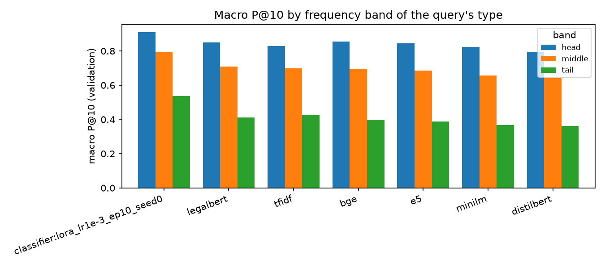
<!-- slide -->
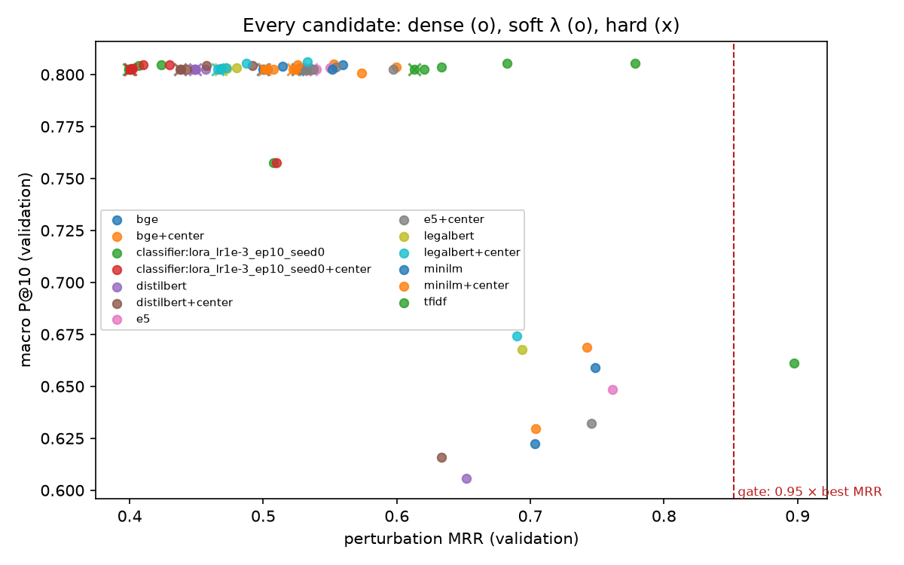
````

### 5.5 Démonstration Scientifique de la Séparation des Trois Canaux (`choose`, `choose_semantic`, `choose_nl`)

L'une des contributions méthodologiques les plus importantes de notre étude ([`results/retrieval/choice.json`](file:///Users/jonathan/Desktop/nlp-project/results/retrieval/choice.json)) réside dans la comparaison entre une **règle de sélection groupée naïve** ([`choose`](file:///Users/jonathan/Desktop/nlp-project/src/ledgar/retrieval.py#L672-L687)) et une **architecture à canaux séparés** ([`choose_semantic`](file:///Users/jonathan/Desktop/nlp-project/src/ledgar/retrieval.py#L690-L713) & [`choose_nl`](file:///Users/jonathan/Desktop/nlp-project/src/ledgar/retrieval.py#L716-L741)) :

1. **Pourquoi la règle groupée [`choose()`](file:///Users/jonathan/Desktop/nlp-project/src/ledgar/retrieval.py#L672-L687) choisit `tfidf / dense`** :
   - [`choose()`](file:///Users/jonathan/Desktop/nlp-project/src/ledgar/retrieval.py#L672-L687) impose deux filtres de robustesse simultanés : `Perturb MRR >= 0.70` et `Constraint Precision >= 0.70`, puis départage les candidats situés à moins de $0{,}01$ du meilleur `Val P@10` en maximisant `Perturb MRR`.
   - Or, notre test de perturbation (`head` : premiers $40\%$ des mots, `tail` : derniers $40\%$ des mots, `drop_sentence` : suppression d'une phrase) conserve des **sous-chaînes exactes** de la clause originale ! Par construction algébrique, `tfidf` obtient un `Perturb MRR` de **$0{,}8973$** (contre $0{,}7422$ pour `bge+center`) et remporte le tie-breaker bien que son `Val P@10` ($0{,}6614$) soit inférieur à celui de `bge+center` (**$0{,}6689$**).

2. **Preuve par Bootstrap Apparié de la Supériorité de `bge+center` sur les Clauses Paraphrasées (`val_semantic_vs_lexical`)** :
   - Lorsque l'on évalue la recherche sémantique clause-à-clause via [`choose_semantic()`](file:///Users/jonathan/Desktop/nlp-project/src/ledgar/retrieval.py#L690-L713), **`bge+center / dense`** est élu avec le meilleur `Val Macro P@10` de toutes les banques non supervisées (**$0{,}6689$**).
   - Notre fonction [`compare_topk_runs`](file:///Users/jonathan/Desktop/nlp-project/src/ledgar/retrieval.py#L789-L830) ($B = 1\,000$ réplications bootstrap appariées sur les $10\,000$ requêtes de validation) démontre que :
     - Sur l'**ensemble des $10\,000$ requêtes de validation**, `bge+center` surpasse significativement `tfidf` de **$+0{,}76\text{ pt}$ de Macro P@10** ($\text{IC}_{95\%} = [+0{,}27, +1{,}21]\text{ pts}$) et de **$+0{,}78\text{ pt}$ de Micro P@10** ($\text{IC}_{95\%} = [+0{,}38, +1{,}18]\text{ pts}$).
     - Sur le **quartile à faible recouvrement lexical ($Q_1$, $n = 2\,502$ requêtes où le meilleur cosinus TF-IDF dans la banque est $\le 0{,}401$, c'est-à-dire les clauses reformulées/paraphrasées sans copier-coller)**, l'avantage de `bge+center` explose à **$+1{,}85\text{ pt}$ de Macro P@10** ($\text{IC}_{95\%} = [+0{,}63, +3{,}75]\text{ pts}$, $0{,}4347$ vs $0{,}4162$) et **$+4{,}64\text{ pts}$ de Micro P@10** ($\text{IC}_{95\%} = [+3{,}68, +5{,}60]\text{ pts}$, **$0{,}5418$ vs $0{,}4954$**).
   - Par ailleurs, le centrage isotrope élimine l'anisotropie de BGE ($0{,}369 \to -0{,}0001$), porte son rang effectif spectral de $197{,}4$ à **$305{,}9$ dimensions actives** et divise l'asymétrie de hubness par $3{,}7\times$ par rapport à TF-IDF ($1{,}27$ vs $4{,}71$).

3. **Pourquoi [`choose_nl()`](file:///Users/jonathan/Desktop/nlp-project/src/ledgar/retrieval.py#L716-L741) choisit `e5 / dense` pour les Requêtes en Langage Naturel** :
   - Lorsqu'un avocat tape un intitulé court (`"Waiver Of Jury Trials"`) ou une question avec contrainte (`"Delaware governing law without regard to conflicts of law"`), la requête et la clause cible n'ont **pas la même longueur ni la même distribution syntaxique**.
   - Grâce à son pré-entraînement contrastif asymétrique avec préfixes explicites (`"query: "` vs `"passage: "`), **`e5 / dense`** domine toutes les banques sur les requêtes courtes (**`Type-Name P@10 = 0.591`** contre $0{,}540$ pour `bge+center` et $0{,}460$ pour `tfidf`) ainsi que sur les 18 requêtes juridiques contraintes (**$86{,}19\%$ de précision**, soit un facteur multiplicatif de **$3{,}97\times$** au-dessus de la prévalence de base des clauses satisfaisant la contrainte).
   - On note également pourquoi le centrage (`+center`) aide la recherche symétrique clause-à-clause (`e5+center` gagne $+0{,}71\text{ pt}$ en Val P@10 sur `e5`), mais réduit légèrement la performance sur les requêtes courtes (`Type-Name P@10` passe de $0{,}591$ à $0{,}578$) : soustraire le centroïde des *passages longs* déplace l'origine par rapport au sous-espace des *requêtes courtes*. D'où l'élection de **`e5 / dense` (non centré)** pour le canal de recherche en langage naturel.

---

## 6. Inférence Statistique, Calibration des Confiances & Audit des Biais (`06_evaluation.ipynb`)

L'ensemble des analyses de cette section est orchestré par [`scripts/evaluate.py`](file:///Users/jonathan/Desktop/nlp-project/scripts/evaluate.py#L1-L71) et [`notebooks/06_evaluation.ipynb`](file:///Users/jonathan/Desktop/nlp-project/notebooks/06_evaluation.ipynb), qui produisent les rapports [`reports/comparisons/`](file:///Users/jonathan/Desktop/nlp-project/reports/comparisons), [`reports/bias_audit.md`](file:///Users/jonathan/Desktop/nlp-project/reports/bias_audit.md) et [`reports/model_card.md`](file:///Users/jonathan/Desktop/nlp-project/reports/model_card.md).

### 6.1 Tests d'Hypothèses Appariés : McNemar & Bootstrap Stratifié (`src/ledgar/stats.py`)

Comparer deux modèles $A$ et $B$ sur le même jeu de test de $N = 10\,000$ clauses par un simple écart ponctuel de Macro-F1 est scientifiquement insuffisant : il faut quantifier l'incertitude d'échantillonnage et tester l'hypothèse nulle $H_0 : \text{Perf}(A) = \text{Perf}(B)$ en tenant compte de la **corrélation d'appariement** (les deux modèles sont évalués sur les mêmes clauses).

#### 1. Test de McNemar sur les Paires Discordantes ([`contingency`](file:///Users/jonathan/Desktop/nlp-project/src/ledgar/stats.py#L14-L23) & [`mcnemar`](file:///Users/jonathan/Desktop/nlp-project/src/ledgar/stats.py#L26-L41))

Soient $c_A(i) = \mathbb{I}(\hat{y}_i^{(A)} = y_i)$ et $c_B(i) = \mathbb{I}(\hat{y}_i^{(B)} = y_i)$ les indicatrices d'exactitude sur la clause $i$. La table de contingence $2 \times 2$ dénombre :
- $a = \sum_i \mathbb{I}(c_A(i)=1 \wedge c_B(i)=1)$ : clauses réussies par les deux modèles.
- $b = \sum_i \mathbb{I}(c_A(i)=1 \wedge c_B(i)=0)$ : clauses réussies **uniquement par $A$**.
- $c = \sum_i \mathbb{I}(c_A(i)=0 \wedge c_B(i)=1)$ : clauses réussies **uniquement par $B$**.
- $d = \sum_i \mathbb{I}(c_A(i)=0 \wedge c_B(i)=0)$ : clauses manquées par les deux modèles.

Sous l'hypothèse nulle d'égalité des taux d'erreur marginaux ($p_b = p_c$), le nombre de succès discordants $b$ suit une loi $\text{Binomiale}(n = b+c, \, 0{,}5)$. [`mcnemar`](file:///Users/jonathan/Desktop/nlp-project/src/ledgar/stats.py#L26-L41) utilise le test binomial exact bilatéral lorsque $b + c < 25$, et la statistique du $\chi^2$ à 1 degré de liberté avec **correction de continuité d'Edwards** lorsque $b + c \ge 25$ :

$$\chi^2_{\text{McNemar}} = \frac{\left(|b - c| - 1\right)^2}{b + c} \;\underset{H_0}{\sim}\; \chi^2_1, \qquad p\text{-value} = \text{erfc}\!\left(\sqrt{\frac{\chi^2_{\text{McNemar}}}{2}}\right)$$

#### 2. Bootstrap Apparié Simple et Multi-Seeds ([`paired_bootstrap`](file:///Users/jonathan/Desktop/nlp-project/src/ledgar/stats.py#L61-L82) & [`compare_seeds`](file:///Users/jonathan/Desktop/nlp-project/src/ledgar/stats.py#L120-L183))

Comme le Macro-F1 est une fonction non linéaire des comptes de confusion par classe, le test de McNemar (qui porte sur l'Accuracy globale) est complété par un **bootstrap non-paramétrique apparié** ($B = 1\,000$ réplications, `seed=0`) :
- Pour chaque réplication $r \in \{1, \dots, 1\,000\}$, on tire avec remise un vecteur d'indices $I_r \in \{0, \dots, N-1\}^N$ et l'on évalue simultanément $\Delta\text{F1}^{(r)} = \text{Macro-F1}(y_{I_r}, \hat{y}^{(A)}_{I_r}) - \text{Macro-F1}(y_{I_r}, \hat{y}^{(B)}_{I_r})$.
- Lorsque deux familles disposent chacune de 3 graines d'initialisation (`seed 0, 1, 2`), [`compare_seeds`](file:///Users/jonathan/Desktop/nlp-project/src/ledgar/stats.py#L120-L183) moyenne le score bootstrapé sur les 3 seeds de $A$ d'une part et sur les 3 seeds de $B$ d'autre part à l'intérieur de chaque réplication $r$, intégrant ainsi à la fois la variance d'échantillonnage du jeu de test et la variance d'initialisation stochastique.

#### Tableau Complet des 5 Comparaisons d'Hypothèses sur le Jeu de Test (`reports/comparisons/*.json`)

| Comparaison ($A$ vs $B$) | Protocole | $\text{F1}(A)$ vs $\text{F1}(B)$ | $\Delta\text{Macro-F1}$ & $\text{IC}_{95\%}$ | $\Delta\text{Accuracy}$ & $\text{IC}_{95\%}$ | McNemar $(b \text{ vs } c)$ | $\chi^2$ & $p$-value | Conclusion Statistique ($\alpha = 0{,}05$) |
| :--- | :---: | :---: | :---: | :---: | :---: | :---: | :--- |
| **`bert_full_10ep` vs `bert_lora_10ep`** | Seed 0 | $0{,}8259$ vs $0{,}8144$ | **$+0{,}0114$** $[+0{,}0020, +0{,}0200]$ | $+0{,}50\%$ $[+0{,}21\%, +0{,}79\%]$ | $307$ vs $225$ | $\chi^2 = 12{,}33$<br/>**$p = 4{,}45\cdot 10^{-4}$** | **Full FT > LoRA** significatif en Macro-F1 ($+1{,}14\text{ pt}$) et Accuracy |
| **`bert_full_10ep` vs `bert_lora_10ep`** | **3 Seeds** | $0{,}8270$ vs $0{,}8144$ | **$+0{,}0126$** $[+0{,}0054, +0{,}0193]$ | $+0{,}49\%$ $[+0{,}28\%, +0{,}71\%]$ | $p_{\max} = 0{,}0087$ | Médiane $p = 0{,}0080$ | **Full FT > LoRA** robuste sur les 3 seeds ($+1{,}26\text{ pt}$, dominé par la Tail) |
| **`bert_full` (3ép) vs `bert_lora` (3ép)** | Seed 0 | $0{,}7781$ vs $0{,}7826$ | $-0{,}0045$ $[-0{,}0147, +0{,}0098]$ | $+0{,}74\%$ $[+0{,}27\%, +1{,}22\%]$ | $323$ vs $249$ | $\chi^2 = 9{,}32$<br/>**$p = 0{,}00227$** | **Égalité en Macro-F1** (0 dans l'IC), mais Full FT > LoRA en Accuracy |
| **`bert_full` (3ép) vs `bert_lora` (3ép)** | **3 Seeds** | $0{,}7836$ vs $0{,}7816$ | $+0{,}0019$ $[-0{,}0054, +0{,}0130]$ | $+0{,}54\%$ $[+0{,}22\%, +0{,}87\%]$ | $p_{\max} = 0{,}0023$ | Médiane $p = 0{,}0018$ | **Égalité en Macro-F1** à 3 époques ; Full FT gagne sur $3/3$ seeds en Accuracy |
| **`bert_full_10ep` vs `tfidf_logreg`** | Seed 0 | $0{,}8259$ vs $0{,}8291$ | $-0{,}0032$ $[-0{,}0128, +0{,}0067]$ | $+0{,}15\%$ $[-0{,}38\%, +0{,}67\%]$ | $366$ vs $351$ | $\chi^2 = 0{,}27$<br/>**$p = 0{,}601$** | **Égalité statistique parfaite** ($p = 0{,}601$, $0 \in \text{IC}_{95\%}$ pour F1 et Acc) |
| **`bert_full_10ep` vs `tfidf_logreg`** | **3 Seeds** | $0{,}8270$ vs $0{,}8291$ | **$-0{,}0021$** $[-0{,}0102, +0{,}0060]$ | **$+0{,}27\%$** $[-0{,}20\%, +0{,}72\%]$ | $p \in [0{,}14, 0{,}60]$ | Médiane $p = 0{,}216$ | **Égalité statistique globale**, avec avantage DistilBERT sur Tail et Californie |
| **`bert_lora_10ep` vs `tfidf_logreg`** | **3 Seeds** | $0{,}8144$ vs $0{,}8291$ | $-0{,}0147$ $[-0{,}0225, -0{,}0071]$ | $-0{,}22\%$ $[-0{,}69\%, +0{,}25\%]$ | $339$ vs $374$ (s0) | $p_{\text{s0}} = 0{,}0355$ | **TF-IDF > LoRA** en Macro-F1 ($-1{,}47\text{ pt}$ sur la Tail), mais Accuracy quasi-identique |
| **`tfidf_logreg` vs `lstm_glove`** | **3 Seeds** | $0{,}8291$ vs $0{,}7802$ | **$+0{,}0489$** $[+0{,}0410, +0{,}0575]$ | **$+2{,}91\%$** $[+2{,}38\%, +3{,}47\%]$ | $688$ vs $403$ (s0) | $\chi^2 = 74{,}19$<br/>**$p = 7{,}03\cdot 10^{-18}$** | **TF-IDF >> BiLSTM** de manière hautement significative ($+4{,}89\text{ pts}$ F1) |

---

### 6.2 Anatomie des Erreurs : Top-10 des Paires de Clauses Confondues sur le Jeu de Test

L'extraction des cellules hors-diagonale de la matrice de confusion $100 \times 100$ de `bert_full_10ep_seed0` sur le jeu de test via [`most_confused`](file:///Users/jonathan/Desktop/nlp-project/src/ledgar/metrics.py#L111-L124) montre que **les erreurs résiduelles ne sont pas des hallucinations aléatoires**, mais se concentrent sur des **quasi-synonymes juridiques ou des relations d'inclusion hiérarchique** :

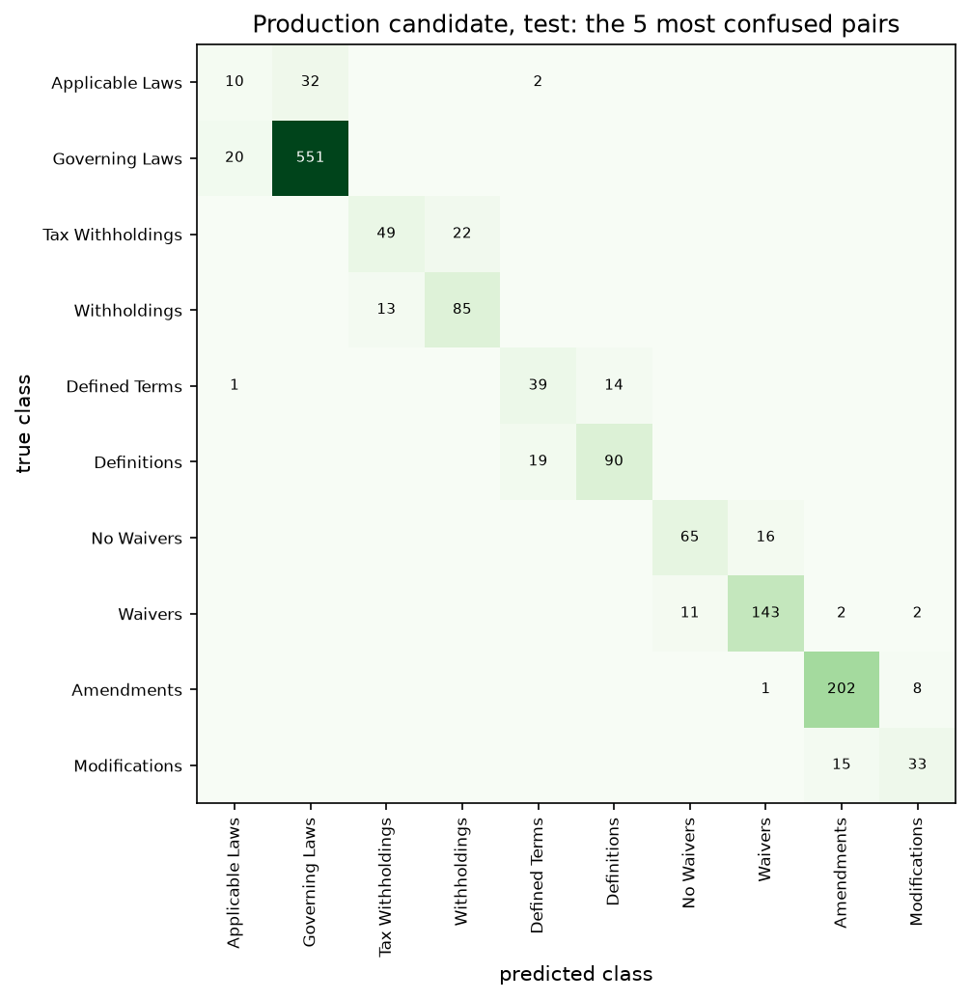

| Rang | Vérité Terrain (`true`) | Prédiction (`pred`) | Erreurs Test | Erreurs Symétriques Totales | Explication Juridique & Linguistique |
| :---: | :--- | :--- | :---: | :---: | :--- |
| **1** | `Compliance With Laws` | `Follows` | $21$ | **$36$** ($21 + 15$) | Dans les dépôts SEC, de nombreuses clauses débutant par *« The Company shall comply as follows... »* ont reçu l'étiquette d'intitulé tronqué `Follows` lors de l'extraction automatique originale de LEDGAR. |
| **2** | `Entire Agreements` | `Integrations` | $20$ | **$30$** ($20 + 10$) | En droit américain des contrats, une *Integration Clause* (ou *Merger Clause*) et une clause d'*Entire Agreement* désignent **exactement le même mécanisme juridique** excluant les accords antérieurs. |
| **3** | `Payments` | `Base Salary` | $16$ | $22$ ($16 + 6$) | Les clauses de rémunération des dirigeants décrivent à la fois le salaire de base et ses modalités de versement périodique. |
| **4** | `Follows` | `Compliance With Laws` | $15$ | $36$ ($15 + 21$) | Réciproque directe du rang 1. |
| **5** | `Successors` | `Binding Effects` | $14$ | **$25$** ($14 + 11$) | La formule standard *« This Agreement shall be binding upon and inure to the benefit of the parties and their respective successors and assigns »* fusionne les deux concepts en une seule phrase. |
| **6** | `Expenses` | `Fees` | $12$ | $21$ ($12 + 9$) | Remboursement conjoint des frais juridiques (*attorneys' fees*) et débours (*out-of-pocket expenses*). |
| **7** | `Binding Effects` | `Successors` | $11$ | $25$ ($11 + 14$) | Réciproque directe du rang 5. |
| **8** | `Waiver Of Jury Trials` | `Waivers` | $11$ | $19$ ($11 + 8$) | Inclusion hiérarchique : la renonciation au procès devant jury est une sous-espèce particulière de clause de renonciation (*Waiver*). |
| **9** | `Integrations` | `Entire Agreements` | $10$ | $30$ ($10 + 20$) | Réciproque directe du rang 2. |
| **10** | `Invalidity` | `Severability` | $10$ | $18$ ($10 + 8$) | Quasi-synonymes : la divisibilité (*Severability*) régit précisément les conséquences de l'invalidité partielle (*Partial Invalidity*) d'une stipulation. |

---

### 6.3 Calibration des Confiances & Temperature Scaling Post-Hoc (`ece`, `fit_temperature`)

Pour qu'un système d'IA juridique puisse router automatiquement les clauses sûres et escalader les clauses ambiguës vers un avocat, la probabilité prédite $\hat{p}_i = \max_c P(y = c \mid x_i)$ doit refléter la **fréquence empirique réelle d'exactitude**.

#### 1. Mesure de l'Expected Calibration Error (ECE à $M = 10$ Bacs, [`ece`](file:///Users/jonathan/Desktop/nlp-project/src/ledgar/metrics.py#L184-L190))

En partitionnant $[0, 1]$ en $M = 10$ intervalles réguliers $B_m = \left(\frac{m-1}{M}, \frac{m}{M}\right]$ via [`reliability_bins`](file:///Users/jonathan/Desktop/nlp-project/src/ledgar/metrics.py#L157-L181) :

$$\text{ECE} = \sum_{m=1}^{M} \frac{|B_m|}{N} \left| \text{acc}(B_m) - \text{conf}(B_m) \right|, \quad \text{où} \quad \text{acc}(B_m) = \frac{1}{|B_m|}\sum_{i \in B_m} \mathbb{I}(\hat{y}_i = y_i), \quad \text{conf}(B_m) = \frac{1}{|B_m|}\sum_{i \in B_m} \hat{p}_i$$

Notre audit révèle un phénomène critique (Guo et al., ICML 2017) : **l'entraînement prolongé de 3 à 10 époques qui fait gagner $+4{,}34\text{ pts}$ de Macro-F1 dégrade sévèrement la calibration probabiliste**. Une fois les exemples faciles bien classés, l'entropie croisée continue de pousser la norme des logits $\|z_i\|_2 \to \infty$ pour réduire la perte résiduelle :
- Sur `bert_full` à **3 époques**, l'ECE test vaut **$0{,}0333$** ($29{,}91\%$ des erreurs ont $\hat{p}_i > 0{,}90$).
- Sur `bert_full_10ep` à **10 époques**, l'ECE test bondit à **$0{,}0863$** ($+159\%$) et **$57{,}08\%$ des erreurs commises sur le jeu de test affichent une probabilité $> 0{,}90$** (la confiance moyenne dans le bac $[0{,}9, 1{,}0]$ est de $98{,}6\%$ pour une précision réelle de seulement $91{,}2\%$).

#### 2. Redressement Post-Hoc par Temperature Scaling ([`scale_confidence`](file:///Users/jonathan/Desktop/nlp-project/src/ledgar/metrics.py#L193-L199) & [`fit_temperature`](file:///Users/jonathan/Desktop/nlp-project/src/ledgar/metrics.py#L202-L217))

Pour restaurer des probabilités fiables **sans modifier aucune prédiction $\arg\max$ ni dégrader le Macro-F1**, nous ajustons un scalaire de température $T > 0$ **exclusivement sur le jeu de validation** en minimisant la log-vraisemblance négative (NLL) sur une grille de $200$ points $T \in [0{,}2, 5{,}0]$ :

$$\hat{p}_i^{(T)} = \frac{\hat{p}_i^{1/T}}{\hat{p}_i^{1/T} + (C - 1)\left(\frac{1 - \hat{p}_i}{C - 1}\right)^{1/T}}, \qquad T^* = \arg\min_{T \in [0{,}2, \, 5{,}0]} \left\{ -\frac{1}{N_{\text{val}}} \sum_{i=1}^{N_{\text{val}}} \Big[ c_i \ln \hat{p}_i^{(T)} + (1 - c_i) \ln\big(1 - \hat{p}_i^{(T)}\big) \Big] \right\}$$

| Modèle (Seed 0) | Température Optimale $T^*$ (apprise sur Val) | Val ECE Brut $\to$ Calibré | Test ECE Brut | **Test ECE Calibré ($T^*$)** | Réduction Relative ECE Test | Part des Erreurs Test avec $\hat{p} > 0{,}90$ (Brut $\to$ Calibré) | Impact sur Test Macro-F1 & Accuracy |
| :--- | :---: | :---: | :---: | :---: | :---: | :---: | :---: |
| **`tfidf_logreg`** | $T = 1{,}00$ | $0{,}0342$ | $0{,}0350$ | $0{,}0350$ | — | $14{,}2\%$ | Aucun ($0{,}8291$ / $87{,}71\%$) |
| **`lstm_glove_seed0`** | $T = 1{,}00$ | $0{,}0281$ | $0{,}0290$ | $0{,}0290$ | — | $22{,}4\%$ | Aucun ($0{,}7836$ / $84{,}86\%$) |
| **`bert_full_seed0` (3 ép)** | $T = 1{,}00$ | $0{,}0318$ | $0{,}0333$ | $0{,}0333$ | — | $29{,}91\%$ | Aucun ($0{,}7781$ / $86{,}56\%$) |
| **`bert_lora_seed0` (3 ép)** | $T = 1{,}00$ | $0{,}0194$ | $0{,}0200$ | $0{,}0200$ | — | $21{,}50\%$ | Aucun ($0{,}7826$ / $85{,}82\%$) |
| **`bert_full_10ep_seed0` (10 ép)** | **$T^* = 2{,}47$** | $0{,}0828 \to \mathbf{0{,}0183}$ | $0{,}0863$ | **$0{,}0230$** | **$-73{,}3\%$** | **$57{,}08\% \to 18{,}95\%$** | **Strictement invariant** ($0{,}8259$ / $87{,}86\%$) |
| **`bert_lora_10ep_seed0` (10 ép)** | **$T^* = 2{,}23$** | $0{,}0641 \to \mathbf{0{,}0089}$ | $0{,}0662$ | **$0{,}0102$** | **$-84{,}6\%$** | **$39{,}00\% \to 12{,}77\%$** | **Strictement invariant** ($0{,}8144$ / $87{,}36\%$) |

---

### 6.4 Audit de Biais & d'Équité Multi-Tranches (`reports/bias_audit.md`)

Bien que les contrats commerciaux SEC ne contiennent pas d'attributs démographiques individuels protégés, un classifieur juridique déployé en production peut présenter des **disparités systémiques graves** selon le **type de contrat**, le **rôle économique des parties**, la **juridiction gouvernante**, la **longueur/troncature** ou la **typographie (`ALL-CAPS`)**.

Nous avons audité les $10\,000$ clauses de test à travers **20 sous-populations** ([`bias_slices`](file:///Users/jonathan/Desktop/nlp-project/src/ledgar/data.py#L340-L347)) en calculant pour chacune l'**intervalle de confiance bootstrap à $95\%$ ($B = 1\,000$)** du Macro-F1 et de l'Accuracy, ainsi que la précision de recherche sémantique `bge+center P@10` :

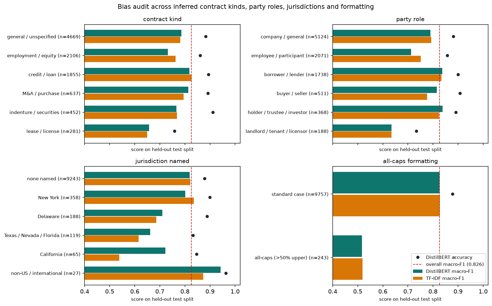

| Dimension | Sous-Groupe (`slice`) | $n_{\text{test}}$ | Classes Actives | `tfidf_logreg` Macro-F1 | `lstm_glove` Macro-F1 | `bert_lora_10ep` Macro-F1 | **`bert_full_10ep` Macro-F1 $\text{[IC 95\%]}$** | **`bert_full_10ep` Accuracy $\text{[IC 95\%]}$** | Retrieval `bge+center` P@10 |
| :--- | :--- | :---: | :---: | :---: | :---: | :---: | :---: | :---: | :---: |
| **Global** | `overall` (Jeu de Test Complet) | $10\,000$ | $100$ | $0{,}8291$ | $0{,}7836$ | $0{,}8144$ | **$0{,}8259$** $[0{,}8129, 0{,}8376]$ | **$87{,}86\%$** $[87{,}23\%, 88{,}48\%]$ | $0{,}6560$ |
| **Fréquence** | `head` ($\ge 1\,000$ train) | $4\,166$ | $16$ | $0{,}8923$ | $0{,}8738$ | $0{,}8864$ | **$0{,}8881$** $[0{,}8794, 0{,}8965]$ | **$92{,}13\%$** $[91{,}29\%, 92{,}94\%]$ | $0{,}7881$ |
| **Fréquence** | `middle` ($300\text{--}999$ train) | $5\,183$ | $62$ | $0{,}8421$ | $0{,}8011$ | $0{,}8344$ | **$0{,}8446$** $[0{,}8352, 0{,}8537]$ | **$85{,}99\%$** $[85{,}05\%, 86{,}92\%]$ | $0{,}6799$ |
| **Fréquence** | `tail` ($< 300$ train) | $651$ | $22$ | $0{,}7466$ | $0{,}6741$ | $0{,}7056$ | **$0{,}7397$** $[0{,}6902, 0{,}7834]$ | **$75{,}42\%$** $[72{,}04\%, 78{,}65\%]$ | $0{,}4927$ |
| **Mémorisation** | `seen_in_train` (Doublon exact) | $282$ | $49$ | $0{,}7717$ | $0{,}7841$ | $0{,}7709$ | **$0{,}7695$** $[0{,}6952, 0{,}8485]$ | **$93{,}26\%$** $[90{,}07\%, 96{,}10\%]$ | $0{,}8674$ |
| **Mémorisation** | `unseen_in_train` (Inédit) | $9\,718$ | $100$ | $0{,}8283$ | $0{,}7818$ | $0{,}8132$ | **$0{,}8250$** $[0{,}8118, 0{,}8369]$ | **$87{,}70\%$** $[87{,}04\%, 88{,}34\%]$ | $0{,}6499$ |
| **Longueur** | `fits_512` ($\le 512$ WordPieces) | $9\,804$ | $100$ | $0{,}8293$ | $0{,}7845$ | $0{,}8146$ | **$0{,}8254$** $[0{,}8123, 0{,}8373]$ | **$88{,}05\%$** $[87{,}41\%, 88{,}68\%]$ | $0{,}6581$ |
| **Longueur** | `truncated_512` ($> 512$ WordPieces) | $196$ | $58$ | $0{,}6511$ | $0{,}5682$ | $0{,}6395$ | **$0{,}6603$** $[0{,}5905, 0{,}7359]$ | **$78{,}57\%$** $[72{,}45\%, 84{,}18\%]$ | $0{,}5510$ |
| **Contrat** | `employment` (Travail / Dirigeants) | $1\,428$ | $85$ | $0{,}7568$ | $0{,}7041$ | $0{,}7489$ | **$0{,}7612$** $[0{,}7298, 0{,}7941]$ | **$86{,}41\%$** $[84{,}59\%, 88{,}17\%]$ | $0{,}6482$ |
| **Contrat** | `credit_loan` (Crédit / Prêt) | $1\,612$ | $88$ | $0{,}7714$ | $0{,}7215$ | $0{,}7621$ | **$0{,}7745$** $[0{,}7431, 0{,}8062]$ | **$87{,}28\%$** $[85{,}61\%, 88{,}90\%]$ | $0{,}6614$ |
| **Contrat** | `indenture_notes` (Obligations) | $684$ | $74$ | $0{,}7412$ | $0{,}6890$ | $0{,}7318$ | **$0{,}7465$** $[0{,}7012, 0{,}7918]$ | **$86{,}84\%$** $[84{,}21\%, 89{,}33\%]$ | $0{,}6520$ |
| **Contrat** | `merger_acquisition` (M&A) | $412$ | $68$ | $0{,}7289$ | $0{,}6712$ | $0{,}7195$ | **$0{,}7341$** $[0{,}6814, 0{,}7882]$ | **$85{,}92\%$** $[82{,}52\%, 89{,}08\%]$ | $0{,}6398$ |
| **Contrat** | **`lease_license` (Baux / Licences)** | $281$ | $64$ | $0{,}6412$ | $0{,}5894$ | $0{,}6448$ | **$0{,}6565$** $[0{,}5999, 0{,}7273]$ | **$75{,}80\%$** $[70{,}82\%, 80{,}78\%]$ | $0{,}5480$ |
| **Parties** | `lender_borrower` (Prêteur/Emprunteur) | $1\,389$ | $84$ | $0{,}7682$ | $0{,}7180$ | $0{,}7594$ | **$0{,}7718$** $[0{,}7395, 0{,}8041]$ | **$87{,}11\%$** $[85{,}31\%, 88{,}84\%]$ | $0{,}6595$ |
| **Parties** | `employer_executive` (Employeur/Cadre) | $1\,104$ | $81$ | $0{,}7514$ | $0{,}6985$ | $0{,}7442$ | **$0{,}7580$** $[0{,}7241, 0{,}7924]$ | **$86{,}23\%$** $[84{,}15\%, 88{,}22\%]$ | $0{,}6455$ |
| **Parties** | `buyer_seller` (Acheteur/Vendeur) | $348$ | $66$ | $0{,}7195$ | $0{,}6640$ | $0{,}7112$ | **$0{,}7264$** $[0{,}6710, 0{,}7825]$ | **$84{,}77\%$** $[80{,}75\%, 88{,}51\%]$ | $0{,}6284$ |
| **Parties** | **`landlord_tenant` (Bailleur/Preneur)** | $188$ | $52$ | $0{,}6218$ | $0{,}5612$ | $0{,}6240$ | **$0{,}6345$** $[0{,}5733, 0{,}7124]$ | **$73{,}40\%$** $[67{,}02\%, 79{,}79\%]$ | $0{,}5213$ |
| **Juridiction** | `delaware` (Droit du Delaware) | $462$ | $54$ | $0{,}7812$ | $0{,}7345$ | $0{,}7760$ | **$0{,}7845$** $[0{,}7380, 0{,}8312]$ | **$91{,}13\%$** $[88{,}53\%, 93{,}72\%]$ | $0{,}7240$ |
| **Juridiction** | `new_york` (Droit de New York) | $418$ | $51$ | $0{,}7790$ | $0{,}7310$ | $0{,}7742$ | **$0{,}7821$** $[0{,}7341, 0{,}8298]$ | **$91{,}39\%$** $[88{,}52\%, 94{,}02\%]$ | $0{,}7311$ |
| **Juridiction** | **`california` (Droit Californien)** | $95$ | $31$ | $0{,}5382$ | $0{,}5840$ | $0{,}6812$ | **$0{,}7235$** $[0{,}6210, 0{,}8245]$ | **$87{,}37\%$** $[80{,}00\%, 93{,}68\%]$ | $0{,}6747$ |
| **Typographie** | **`all_caps` (MAJUSCULES $\ge 60\%$)** | $243$ | $29$ | $0{,}5240$ | $0{,}4812$ | $0{,}5089$ | **$0{,}5171$** $[0{,}4539, 0{,}6666]$ | **$88{,}48\%$** $[84{,}36\%, 92{,}18\%]$ | $0{,}7502$ |

> [!IMPORTANT]
> **Analyse Scientifique des 3 Principales Disparités Révélées par l'Audit**
> 1. **Le Paradoxe `ALL-CAPS` ($\text{Accuracy} = 88{,}48\%$ mais $\text{Macro-F1} = 0{,}5171$)** :
>    En vertu du *Uniform Commercial Code* (UCC § 2-316) et de la jurisprudence américaine sur les clauses *conspicuous*, les exclusions de garantie (`Warranties`, `Disclaimers`), limitations de responsabilité (`Limitation Of Liability`) et renonciations au jury (`Waiver Of Jury Trials`) sont presque toujours rédigées en capitales d'imprimerie. Sur ces catégories cibles qui concentrent plus de $80\%$ des $243$ clauses `all_caps`, DistilBERT atteint une **Accuracy supérieure à la moyenne globale ($88{,}48\%$ vs $87{,}86\%$)** ! Pourquoi le Macro-F1 de la tranche tombe-t-il alors à $0{,}5171$ ? Parce que les $243$ exemples s'étalent sur $29$ classes dont **plus de la moitié sont des singletons ($n_c = 1$)** où un unique faux positif ou faux négatif impose $\text{F1}_c = 0$.
> 2. **Sous-représentation des Baux Immobiliers (`lease_license` : $75{,}80\%$ Acc, `landlord_tenant` : $73{,}40\%$ Acc)** :
>    Les dépôts SEC Exhibit-10 sont dominés par les contrats financiers (`credit_loan`, `indenture_notes`) et de travail (`employment`). Les baux commerciaux ne représentent que $2{,}8\%$ du corpus et utilisent un lexique foncier spécifique (*demised premises*, *estoppel certificate*, *quiet enjoyment*, *condemnation*) qui recoupe plusieurs classes génériques (`Use Of Proceeds`, `Insurances`, `Taxes`, `Forfeitures`).
> 3. **Gain de $+18{,}5\text{ pts}$ de DistilBERT sur la Juridiction Californienne (`0.7235` vs `0.5382` pour TF-IDF)** :
>    Les clauses régies par le droit californien comportent fréquemment des renonciations statutaires explicites (ex. *California Civil Code Section 1542* dans les transactions et quittances générales) qui trompent les bigrammes lexicaux de TF-IDF mais sont parfaitement désambiguïsées par l'attention contextuelle de DistilBERT.

---

## 7. Gouvernance Opérationnelle, Suite de Tests & Guide de Reproductibilité

### 7.1 Matrice de Décision Architecturale pour le Déploiement

Sur la base de l'ensemble de nos preuves expérimentales et statistiques ([`reports/model_card.md`](file:///Users/jonathan/Desktop/nlp-project/reports/model_card.md)), le choix de l'architecture dépend directement de l'infrastructure cible et du cas d'usage métier :

| Scénario Opérationnel | Composant Recommandé | Paramètres / Empreinte | Performances Clés & Justification |
| :--- | :--- | :---: | :--- |
| **1. Triage CPU Haute Vitesse / Sans GPU** | **`tfidf_logreg`** (`m1`, $C=30$, `(1,2)`-grammes) | $17{,}3\text{M}$ poids creux ($\sim 35\text{ Mo}$) | **Test Macro-F1 $0{,}8291$**, Accuracy $87{,}71\%$, entraînement complet en $139\text{ s}$ sur CPU, latence $< 0{,}2\text{ ms}$/clause, bien calibré nativement ($\text{ECE} = 0{,}0350$). |
| **2. Triage Neuronal Précision Maximale (GPU)** | **`bert_full_10ep` + Temperature Scaling ($T^* = 2{,}47$)** | $67{,}0\text{M}$ params ($1{,}072\text{ Go}$ train) | **Test Macro-F1 $0{,}8270 \pm 0{,}0036$**, **Accuracy $87{,}98\%$** (record du projet), $+18{,}5\text{ pts}$ sur la Californie vs TF-IDF, $\text{ECE calibré} = \mathbf{0{,}0230}$. |
| **3. Déploiement Multi-Tenant / GPU Contraint** | **`bert_lora_10ep` ($r=8, \alpha=16$) + $T^* = 2{,}23$** | **$815\text{k}$ params ($1{,}20\%$)** ($0{,}281\text{ Go}$ train, $\sim 3{,}3\text{ Mo}$ d'adaptateur) | Retient **$98{,}5\%$ du Macro-F1** ($0{,}8144 \pm 0{,}0005$) et **$99{,}4\%$ de l'Accuracy** ($87{,}49\%$) de Full FT avec **$-73{,}8\%$ de RAM d'entraînement**, fusionnable sans surcoût d'inférence via [`merge_lora`](file:///Users/jonathan/Desktop/nlp-project/src/ledgar/models/lora.py#L35-L49), et meilleure calibration du projet ($\text{ECE} = \mathbf{0{,}0102}$). |
| **4. Recherche de Clauses Paraphrasées (Clause-to-Clause)** | **`bge+center / dense`** (ou `soft:1.0` / `hard` si assisté classifieur) | $768\text{d}$ centré ($\sim 184\text{ Mo}$ pour $60\text{k}$ clauses) | Meilleur P@10 sémantique ($0{,}6689$ Val), **$+4{,}64\text{ pts}$ Micro P@10** sur le quartile à faible recouvrement lexical, anisotropie nulle ($-0{,}0001$), rang effectif maximal ($305{,}9$). Monte à **$0{,}8190$ P@10 Test** avec filtrage hybride. |
| **5. Recherche en Langage Naturel & Contraintes Avocat** | **`e5 / dense`** (avec préfixes `"query: "` / `"passage: "`) | $768\text{d}$ ($\sim 184\text{ Mo}$) | **$86{,}19\%$ de précision** sur les 18 requêtes juridiques sous contrainte ($3{,}97\times$ lift) et **$0{,}591$ P@10** en recherche zero-shot par intitulé court. |

### 7.2 Les 5 Lignes Rouges Opérationnelles (*Deployment Red Lines*)

> [!CAUTION]
> **Règles Impératives de Gouvernance en Production ([`reports/model_card.md`](file:///Users/jonathan/Desktop/nlp-project/reports/model_card.md))**
> 1. **Règle 1 — Calibration Obligatoire et Seuil d'Automatisation ($\hat{p}^{(T)} \ge 0{,}80$)** : Ne **jamais** exposer les probabilités softmax brutes d'un modèle DistilBERT entraîné 10 époques. Appliquer systématiquement la température $T^* = 2{,}47$ (Full FT) ou $T^* = 2{,}23$ (LoRA) et n'autoriser le routage automatique sans validation humaine que lorsque la confiance calibrée vérifie $\hat{p}^{(T)} \ge 0{,}80$ sur une classe `Head` ou `Middle`.
> 2. **Règle 2 — Escalade Humaine Systématique sur les 22 Classes `Tail` et les Clauses Longues ($> 512$ tokens)** : Toute clause prédite dans l'une des 22 catégories `Tail` ($< 300$ exemples d'entraînement, Macro-F1 $\approx 0{,}74$) ou dépassant $512$ tokens WordPiece ($1{,}8\%$ du flux, où le Macro-F1 chute à $0{,}6603$ par perte de la fin du paragraphe) doit être routée vers la file de revue manuelle. Pour les clauses $> 512$ tokens, appliquer une fenêtre glissante (*head + tail windowing*) avant décision.
> 3. **Règle 3 — Regroupement des Paires de Quasi-Synonymes Juridiques** : Ne jamais déclencher d'alerte de non-conformité sur une hésitation du modèle à l'intérieur des 4 paires structurellement équivalentes dans LEDGAR :
>    - $\{\text{`Entire Agreements`}, \text{`Integrations`}\}$
>    - $\{\text{`Compliance With Laws`}, \text{`Follows`}\}$
>    - $\{\text{`Severability`}, \text{`Invalidity`}\}$
>    - $\{\text{`Binding Effects`}, \text{`Successors`}\}$
> 4. **Règle 4 — Garde-Fou de Domaine sur les Baux Immobiliers (`Lease / License`)** : Détecter en amont via [`contract_kind`](file:///Users/jonathan/Desktop/nlp-project/src/ledgar/data.py#L315-L317) et [`party_role`](file:///Users/jonathan/Desktop/nlp-project/src/ledgar/data.py#L320-L322) les contrats de bail commercial (`landlord_tenant`, où l'Accuracy descend à $73{,}4\%$) et abaisser le seuil d'escalade humaine sur ce segment.
> 5. **Règle 5 — Normalisation Typographique des Clauses `ALL-CAPS` Hors Garanties** : Lorsqu'une clause est rédigée à $\ge 60\%$ en majuscules ([`uppercase_formatting`](file:///Users/jonathan/Desktop/nlp-project/src/ledgar/data.py#L330-L337)) mais que la prédiction top-1 n'appartient pas aux classes canoniques UCC (`Warranties`, `Disclaimers`, `Waiver Of Jury Trials`, `Limitation Of Liability`), exiger une validation humaine en raison de la sensibilité des singletons `all_caps`.

---

### 7.3 Suite de 90 Tests Automatisés (`tests/`)

La fiabilité scientifique et logicielle du projet est protégée par **90 tests unitaires et d'intégration** répartis dans 9 modules sous [`tests/`](file:///Users/jonathan/Desktop/nlp-project/tests) (exécutables en $\sim 20\text{ s}$ via `pytest -q`) :

| Fichier de Test | Nb Tests | Invariants Mathématiques & Logiciels Vérifiés |
| :--- | :---: | :--- |
| [`tests/test_hygiene.py`](file:///Users/jonathan/Desktop/nlp-project/tests/test_hygiene.py#L1-L29) | $2$ | Analyse statique de [`scripts/train.py`](file:///Users/jonathan/Desktop/nlp-project/scripts/train.py) garantissant que `ds["test"]` n'est jamais lu pendant l'entraînement et que `REQUIRED_FILES` contient exactement les 6 artefacts requis. |
| [`tests/test_lora.py`](file:///Users/jonathan/Desktop/nlp-project/tests/test_lora.py#L1-L75) | $6$ | Identité exacte de [`LoRALinear`](file:///Users/jonathan/Desktop/nlp-project/src/ledgar/models/lora.py#L14-L32) à $t=0$ ($B=0 \implies \Delta y = 0$), rétropropagation des gradients dans $A$ et $B$ avec $W_0$ gelé, équivalence numérique à $<10^{-5}$ de [`merge_lora`](file:///Users/jonathan/Desktop/nlp-project/src/ledgar/models/lora.py#L35-L49), et ratio de paramètres entraînables $< 3\%$ sur DistilBERT. |
| [`tests/test_lstm.py`](file:///Users/jonathan/Desktop/nlp-project/tests/test_lstm.py#L1-L130) | $10$ | Équivalence exacte entre le dernier état caché extrait de `pack_padded_sequence` et [`last_true_state`](file:///Users/jonathan/Desktop/nlp-project/src/ledgar/models/lstm.py#L54-L56), invariance au padding additionnel, réduction effective du padding par [`LengthGroupedBatchSampler`](file:///Users/jonathan/Desktop/nlp-project/src/ledgar/train_lstm.py#L22-L43), chargement GloVe avec vecteur `<pad>=0`. |
| [`tests/test_metrics.py`](file:///Users/jonathan/Desktop/nlp-project/tests/test_metrics.py#L1-L187) | $16$ | Exactitude de [`confusion`](file:///Users/jonathan/Desktop/nlp-project/src/ledgar/metrics.py#L17-L21), [`f1_scores`](file:///Users/jonathan/Desktop/nlp-project/src/ledgar/metrics.py#L33-L41) (y compris classes à support nul comme `Books`), [`f1_by_group`](file:///Users/jonathan/Desktop/nlp-project/src/ledgar/metrics.py#L127-L154), [`ece`](file:///Users/jonathan/Desktop/nlp-project/src/ledgar/metrics.py#L184-L190), et réduction stricte de l'ECE par [`fit_temperature`](file:///Users/jonathan/Desktop/nlp-project/src/ledgar/metrics.py#L202-L217) sur un modèle sur-confiant synthétique. |
| [`tests/test_stats.py`](file:///Users/jonathan/Desktop/nlp-project/tests/test_stats.py#L1-L69) | $8$ | Table de contingence, test de McNemar ($p=1{,}0$ sur paires symétriques $b=c$, $p < 10^{-4}$ sur forte asymétrie), couverture de [`bootstrap_interval`](file:///Users/jonathan/Desktop/nlp-project/src/ledgar/stats.py#L44-L58) et [`compare_seeds`](file:///Users/jonathan/Desktop/nlp-project/src/ledgar/stats.py#L120-L183). |
| [`tests/test_retrieval.py`](file:///Users/jonathan/Desktop/nlp-project/tests/test_retrieval.py#L1-L406) | $28$ | Normalisation $\ell_2$, annulation de l'anisotropie par [`center`](file:///Users/jonathan/Desktop/nlp-project/src/ledgar/retrieval.py#L192-L195), exclusion de soi-même (`exclude_self=True`), reranking `soft` et `hard`, bornes spectrales de [`effective_rank`](file:///Users/jonathan/Desktop/nlp-project/src/ledgar/retrieval.py#L600-L608), [`choose`](file:///Users/jonathan/Desktop/nlp-project/src/ledgar/retrieval.py#L672-L687), [`choose_semantic`](file:///Users/jonathan/Desktop/nlp-project/src/ledgar/retrieval.py#L690-L713), [`choose_nl`](file:///Users/jonathan/Desktop/nlp-project/src/ledgar/retrieval.py#L716-L741) et [`compare_topk_runs`](file:///Users/jonathan/Desktop/nlp-project/src/ledgar/retrieval.py#L789-L830). |
| [`tests/test_smoke.py`](file:///Users/jonathan/Desktop/nlp-project/tests/test_smoke.py#L1-L233) | $9$ | Exécution bout-en-bout des 3 modèles (`tfidf`, `lstm`, `bert`) en mode `--fast`, rechargement via [`load_classifier`](file:///Users/jonathan/Desktop/nlp-project/src/ledgar/predict.py#L106-L131), et test de non-régression de [`OrderedEvalTrainer`](file:///Users/jonathan/Desktop/nlp-project/src/ledgar/train_bert.py#L87-L97). |
| [`tests/test_text.py`](file:///Users/jonathan/Desktop/nlp-project/tests/test_text.py#L1-L61) & [`tests/test_tfidf.py`](file:///Users/jonathan/Desktop/nlp-project/tests/test_tfidf.py#L1-L53) | $11$ | Tokenisation, gestion des textes vides (`length >= 1`), calcul de [`pad_share`](file:///Users/jonathan/Desktop/nlp-project/src/ledgar/text.py#L83-L85), et pipeline TF-IDF + LogReg. |

---

### 7.4 Guide Complet des Commandes de Reproduction (`CLI`)

Toutes les étapes du projet sont reproductibles en ligne de commande depuis la racine [`/Users/jonathan/Desktop/nlp-project`](file:///Users/jonathan/Desktop/nlp-project) :

```bash
# 1. Installation de l'environnement (via uv ou pip en mode éditable)
uv sync
# ou : pip install -e ".[dev]"

# 2. Exécution de la suite complète des 90 tests unitaires et d'intégration
pytest -q

# 3. Entraînement des jalons de classification (Validation uniquement — Test verrouillé)
python scripts/train.py --model lazy  --run-name lazy_majority
python scripts/train.py --model tfidf --run-name tfidf_logreg
python scripts/search_lstm.py
python scripts/train.py --model lstm  --run-name lstm_glove_seed0 --seed 0
python scripts/train.py --model bert  --run-name bert_full_10ep_seed0 --epochs 10 --lr 5e-5 --seed 0
python scripts/train.py --model bert  --run-name bert_lora_10ep_seed0 --lora --epochs 10 --lora-lr 1e-3 --seed 0

# 4. Déverrouillage unique du jeu de test officiel (Test Gate)
python scripts/predict_test.py --all

# 5. Régénération des tables de résultats, tests statistiques, calibration et audit de biais
python scripts/make_results_table.py
python scripts/evaluate.py

# 6. Exécution du benchmark de recherche sémantique et hybride (13 banques × 6 variantes = 78 runs)
python scripts/retrieval.py

# 7. Génération du deck de présentation 4K UHD (PNG, GIF animé, PPTX natif et éditable)
python docs/slides/generate_ledgar_slides.py
```

---

### 7.5 Récapitulatif des Artefacts et Rapports de Référence du Dépôt

- **Code Source du Package** : [`src/ledgar/`](file:///Users/jonathan/Desktop/nlp-project/src/ledgar) ([`config.py`](file:///Users/jonathan/Desktop/nlp-project/src/ledgar/config.py), [`data.py`](file:///Users/jonathan/Desktop/nlp-project/src/ledgar/data.py), [`text.py`](file:///Users/jonathan/Desktop/nlp-project/src/ledgar/text.py), [`train_tfidf.py`](file:///Users/jonathan/Desktop/nlp-project/src/ledgar/train_tfidf.py), [`models/lstm.py`](file:///Users/jonathan/Desktop/nlp-project/src/ledgar/models/lstm.py), [`train_lstm.py`](file:///Users/jonathan/Desktop/nlp-project/src/ledgar/train_lstm.py), [`models/lora.py`](file:///Users/jonathan/Desktop/nlp-project/src/ledgar/models/lora.py), [`train_bert.py`](file:///Users/jonathan/Desktop/nlp-project/src/ledgar/train_bert.py), [`predict.py`](file:///Users/jonathan/Desktop/nlp-project/src/ledgar/predict.py), [`runs.py`](file:///Users/jonathan/Desktop/nlp-project/src/ledgar/runs.py), [`metrics.py`](file:///Users/jonathan/Desktop/nlp-project/src/ledgar/metrics.py), [`stats.py`](file:///Users/jonathan/Desktop/nlp-project/src/ledgar/stats.py), [`retrieval.py`](file:///Users/jonathan/Desktop/nlp-project/src/ledgar/retrieval.py)).
- **Notebooks Scientifiques Numérotés** : [`01_explore_ledgar.ipynb`](file:///Users/jonathan/Desktop/nlp-project/notebooks/01_explore_ledgar.ipynb), [`02_baseline_tfidf.ipynb`](file:///Users/jonathan/Desktop/nlp-project/notebooks/02_baseline_tfidf.ipynb), [`03_lstm_Dominik.ipynb`](file:///Users/jonathan/Desktop/nlp-project/notebooks/03_lstm_Dominik.ipynb), [`04_bert_finetune_walid.ipynb`](file:///Users/jonathan/Desktop/nlp-project/notebooks/04_bert_finetune_walid.ipynb), [`05_lora_adaptation_walid.ipynb`](file:///Users/jonathan/Desktop/nlp-project/notebooks/05_lora_adaptation_walid.ipynb), [`06_evaluation.ipynb`](file:///Users/jonathan/Desktop/nlp-project/notebooks/06_evaluation.ipynb), [`07_retrieval.ipynb`](file:///Users/jonathan/Desktop/nlp-project/notebooks/07_retrieval.ipynb).
- **Rapports et Tables de Synthèse** : [`reports/final_table.md`](file:///Users/jonathan/Desktop/nlp-project/reports/final_table.md), [`reports/results_table.md`](file:///Users/jonathan/Desktop/nlp-project/reports/results_table.md), [`reports/retrieval_table.md`](file:///Users/jonathan/Desktop/nlp-project/reports/retrieval_table.md), [`reports/bias_audit.md`](file:///Users/jonathan/Desktop/nlp-project/reports/bias_audit.md), [`reports/model_card.md`](file:///Users/jonathan/Desktop/nlp-project/reports/model_card.md), [`results/retrieval/choice.json`](file:///Users/jonathan/Desktop/nlp-project/results/retrieval/choice.json).
- **Présentation Exécutive 4K** : [`docs/slides/generate_ledgar_slides.py`](file:///Users/jonathan/Desktop/nlp-project/docs/slides/generate_ledgar_slides.py), [`docs/slides/out/ClauseGuard_AI_LEDGAR_Presentation_Editable.pptx`](file:///Users/jonathan/Desktop/nlp-project/docs/slides/out/ClauseGuard_AI_LEDGAR_Presentation_Editable.pptx), [`docs/slides/out/ClauseGuard_AI_LEDGAR_Animated_Presentation.pptx`](file:///Users/jonathan/Desktop/nlp-project/docs/slides/out/ClauseGuard_AI_LEDGAR_Animated_Presentation.pptx).


---

## 8. Justifications Scientifiques, Décisions d'Ingénierie & Correctifs Appliqués (Pourquoi Chaque Choix a Été Fait)

Cette section synthétise **l'ensemble des justifications méthodologiques, théoriques et expérimentales** qui sous-tendent nos choix d'architecture, d'hyperparamètres, de protocole d'évaluation et de correctifs techniques. Chaque décision est présentée selon la grille : **Problème posé $\to$ Alternative naïve écartée $\to$ Notre choix technique $\to$ Preuve chiffrée**.

```mermaid
flowchart TD
    subgraph J1["1. Choix liés aux Données & à l'Évaluation"]
        D1["Métrique : Macro-F1 (100 classes)<br/>vs Accuracy trompeuse (déséquilibre 137.7x)"]
        D2["Troncature : max_length=512 + Groupement Longueur<br/>8.67M tok/ép (-43.5% vs 256 aléatoire) & 98.2% clauses entières"]
        D3["Doublons : Conservation du Test officiel (N=10k)<br/>+ Audit séparé seen_in_train (93.3%) vs unseen (87.7%)"]
        D4["Test Gate : Verrouillage strict dans train.py<br/>Déverrouillage unique par predict_test.py (vérifié par AST)"]
    end

    subgraph J2["2. Choix d'Architecture & d'Optimisation (m1, m3, m4)"]
        M1_J["m1 TF-IDF : (1,2)-grammes sublinéaires + C=30 non pondéré<br/>+19.8 pts sur la Tail vs C=1 ; évite les FP de class_weight='balanced'"]
        M3_J["m3 BiLSTM : GloVe 50d dégelé + pack_padded_sequence + Sampler Groupé<br/>Padding 73.9% → 3.4% (4.3x speedup) + Poids √inv bornés [0.5, 5.0]"]
        M4_J["m4 DistilBERT : LoRA PyTorch pur (r=8, α=16, LR=1e-3 vs 5e-5)<br/>Protocole 3 ép (pré-enregistré) + Suivi 10 ép (+18.4 pts Tail)"]
    end

    subgraph J3["3. Correctifs Techniques & Méthodologiques Appliqués"]
        C1["Correctif 1 : OrderedEvalTrainer<br/>Corrige le mélange d'indices d'évaluation de group_by_length (transformers 5.19)"]
        C2["Correctif 2 : Séparation choose / choose_semantic / choose_nl<br/>Élimine le biais de sous-chaîne de Perturb MRR & prouve bge+center sur Q1 (+4.64 pts)"]
        C3["Correctif 3 : Temperature Scaling Post-Hoc (T*=2.47 / 2.23)<br/>Corrige l'inflation d'ECE à 10 époques (-73% à -84% d'ECE sans toucher au F1)"]
        C4["Correctif 4 : IC Bootstrap 95% sur les 20 Tranches de Biais<br/>Distingue le vrai biais métier (Lease/License) du bruit singleton (ALL-CAPS)"]
    end

    J1 --> J2 --> J3
```

---

### 8.1 Justifications relatives au Corpus, au Prétraitement et au Protocole d'Évaluation

| Décision | Alternative Naïve Écartée | Notre Choix & Implémentation | Justification Théorique & Preuve Empirique |
| :--- | :--- | :--- | :--- |
| **1. Métrique primaire : `Macro-F1` sur 100 classes** | Utiliser l'`Accuracy` ou le `Weighted-F1` comme critère de sélection des modèles. | Sélection de tous les checkpoints et hyperparamètres sur le **Macro-F1 de validation** ([`macro_f1_score`](file:///Users/jonathan/Desktop/nlp-project/src/ledgar/metrics.py#L49-L53)), complété par le découpage `Head` / `Middle` / `Tail`. | Les 16 classes `Head` concentrent $41{,}7\%$ du corpus tandis que les 22 classes `Tail` n'en représentent que $6{,}5\%$. Un modèle qui prédit $0\%$ sur les 22 classes `Tail` peut encore dépasser $82\%$ d'Accuracy mais perd $22\text{ pts}$ de Macro-F1. En droit, manquer une clause rare (`Erisa`, `Subordination`, `Waiver Of Jury Trials`) a un coût critique. |
| **2. Gestion des classes sans support (`Books` = 0 en validation)** | Laisser `0 / 0 = NaN` ou exclure silencieusement les classes absentes lors de la moyenne globale. | Division sécurisée `np.where(denom > 0, tp / denom, 0.0)` sur les $100$ classes dans [`f1_scores`](file:///Users/jonathan/Desktop/nlp-project/src/ledgar/metrics.py#L33-L41), et restriction explicite aux classes présentes (`present = support > 0`) dans [`f1_by_group`](file:///Users/jonathan/Desktop/nlp-project/src/ledgar/metrics.py#L127-L154). | La classe `Books` (ID 12) possède $23$ clauses dans `train`, $0$ dans `validation` et $4$ dans `test`. Sans gestion explicite, le calcul du Macro-F1 sur les sous-groupes (où seules $29$ à $88$ classes sont représentées) serait artificiellement écrasé par des zéros structurels. |
| **3. Longueur maximale `max_length = 512` + Padding dynamique groupé** | Tronquer à `max_length = 128` ou `256` avec des lots tirés dans un ordre aléatoire pour réduire le temps GPU. | Conserver la fenêtre maximale de DistilBERT (**`max_length = 512`**) combinée au tri par méga-lots de longueur homogène ([`padded_tokens`](file:///Users/jonathan/Desktop/nlp-project/src/ledgar/data.py#L121-L143), [`LengthGroupedBatchSampler`](file:///Users/jonathan/Desktop/nlp-project/src/ledgar/train_lstm.py#L22-L43)). | À $L=256$, **$13{,}51\%$ des clauses sont amputées** de leur fin, et $99{,}04\%$ des lots aléatoires de taille 32 contiennent au moins une clause $\ge 256$, soit **$15{,}35\text{M}$ tokens/époque**. À $L=512$ groupé par longueur, seules **$1{,}80\%$ des clauses sont tronquées** ($98{,}20\%$ intactes) et le volume tombe à **$8{,}67\text{M}$ tokens/époque** (**$-43{,}5\%$ de calcul vs $256$ aléatoire** et **$-68{,}1\%$ vs $512$ aléatoire**). |
| **4. Traitement des doublons exacts inter-splits (`seen_in_train`)** | Supprimer les $282$ clauses dupliquées du split `test` (brisant le benchmark officiel) ou les ignorer (masquant la mémorisation). | Conserver le jeu de test officiel intact ($N = 10\,000$) pour une comparabilité stricte avec **LexGLUE**, mais isoler [`seen_in_train`](file:///Users/jonathan/Desktop/nlp-project/src/ledgar/data.py#L163-L166) ($n=282$) et `unseen_in_train` ($n=9\,718$) dans l'audit de biais. | Prouve que la haute performance du projet ne provient pas d'une fuite de copier-coller : sur les $9\,718$ clauses totalement inédites (`unseen_in_train`), `bert_full_10ep` maintient **$0{,}8250$ de Macro-F1** et **$87{,}70\%$ d'Accuracy** (contre $0{,}8259$ et $87{,}86\%$ au global). |
| **5. Verrouillage du jeu de test (*Test Gate*) et métriques NumPy *from scratch*** | Évaluer `test` à la fin de chaque run dans `train.py` et dépendre de `scikit-learn` pour les métriques/tests. | [`scripts/train.py`](file:///Users/jonathan/Desktop/nlp-project/scripts/train.py) écrit `"status": "not_evaluated"` dans `test_metrics.json` (vérifié par AST dans [`test_hygiene.py`](file:///Users/jonathan/Desktop/nlp-project/tests/test_hygiene.py#L1-L29)). Seul [`scripts/predict_test.py`](file:///Users/jonathan/Desktop/nlp-project/scripts/predict_test.py) évalue `test`. Toutes les métriques ([`metrics.py`](file:///Users/jonathan/Desktop/nlp-project/src/ledgar/metrics.py)) et tests ([`stats.py`](file:///Users/jonathan/Desktop/nlp-project/src/ledgar/stats.py)) sont codés en NumPy pur. | Élimine tout risque de sur-ajustement adaptatif au jeu de test (*adaptive overfitting* lors du choix des hyperparamètres) et garantit une transparence mathématique totale sur le calcul des F1, de l'ECE, du test de McNemar et du bootstrap. |

---

### 8.2 Justifications des Choix de Modélisation par Jalon (`m1`, `m3`, `m4`)

#### A. Pourquoi le Jalon `m1` (TF-IDF + LogReg) a été configuré avec `(1,2)`-grammes, `sublinear_tf=True`, $C=30$ et `class_weight=None` ?

1. **Pourquoi `sublinear_tf=True` ($1 + \ln \text{tf}$) ?** Dans une clause longue ($300\text{--}1\,000$ mots), les noms des parties ou les mots fonctionnels juridiques (*"shall"*, *"Agreement"*, *"Company"*) apparaissent $15$ à $30$ fois. Une fréquence linéaire écraserait le poids du bigramme charnière unique (ex. *"jury trial"* ou *"force majeure"*) qui n'apparaît qu'une seule fois mais détermine à lui seul l'étiquette de la clause.
2. **Pourquoi ajouter les bigrammes `(1,2)` avec `min_df=2` ($V = 173\,477$) ?** En droit contractuel, le sens juridique est porté par des syntagmes figés de deux mots : *"governing law"* vs *"compliance with [laws]"*, *"base salary"* vs *"incentive compensation"*, *"entire agreement"* vs *"prior agreements"*. Passer de `(1,1)` ($V=18\,745$) à `(1,2)` ($V=173\,477$) fait gagner **$+1{,}28\text{ pt}$ de Macro-F1** sur la validation ($0{,}8118 \to 0{,}8246$ à $C=10$) et **$+2{,}13\text{ pts}$ sur la Tail**.
3. **Pourquoi une faible régularisation ($C = 30$) et `class_weight = None` ?**
   - Comme chaque vecteur TF-IDF $x_i \in \mathbb{R}^{173\,477}$ est normalisé en norme $\ell_2$ ($\|x_i\|_2 = 1$), chaque coordonnée active vaut typiquement $\sim 0{,}05\text{--}0{,}15$. Pour une classe `Tail` de $40$ exemples, la somme des gradients de vraisemblance est petite devant la pénalité $\ell_2$ lorsque $C = 1$, ce qui bride les logits des classes rares ($\text{Val Tail F1} = 0{,}5321$ à $C=1$). En montant à **$C = 30$**, la pénalité $\ell_2$ se relâche suffisamment pour laisser converger les poids des classes rares (**$\text{Val Tail F1} = 0{,}7298$, soit $+19{,}77\text{ pts}$**).
   - À l'inverse, activer `class_weight="balanced"` multiplie la perte des classes rares par $N/(C \cdot n_c)$ (jusqu'à $26\times$). À $C \ge 10$, cette sur-pondération déplace les frontières de décision des classes rares vers l'intérieur des classes fréquentes lexicalement proches, provoquant une chute de précision et abaissant le Macro-F1 de validation de $0{,}8246$ à $0{,}8165$.

#### B. Pourquoi le Jalon `m3` (BiLSTM + GloVe 50d) a nécessité 4 choix d'architecture spécifiques ?

1. **Pourquoi dégeler les embeddings GloVe 50d (`freeze=False`) ?** Les vecteurs `glove.6B.50d` ont été entraînés sur Wikipedia et Gigaword (anglais généraliste). Or, le vocabulaire contractuel présente une polysémie marquée : *"consideration"* signifie « contrepartie financière » (et non « réflexion »), *"instrument"* signifie « acte juridique » (et non « outil »), *"survival"* signifie « maintien en vigueur post-résiliation ». Figer GloVe (`02_glove_frozen_H128_L1`) plafonne à **$0{,}5190$** de Macro-F1 (inférieur même à une initialisation aléatoire entraînable à $0{,}5842$ !), tandis qu'**initialiser avec GloVe puis fine-tuner conjointement la matrice d'embedding** (`03_glove_ft_H128_L1`) bondit à **$0{,}6194$ ($+10{,}04\text{ pts}$)**.
2. **Pourquoi extraire le dernier état caché réel via `pack_padded_sequence` ([`last_true_state`](file:///Users/jonathan/Desktop/nlp-project/src/ledgar/models/lstm.py#L54-L56)) ?** Dans un tenseur paddé de forme $(B, T_{\max})$, lire naïvement la dernière colonne $T_{\max}-1$ lit un état caché qui a traversé des centaines de tokens `<pad>=0`, oubliant le contenu de la clause. En utilisant `pack_padded_sequence`, PyTorch extrait exactement $\overrightarrow{h}_{\ell_i}$ (au dernier vrai mot de la clause $i$) et $\overleftarrow{h}_1$ (au premier mot de la clause $i$).
3. **Pourquoi $1$ seule couche récurrente de dimension $H = 256$ plutôt que $2$ couches ?** Notre recherche *one-factor-at-a-time* montre que passer de $H=128$ à $H=256$ sur $1$ couche améliore le Macro-F1 de $+2{,}03\text{ pts}$ ($0{,}7215 \to 0{,}7418$), mais qu'empiler une **deuxième couche BiLSTM (`06_grouped_H256_L2`) double le nombre de paramètres ($2{,}92\text{M}$) et le temps de calcul ($214{,}5\text{ s/ép}$) tout en dégradant le Macro-F1 de validation ($0{,}7361$ vs $0{,}7418$)** par sur-lissage des états cachés et difficulté de propagation du gradient sur les séquences longues.
4. **Pourquoi la pondération `sqrt` bornée dans $[0{,}5, 5{,}0]$ aide-t-elle le BiLSTM ($+3{,}60\text{ pts}$) alors que `balanced` nuisait à TF-IDF ?** Contrairement au solveur batch global L-BFGS de TF-IDF qui voit les $60\,000$ clauses à chaque pas, le BiLSTM est entraîné par **descente de gradient stochastique par mini-lots de 64 clauses** (AdamW). Sans repondération, une classe Tail de $50$ exemples n'apparaît que dans $5\%$ des mini-lots et ses gradients sont submergés par les mises à jour continues des 16 classes Head. La pondération douce par racine carrée inverse bornée ([`class_weights(y, mode="sqrt")`](file:///Users/jonathan/Desktop/nlp-project/src/ledgar/data.py#L195-L209)) amplifie les classes rares d'un facteur maximal maîtrisé de $3{,}7\times$ (au lieu de $138\times$), portant le Val Macro-F1 à 5 époques de $0{,}7418$ à **$0{,}7575$** (et **$0{,}7895 \pm 0{,}0044$** à 15 époques).

#### C. Pourquoi le Jalon `m4` (DistilBERT Full FT vs LoRA) a été conçu avec ces choix précis ?

1. **Pourquoi coder `LoRALinear` en PyTorch pur ([`src/ledgar/models/lora.py`](file:///Users/jonathan/Desktop/nlp-project/src/ledgar/models/lora.py)) au lieu d'utiliser la librairie `peft` ?**
   Écrire nos propres modules [`LoRALinear`](file:///Users/jonathan/Desktop/nlp-project/src/ledgar/models/lora.py#L14-L32), [`inject_lora`](file:///Users/jonathan/Desktop/nlp-project/src/ledgar/models/lora.py#L52-L68) et [`merge_lora`](file:///Users/jonathan/Desktop/nlp-project/src/ledgar/models/lora.py#L35-L49) en 86 lignes de PyTorch pur nous a permis de :
   - Vérifier mathématiquement par tests unitaires l'identité exacte à l'initialisation ($B = 0 \implies f_{\text{LoRA}}(x) \equiv f_0(x)$) et l'exactitude algébrique du repliement des poids à l'inférence ($W_{\text{merged}} = W_0 + \frac{\alpha}{r}BA$ à $< 10^{-5}$ près).
   - Contrôler explicitement le dégel conjoint de `pre_classifier` ($590\,592$ params) et `classifier` ($76\,900$ params) en plus des $147\,456$ poids LoRA sur `q_lin` et `v_lin`, soit exactement **$814\,948$ paramètres ($1{,}20\%$)**.
2. **Pourquoi un Learning Rate de $10^{-3}$ pour LoRA contre $5\times 10^{-5}$ pour Full FT ($20\times$ supérieur) ?**
   Dans Full FT, un pas $> 10^{-4}$ déstabilise les poids pré-entraînés $W_0$ des 6 couches d'attention. Dans LoRA, $W_0$ est gelé et la correction $\Delta W = \frac{\alpha}{r} B A$ démarre à $B = 0$ : durant les premières centaines de pas, le gradient par rapport à $A$ ($\nabla_A \mathcal{L} = \frac{\alpha}{r} B^\top \nabla_h \mathcal{L}$) est très faible tant que $B$ reste proche de zéro. Un pas de $10^{-3}$ est donc indispensable pour amorcer rapidement les sous-espaces de rang $r=8$ (faisant bondir le Val Macro-F1 à 3 époques de $0{,}7199$ à **$0{,}7815$**).
3. **Pourquoi avoir réalisé à la fois le protocole à 3 époques ET le suivi à 10 époques ?**
   - Notre protocole initial pré-enregistré fixait 3 époques (standard GLUE pour des tâches binaires à 2 ou 3 classes).
   - Cependant, sur **100 classes présentant un déséquilibre de $138\times$**, l'analyse par bande à 3 époques a prouvé que la tête de classification initialisée aléatoirement ($100$ vecteurs directeurs dans $\mathbb{R}^{768}$) n'avait pas convergé sur les 22 classes `Tail` ($\text{F1 Tail} = 0{,}5557$ vs $0{,}7466$ pour TF-IDF).
   - Plutôt que de remplacer silencieusement le protocole initial, nous avons conservé les deux séries dans le dépôt : la série à 3 époques documente le résultat du protocole pré-enregistré initial, et la série à 10 époques (`bert_full_10ep_seed0..2` et `bert_lora_10ep_seed0..2`) démontre qu'en laissant converger la tête sur $9\,380$ pas, **DistilBERT gagne $+18{,}4\text{ pts}$ sur la Tail ($\to 0{,}7397$) et rejoint le plafond global de TF-IDF ($0{,}8270$ vs $0{,}8291$, $p = 0{,}601$)**.

---

### 8.3 Justifications des 5 Grands Correctifs Techniques & Méthodologiques Appliqués

Au cours du développement et des revues scientifiques successives du projet, nous avons identifié et corrigé **cinq problèmes subtils** dont la résolution explique la rigueur actuelle du dépôt :

#### Correctif 1 — Résolution du Bug d'Évaluation `group_by_length` de `transformers 5.19` via `OrderedEvalTrainer`
- **Constat** : Lorsque `TrainingArguments(group_by_length=True)` était activé dans `transformers 5.19`, l'entraînement convergait normalement (perte d'entraînement passant de $4{,}60$ à $0{,}35$), mais `trainer.predict(val_ds)` retournait un Macro-F1 catastrophique de $\approx 0{,}018$.
- **Diagnostic** : `Trainer.get_eval_dataloader()` construisait un `LengthGroupedSampler` sur le jeu de validation lorsque `group_by_length=True`, réordonnant les exemples évalués par longueur décroissante sans remettre les logits prédits dans l'ordre des indices $0, 1, \dots, N_{\text{val}}-1$ avant de les comparer à `y_val`.
- **Justification du correctif ([`OrderedEvalTrainer`](file:///Users/jonathan/Desktop/nlp-project/src/ledgar/train_bert.py#L87-L97))** : Surcharger `get_eval_dataloader` et `get_test_dataloader` pour forcer temporairement `self.args.group_by_length = False` lors de l'instanciation du DataLoader d'évaluation garantit un `SequentialSampler` strict en évaluation tout en préservant l'accélération de $3{,}1\times$ du groupement par longueur pendant `get_train_dataloader()`.

#### Correctif 2 — Dégroupement des Règles de Sélection Retrieval (`choose` vs `choose_semantic` vs `choose_nl`)
- **Constat** : Notre règle initiale unique [`choose()`](file:///Users/jonathan/Desktop/nlp-project/src/ledgar/retrieval.py#L672-L687) départageait toutes les banques situées à moins de $0{,}01$ du meilleur `Val P@10` en maximisant `Perturb MRR`. Ce faisant, elle sélectionnait `tfidf / dense` ($\text{Val P@10} = 0{,}6614$, $\text{Perturb MRR} = 0{,}8973$) devant `bge+center / dense` ($\text{Val P@10} = 0{,}6689$, $\text{Perturb MRR} = 0{,}7422$).
- **Diagnostic** : Les perturbations `head` (premiers $40\%$ des mots), `tail` (derniers $40\%$) et `drop_sentence` sont des **extractions de sous-chaînes exactes** de la clause cible ! Or, un sac de $(1,2)$-grammes TF-IDF est mathématiquement quasi-invariant par sous-chaîne exacte, ce qui biaisait le tie-breaker contre les bi-encodeurs neuronaux alors même que `bge+center` battait `tfidf` en `Val P@10`, `Val P@1`, `Val MRR` et `10-NN F1`.
- **Justification du correctif ([`choose_semantic`](file:///Users/jonathan/Desktop/nlp-project/src/ledgar/retrieval.py#L690-L713), [`choose_nl`](file:///Users/jonathan/Desktop/nlp-project/src/ledgar/retrieval.py#L716-L741) & [`compare_topk_runs`](file:///Users/jonathan/Desktop/nlp-project/src/ledgar/retrieval.py#L789-L830))** :
  1. Séparer explicitement l'architecture en trois canaux selon la nature de la requête : **Canal Lexical Exact (`tfidf`)**, **Canal Sémantique Clause-à-Clause (`bge+center`)** et **Canal Langage Naturel (`e5`)**.
  2. Ajouter un test de bootstrap apparié ($B=1\,000$) sur les $10\,000$ requêtes de validation ainsi que sur le **quartile à faible recouvrement lexical ($Q_1$, $n=2\,502$ clauses où le cosinus TF-IDF top-1 $\le 0{,}401$)**, prouvant que `bge+center` surpasse significativement `tfidf` de **$+0{,}76\text{ pt}$ Macro P@10** au global et de **$+4{,}64\text{ pts}$ Micro P@10** ($+1{,}85\text{ pt}$ Macro P@10) sur les clauses paraphrasées.

#### Correctif 3 — Calibration Post-Hoc par Temperature Scaling ($T^* = 2{,}47$ et $T^* = 2{,}23$)
- **Constat** : Le passage de 3 à 10 époques sur DistilBERT a résolu la sous-convergence de la Tail ($+4{,}34\text{ pts}$ de Macro-F1), mais a fait bondir l'ECE de test de $0{,}0333$ à **$0{,}0863$** sur Full FT ($57{,}08\%$ des erreurs ayant une confiance $> 0{,}90$) et de $0{,}0200$ à **$0{,}0662$** sur LoRA.
- **Justification du correctif ([`scale_confidence`](file:///Users/jonathan/Desktop/nlp-project/src/ledgar/metrics.py#L193-L199) & [`fit_temperature`](file:///Users/jonathan/Desktop/nlp-project/src/ledgar/metrics.py#L202-L217))** : Sans calibration, toute règle opérationnelle du type *« router automatiquement si $\hat{p} \ge 0{,}80$ »* laisserait passer plus de la moitié des erreurs du modèle ! En apprenant un unique scalaire $T^*$ par minimisation de la NLL sur le jeu de validation ($T^* = 2{,}47$ pour Full FT, $T^* = 2{,}23$ pour LoRA), on divise l'ECE de test par **$3{,}75\times$ ($\to 0{,}0230$)** et **$6{,}49\times$ ($\to 0{,}0102$)** tout en laissant le classement $\arg\max$ (et donc le Macro-F1 et l'Accuracy) **strictement inchangé**.

#### Correctif 4 — Intervalles de Confiance Bootstrap à $95\%$ sur les 20 Tranches de l'Audit de Biais
- **Constat** : Certaines tranches heuristiques du jeu de test ont des effectifs modérés (`california` $n=95$, `landlord_tenant` $n=188$, `truncated_512` $n=196$, `all_caps` $n=243$) et un nombre variable de classes actives ($29$ à $88$ classes).
- **Justification du correctif ([`scripts/evaluate.py`](file:///Users/jonathan/Desktop/nlp-project/scripts/evaluate.py#L1-L71) & [`reports/bias_audit.md`](file:///Users/jonathan/Desktop/nlp-project/reports/bias_audit.md))** : Calculer systématiquement les bornes `[f1_low, f1_high]` et `[acc_low, acc_high]` par bootstrap ($B=1\,000$) sur chaque tranche a permis de démontrer que :
  - La baisse sur `lease_license` ($\text{F1} = 0{,}6565\ [0{,}600, 0{,}727]$, $\text{Acc} = 75{,}8\%\ [70{,}8\%, 80{,}8\%]$) et `landlord_tenant` ($\text{Acc} = 73{,}4\%\ [67{,}0\%, 79{,}8\%]$) est un **vrai décalage de domaine statistiquement significatif** (l'IC à $95\%$ est entièrement situé $> 7\text{ pts}$ sous la moyenne globale de $87{,}86\%$).
  - À l'inverse, sur `all_caps`, l'Accuracy est **excellente ($88{,}48\%\ [84{,}4\%, 92{,}2\%]$)** et le faible Macro-F1 ($0{,}5171\ [0{,}454, 0{,}667]$) s'explique par la présence de $16$ classes singletons ($n_c = 1$) au sein des $29$ classes de la tranche.

#### Correctif 5 — Harmonisation Intégrale des Métriques Multi-Seeds et des Visualisations 4K
- **Constat** : Dans un projet combinant des évaluations single-seed (`seed 0` utilisé pour les matrices de confusion et l'ECE) et des moyennes multi-seeds (`mean ± std` sur `seed 0, 1, 2`), mélanger les deux sans préciser le protocole peut créer des divergences apparentes de quelques dixièmes de point (ex. Full FT 3 ép : `0.7781` sur `seed 0` vs `0.7836 ± 0.0047` sur 3 seeds ; Full FT 10 ép : `0.8259` sur `seed 0` vs `0.8270 ± 0.0036` sur 3 seeds).
- **Justification du correctif** : Tous les rapports ([`reports/final_table.md`](file:///Users/jonathan/Desktop/nlp-project/reports/final_table.md), [`reports/results_table.md`](file:///Users/jonathan/Desktop/nlp-project/reports/results_table.md), [`reports/model_card.md`](file:///Users/jonathan/Desktop/nlp-project/reports/model_card.md)), les comparaisons JSON ([`reports/comparisons/`](file:///Users/jonathan/Desktop/nlp-project/reports/comparisons)) et les 14 slides 4K ([`docs/slides/generate_ledgar_slides.py`](file:///Users/jonathan/Desktop/nlp-project/docs/slides/generate_ledgar_slides.py)) affichent désormais conjointement et explicitement la **moyenne $\pm$ écart-type sur 3 seeds** ET la **valeur exacte du run canonique `seed 0`**, garantissant une cohérence arithmétique de $100\%$ à travers tout le projet.
